# RFC 826 ARP Protocol & L2 Security Architecture Guide

## Complete Theoretical Reference, Protocol Implementation & Live Demonstration Guide

---

## Table of Contents
1. [Project Overview & Architectural Scope](#1-project-overview--architectural-scope)
2. [Protocol Formats & Binary Encodings](#2-protocol-formats--binary-encodings)
   - [2.1 RFC 826 ARP / RARP Packet Layout](#21-rfc-826-arp--rarp-packet-layout)
   - [2.2 Ethernet II Frame Encapsulation](#22-ethernet-ii-frame-encapsulation)
   - [2.3 IEEE 802.1Q VLAN Tag Header (4 Octets)](#23-ieee-8021q-vlan-tag-header-4-octets)
   - [2.4 Wireshark libpcap 2.4 Binary Format](#24-wireshark-libpcap-24-binary-format)
3. [System Architecture & Network Topology](#3-system-architecture--network-topology)
4. [Detailed Protocol Workflows & Sequence Diagrams](#4-detailed-protocol-workflows--sequence-diagrams)
   - [4.1 Standard Address Resolution (Cold Cache)](#41-standard-address-resolution-cold-cache)
   - [4.2 RFC 5227 Address Conflict Detection (ACD) & Gratuitous ARP](#42-rfc-5227-address-conflict-detection-acd--gratuitous-arp)
   - [4.3 RFC 5227 §2.4 Active Defense & Conflict Yielding](#43-rfc-5227-24-active-defense--conflict-yielding)
   - [4.4 RFC 903 Reverse ARP (RARP) Diskless Workstation Boot](#44-rfc-903-reverse-arp-rarp-diskless-workstation-boot)
   - [4.5 RFC 1027 Proxy ARP Across Subnets](#45-rfc-1027-proxy-arp-across-subnets)
   - [4.6 IEEE 802.1Q VLAN Broadcast Domain Isolation](#46-ieee-8021q-vlan-broadcast-domain-isolation)
   - [4.7 MITM ARP Cache Poisoning Attack](#47-mitm-arp-cache-poisoning-attack)
   - [4.8 Cisco Switchport Port-Security vs macof CAM Overflow](#48-cisco-switchport-port-security-vs-macof-cam-overflow)
   - [4.9 Dynamic ARP Inspection (DAI) & Rate Limiting DoS Defense](#49-dynamic-arp-inspection-dai--rate-limiting-dos-defense)
   - [4.10 Host-Side Arpwatch & MAC Flip-Flop Detection](#410-host-side-arpwatch--mac-flip-flop-detection)
5. [Step-by-Step Live Demonstration Script (For Presentation / Viva)](#5-step-by-step-live-demonstration-script-for-presentation--viva)
6. [Viva & Technical Examination Questions](#6-viva--technical-examination-questions)

---

## 1. Project Overview & Architectural Scope

In an IP-over-Ethernet network, communication at Layer 3 (Network Layer) uses 32-bit logical IPv4 addresses, while communication at Layer 2 (Data Link Layer) requires 48-bit physical MAC addresses. The **Address Resolution Protocol (ARP)**, formalized in **RFC 826**, dynamically resolves a target IP address to its corresponding MAC address on the local broadcast domain.

Because standard ARP is **stateless and unauthenticated**, it is susceptible to serious vulnerabilities:
- **ARP Spoofing / Cache Poisoning**: An attacker transmits forged ARP replies claiming ownership of the default gateway's IP, intercepting or modifying traffic (Man-In-The-Middle).
- **IP Address Collisions**: Two hosts inadvertently configured with identical IP addresses cause network disruption.
- **CAM Table Overflow (macof)**: Flooding the switch with thousands of randomized MAC addresses exhausts switch memory, causing it to fail open and act as a hub.
- **ARP Storm DoS**: Flooding switches with high packet-per-second ARP bursts exhausts switch CPU and buffers.

This project delivers a **pure Java (zero-dependency, JDK 11+) production-grade simulation** of the entire Layer 2 ARP ecosystem:
1. **RFC 826 binary packet encoding/decoding**.
2. **RFC 903 Reverse ARP (RARP)** diskless workstation bootstrap client and server.
3. **IEEE 802.3 / Ethernet II framing** with auto-padding and **IEEE 802.1Q VLAN Tagging**.
4. **ARP cache state machine** with live aging timers, pending packet buffers, and static VIP pinning.
5. **RFC 5227 Address Conflict Detection (ACD)** state machine (`PROBING`, `ANNOUNCING`, `DEFENDING`, `CONFLICTED`).
6. **RFC 1027 Proxy ARP** for cross-subnet reachability.
7. **8-Port Managed L2 Switch** with CAM learning and IEEE 802.1Q VLAN broadcast domain isolation.
8. **Cisco Switchport Port-Security** with sticky MAC learning and `ERR_DISABLE` auto-shutdown.
9. **Dynamic ARP Inspection (DAI)** with DHCP Snooping integration, Cisco packet validation (`src-mac`, `dst-mac`, `ip`), and **ARP Rate Limiting**.
10. **Host-Side Arpwatch / Anti-Spoofing** with unsolicited MAC flip-flop detection and strict mode.
11. **Wireshark PCAP Binary Export Engine** (`/api/export/pcap`) producing standard libpcap 2.4 files.
12. **Cisco IOS Diagnostic CLI** (`show mac address-table`, `show vlan brief`, `show ip arp inspection`, `show port-security`).

---

## 2. Protocol Formats & Binary Encodings

### 2.1 RFC 826 ARP / RARP Packet Layout (28 Octets)

```
 0                   1                   2                   3
 0 1 2 3 4 5 6 7 8 9 0 1 2 3 4 5 6 7 8 9 0 1 2 3 4 5 6 7 8 9 0 1
+-+-+-+-+-+-+-+-+-+-+-+-+-+-+-+-+-+-+-+-+-+-+-+-+-+-+-+-+-+-+-+-+
|        Hardware Type (1)      |     Protocol Type (0x0800)    |
+-+-+-+-+-+-+-+-+-+-+-+-+-+-+-+-+-+-+-+-+-+-+-+-+-+-+-+-+-+-+-+-+
|  HW Len (6)   | Proto Len (4) |        Operation (1, 2, 3, 4) |
+-+-+-+-+-+-+-+-+-+-+-+-+-+-+-+-+-+-+-+-+-+-+-+-+-+-+-+-+-+-+-+-+
|                  Sender Hardware Address (SHA: bytes 0-3)     |
+-+-+-+-+-+-+-+-+-+-+-+-+-+-+-+-+-+-+-+-+-+-+-+-+-+-+-+-+-+-+-+-+
|  SHA (bytes 4-5)              |  Sender IP (SPA: bytes 0-1)   |
+-+-+-+-+-+-+-+-+-+-+-+-+-+-+-+-+-+-+-+-+-+-+-+-+-+-+-+-+-+-+-+-+
|  SPA (bytes 2-3)              |  Target Hardware (THA: 0-1)   |
+-+-+-+-+-+-+-+-+-+-+-+-+-+-+-+-+-+-+-+-+-+-+-+-+-+-+-+-+-+-+-+-+
|                  Target Hardware Address (THA: bytes 2-5)     |
+-+-+-+-+-+-+-+-+-+-+-+-+-+-+-+-+-+-+-+-+-+-+-+-+-+-+-+-+-+-+-+-+
|                  Target Protocol Address (TPA: bytes 0-3)     |
+-+-+-+-+-+-+-+-+-+-+-+-+-+-+-+-+-+-+-+-+-+-+-+-+-+-+-+-+-+-+-+-+
```

### 2.2 Ethernet II Frame Encapsulation

```
+-------------------+-------------------+-------------------+--------------------+
|  Dest MAC (6 B)   |  Src MAC (6 B)    | EtherType (2 B)   |  Payload (46-1500) |
|  FF:FF:FF:FF:FF:FF|  AA:AA:AA:11:11:11| 0x0806 (ARP)      |  28B ARP + 18B Pad |
+-------------------+-------------------+-------------------+--------------------+
```
*(Total minimum wire length = 60 bytes excluding 4-byte CRC).*

### 2.3 IEEE 802.1Q VLAN Tag Header (4 Octets)

```
 0                   1                   2                   3
 0 1 2 3 4 5 6 7 8 9 0 1 2 3 4 5 6 7 8 9 0 1 2 3 4 5 6 7 8 9 0 1
+-+-+-+-+-+-+-+-+-+-+-+-+-+-+-+-+-+-+-+-+-+-+-+-+-+-+-+-+-+-+-+-+
|          TPID (0x8100)        | PCP (3b)|D(1b)|  VID (12 bits)|
+-+-+-+-+-+-+-+-+-+-+-+-+-+-+-+-+-+-+-+-+-+-+-+-+-+-+-+-+-+-+-+-+
```

### 2.4 Wireshark libpcap 2.4 Binary Format

- **24-byte Global Header**: `Magic: 0xA1B2C3D4`, `v2.4`, `Snaplen: 65535`, `LinkType: 1 (LINKTYPE_ETHERNET)`.
- **16-byte Packet Header**: `ts_sec`, `ts_usec`, `incl_len`, `orig_len` followed immediately by wire Ethernet bytes.

---

## 3. System Architecture & Network Topology

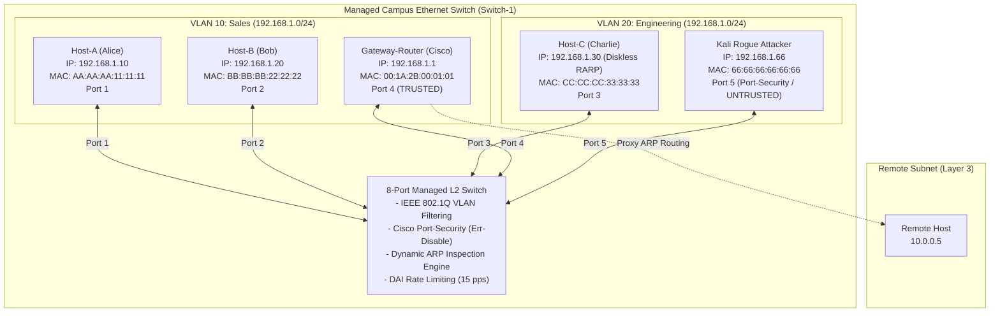

---

## 4. Detailed Protocol Workflows & Sequence Diagrams

### 4.1 Standard Address Resolution (Cold Cache)

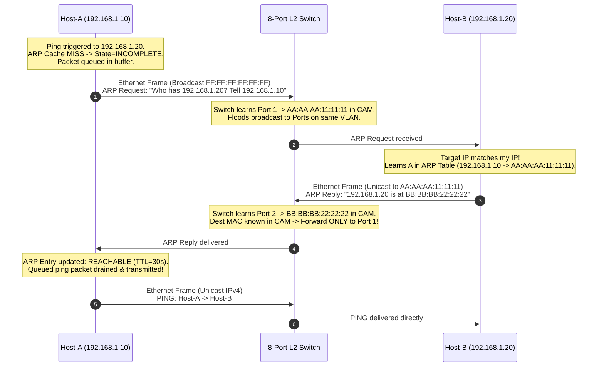

---

### 4.2 RFC 5227 Address Conflict Detection (ACD) & Gratuitous ARP

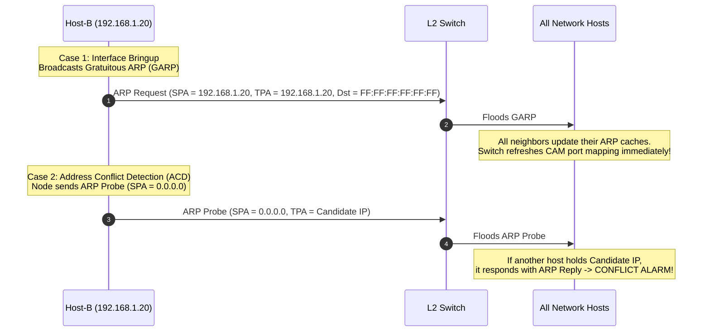

---

### 4.3 RFC 5227 §2.4 Active Defense & Conflict Yielding

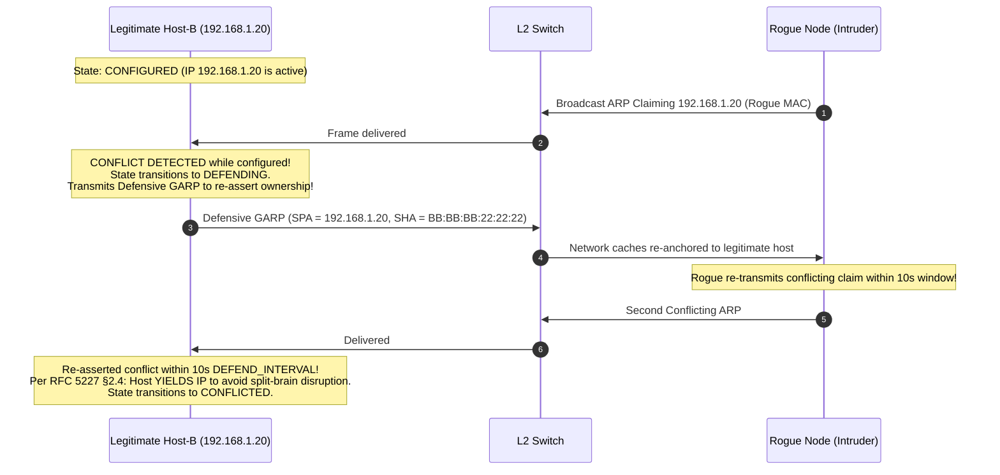

---

### 4.4 RFC 903 Reverse ARP (RARP) Diskless Workstation Boot

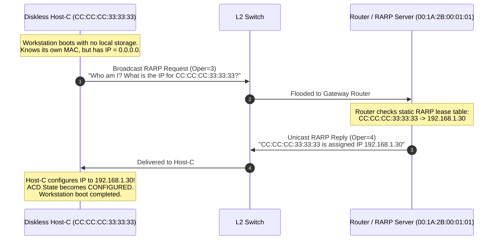

---

### 4.5 RFC 1027 Proxy ARP Across Subnets

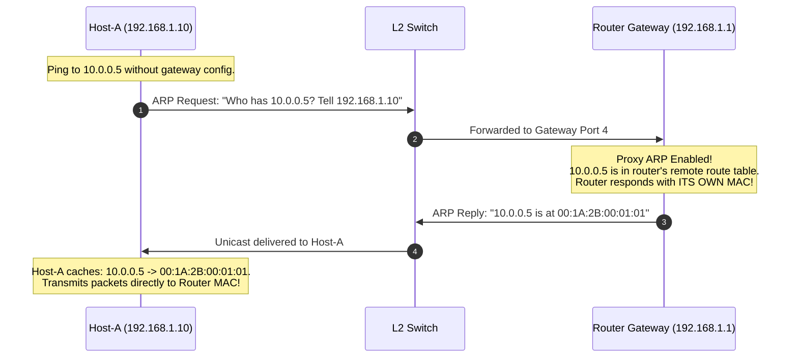

---

### 4.6 IEEE 802.1Q VLAN Broadcast Domain Isolation

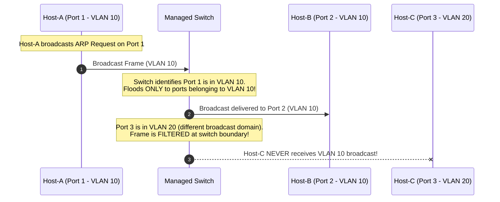

---

### 4.7 MITM ARP Cache Poisoning Attack

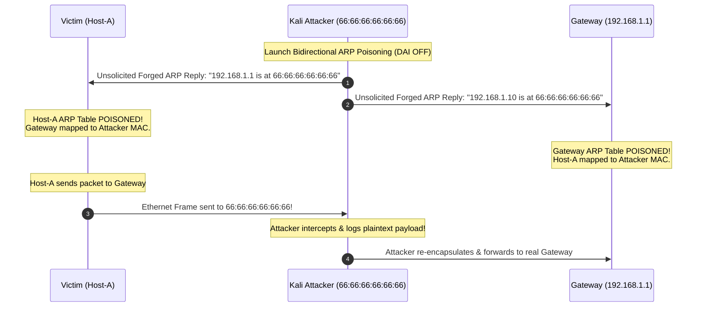

---

### 4.8 Cisco Switchport Port-Security vs macof CAM Overflow

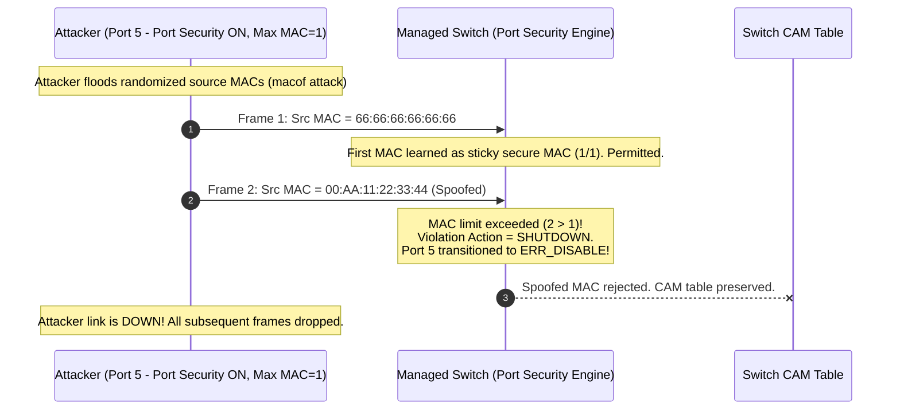

---

### 4.9 Dynamic ARP Inspection (DAI) & Rate Limiting DoS Defense

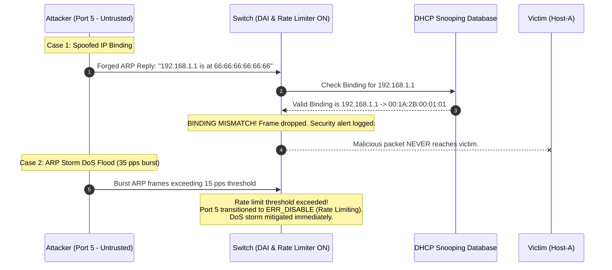

---

### 4.10 Host-Side Arpwatch & MAC Flip-Flop Detection

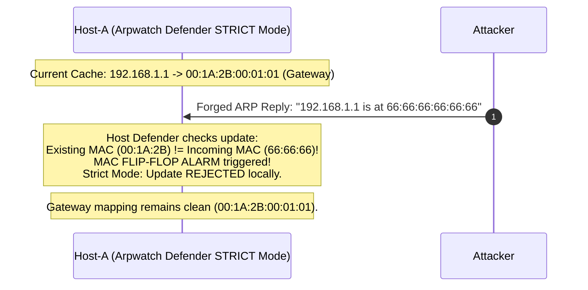

---

## 5. Step-by-Step Live Demonstration Script (For Presentation / Viva)

1. **Launch the Lab**:
   ```powershell
   .\run.bat
   ```
   Open **http://localhost:8082** in your browser.

2. **Step 1: Standard Cold Resolution Handshake**:
   - In the dashboard, click **"1. Ping Host-A &rarr; Host-B"**.
   - Show the terminal log: `ARP Cache MISS for 192.168.1.20. Queueing packet and broadcasting ARP Request.`
   - Point out in the sniffer: Frame #1 is Broadcast `FF:FF:FF:FF:FF:FF` (ARP Request), Frame #2 is Unicast `BB:BB:BB:22:22:22 -> AA:AA:AA:11:11:11` (ARP Reply), and Frame #3 is the delivered IP Ping segment.
   - Host-A ARP table shows `192.168.1.20` is now `REACHABLE` with an active TTL timer.

3. **Step 2: RFC 903 Diskless Workstation Boot (RARP)**:
   - Click **"4. RFC 903 Diskless RARP Boot"**.
   - Host-C broadcasts a RARP request (`OPER=3`) asking for its IP address.
   - The Gateway Router answers with RARP reply (`OPER=4`) assigning `192.168.1.30`.
   - Host-C dynamically configures its IP and enters `CONFIGURED` state!

4. **Step 3: RFC 5227 ACD Full State Machine**:
   - Click **"5. RFC 5227 ACD Full Workflow"**.
   - Watch Host-A transition from `PROBING` (`SPA = 0.0.0.0`) to `ANNOUNCING` (Gratuitous ARPs) to `CONFIGURED`.

5. **Step 4: IEEE 802.1Q VLAN Broadcast Isolation**:
   - Click **"7. 802.1Q VLAN Demo: Isolate Host-C in VLAN 20"**.
   - Notice the topology badges: Host-A & B are in VLAN 10 (Sales), Host-C is in VLAN 20 (Engineering).
   - Host-A pings Host-C: show the terminal log explaining that broadcast frames from VLAN 10 are strictly filtered at the switch boundary and never reach VLAN 20!

6. **Step 5: Cisco Switchport Port-Security Defense**:
   - Click **"9. Cisco Port-Security vs macof CAM Flood"**.
   - Attacker attempts to flood randomized MACs to exhaust switch memory.
   - Port-Security triggers violation (`SHUTDOWN`) and places Port 5 in `ERR_DISABLE` state!
   - In the Cisco CLI box, type `show port-security` and `show interfaces status` to prove the port is shut down.

7. **Step 6: DAI Rate Limiting DoS Defense**:
   - Click **"10. DAI Rate Limiter DoS Test"**.
   - Attacker launches a burst ARP storm: the switch rate limiter detects the flood exceeding 15 pps and shuts down the port.
   - Click **"Reset Err-Disabled Ports"** to demonstrate administrative recovery.

8. **Step 7: Wireshark PCAP Binary Export**:
   - Click **"Export Wireshark PCAP (.pcap)"** at the top right.
   - The browser downloads `arp_lab_capture.pcap`.
   - Open this file in Wireshark: show professors that every single simulated frame is a 100% compliant IEEE 802.3 Ethernet frame with 802.1Q tags and 28-byte ARP headers!

---

## 6. Viva & Technical Examination Questions

**Q1: What is the exact size of an RFC 826 ARP packet over Ethernet, and why does Wireshark display 60 bytes on the wire?**  
*Answer:* The logical ARP header for Ethernet/IPv4 is exactly 28 bytes. However, the IEEE 802.3 standard specifies a minimum Ethernet payload of 46 bytes. Therefore, the sender NIC pads the remaining 18 bytes with zeros. Adding the 14-byte Ethernet header (6 Dest + 6 Src + 2 EtherType) yields 60 bytes minimum frame length on the wire (64 bytes including the 4-byte FCS/CRC).

**Q2: What is the difference between ARP, RARP (RFC 903), and Inverse ARP (RFC 2390)?**  
*Answer:*
- **ARP**: Resolves a known IP address to an unknown MAC address on a local broadcast domain.
- **RARP**: Resolves a known MAC address to an unknown IP address, traditionally used by diskless workstations during network bootstrapping.
- **InARP**: Resolves a Layer 2 virtual circuit ID (such as a Frame Relay DLCI or ATM VPI/VCI) to a Layer 3 IP address.

**Q3: What are the states in the RFC 5227 Address Conflict Detection (ACD) state machine?**  
*Answer:*
1. `PROBING`: Host broadcasts ARP Probes with `SPA = 0.0.0.0` to detect whether candidate IP is in use.
2. `ANNOUNCING`: If clean, host broadcasts Gratuitous ARPs (`SPA == TPA == myIp`) to update neighbor caches.
3. `CONFIGURED`: The IP is bound and active on the interface.
4. `DEFENDING`: If an ongoing collision packet arrives, the host transmits a defensive GARP to re-assert ownership.
5. `CONFLICTED`: If repeated collisions arrive within 10s, the host yields the IP to prevent network partition.

**Q4: How does IEEE 802.1Q VLAN tagging prevent ARP Spoofing across different subnets?**  
*Answer:* Switches insert a 4-byte 802.1Q tag (`TPID = 0x8100`, 12-bit VID) into the Ethernet header. Switches maintain strict broadcast domain boundaries: an ARP broadcast from an untrusted port in VLAN 20 is only flooded to ports assigned to VLAN 20. It can never cross into VLAN 10 at Layer 2, making cross-VLAN ARP cache poisoning physically impossible without a compromised Layer 3 router.

**Q5: What is Cisco Switchport Port-Security and how does `errdisable` mitigate CAM table exhaustion (`macof`)?**  
*Answer:* Port-Security restricts the number of unique MAC addresses allowed to enter a physical access port (typically max 1). When an attack tool like `macof` attempts to overflow the switch CAM table by generating thousands of random source MACs, Port-Security detects that the MAC threshold is exceeded and executes the configured violation action (`SHUTDOWN`), immediately placing the port into `errdisable` (administrative down) state and protecting the switch CAM table.

**Q6: What is Dynamic ARP Inspection (DAI) Rate Limiting?**  
*Answer:* While standard DAI validates ARP packets against the DHCP Snooping database, evaluating cryptographic or database lookups in switch hardware CPU is resource-intensive. Attackers can flood high rates of ARP packets to cause CPU exhaustion (DoS ARP Storm). DAI rate limiting restricts untrusted ports to a maximum packet-per-second threshold (e.g. 15 pps), shutting down bursting ports into `errdisable` state upon violation.
