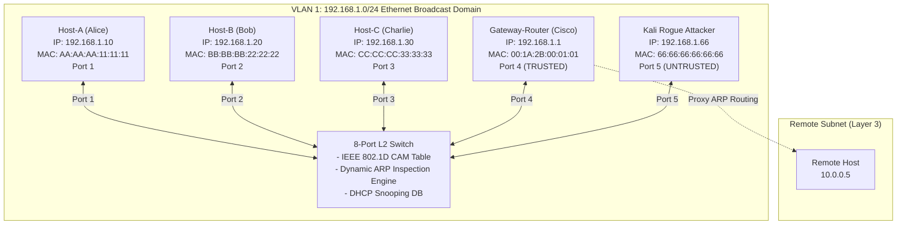
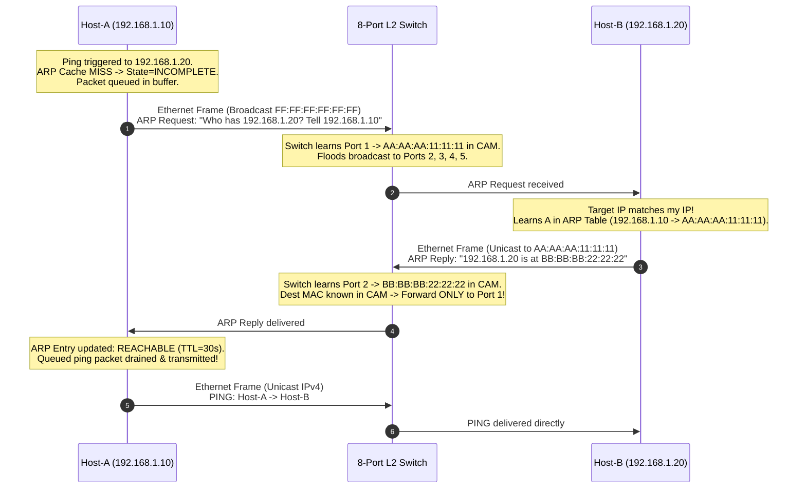
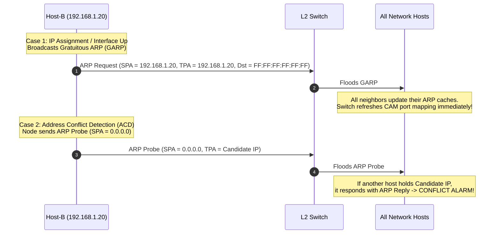
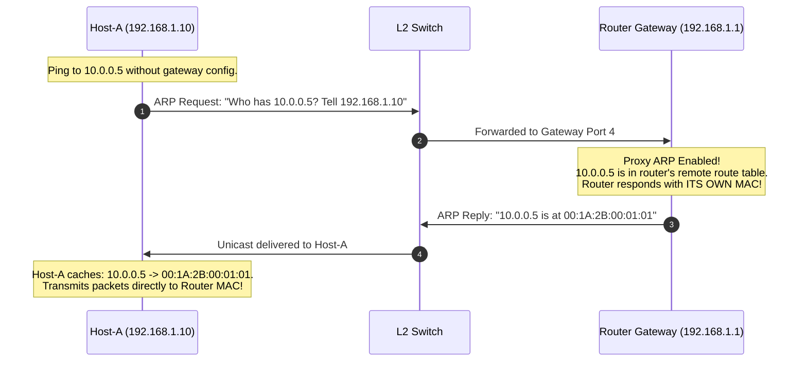
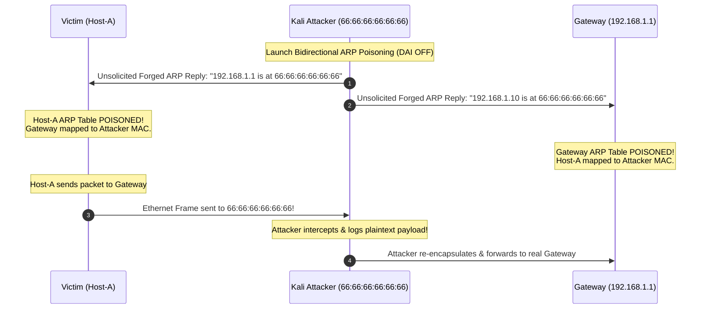
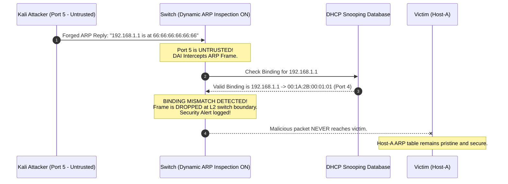

# RFC 826 ARP Protocol & L2 Security Architecture Guide

## Complete Theoretical Reference, Protocol Implementation & Live Demonstration Guide

---

## Table of Contents
1. [Project Overview & Architectural Scope](#1-project-overview--architectural-scope)
2. [Protocol Formats & Binary Encodings](#2-protocol-formats--binary-encodings)
3. [System Architecture & Network Topology](#3-system-architecture--network-topology)
4. [Detailed Protocol Workflows & Sequence Diagrams](#4-detailed-protocol-workflows--sequence-diagrams)
   - [4.1 Standard Address Resolution (Cold Cache)](#41-standard-address-resolution-cold-cache)
   - [4.2 RFC 5227 Address Conflict Detection & Gratuitous ARP](#42-rfc-5227-address-conflict-detection--gratuitous-arp)
   - [4.3 RFC 1027 Proxy ARP Across Subnets](#43-rfc-1027-proxy-arp-across-subnets)
   - [4.4 MITM ARP Cache Poisoning Attack](#44-mitm-arp-cache-poisoning-attack)
   - [4.5 Dynamic ARP Inspection (DAI) Hardware Defense](#45-dynamic-arp-inspection-dai-hardware-defense)
5. [Step-by-Step Live Demonstration Script (For Presentation / Viva)](#5-step-by-step-live-demonstration-script-for-presentation--viva)
6. [Viva & Technical Examination Questions](#6-viva--technical-examination-questions)

---

## 1. Project Overview & Architectural Scope

In an IP-over-Ethernet network, communication at Layer 3 (Network Layer) uses 32-bit logical IPv4 addresses, while communication at Layer 2 (Data Link Layer) requires 48-bit physical MAC addresses. The **Address Resolution Protocol (ARP)**, formalized in **RFC 826**, bridges this gap by dynamically resolving a target IP address to its corresponding MAC address on the local broadcast domain.

Because standard ARP is **stateless and unauthenticated**, it is susceptible to serious vulnerabilities:
- **ARP Spoofing / Cache Poisoning**: An attacker transmits forged ARP replies claiming ownership of the default gateway's IP, intercepting or modifying traffic (Man-In-The-Middle).
- **IP Address Collisions**: Two hosts inadvertently configured with identical IP addresses cause disruption.

This project delivers a **pure Java (zero-dependency, JDK 11+) production-grade simulation** of the entire ARP ecosystem:
1. **RFC 826 binary packet encoding/decoding**.
2. **IEEE 802.3 / Ethernet II framing** with auto-padding.
3. **ARP cache state machine** with live aging timers and static VIP pinning.
4. **Outbound packet buffer queue** during resolution.
5. **RFC 5227 Address Conflict Detection (ACD)** and **Gratuitous ARP (GARP)**.
6. **RFC 1027 Proxy ARP** for subnet isolation.
7. **8-Port L2 Learning Switch** with a CAM table.
8. **Dynamic ARP Inspection (DAI)** with DHCP Snooping integration.
9. **Interactive real-time web dashboard (`http://localhost:8082`)** and an automated verification suite.

---

## 2. Protocol Formats & Binary Encodings

### 2.1 RFC 826 ARP Packet Format (28 Octets)

```
 0                   1                   2                   3
 0 1 2 3 4 5 6 7 8 9 0 1 2 3 4 5 6 7 8 9 0 1 2 3 4 5 6 7 8 9 0 1
+-+-+-+-+-+-+-+-+-+-+-+-+-+-+-+-+-+-+-+-+-+-+-+-+-+-+-+-+-+-+-+-+
|        Hardware Type (1)      |     Protocol Type (0x0800)    |
+-+-+-+-+-+-+-+-+-+-+-+-+-+-+-+-+-+-+-+-+-+-+-+-+-+-+-+-+-+-+-+-+
|  HW Len (6)   | Proto Len (4) |        Operation (1 or 2)     |
+-+-+-+-+-+-+-+-+-+-+-+-+-+-+-+-+-+-+-+-+-+-+-+-+-+-+-+-+-+-+-+-+
|                  Sender Hardware Address (SHA: bytes 0-3)     |
+-+-+-+-+-+-+-+-+-+-+-+-+-+-+-+-+-+-+-+-+-+-+-+-+-+-+-+-+-+-+-+-+
|  SHA (bytes 4-5)              |  Sender IP (SPA: bytes 0-1)   |
+-+-+-+-+-+-+-+-+-+-+-+-+-+-+-+-+-+-+-+-+-+-+-+-+-+-+-+-+-+-+-+-+
|  SPA (bytes 2-3)              |  Target Hardware (THA: 0-1)   |
+-+-+-+-+-+-+-+-+-+-+-+-+-+-+-+-+-+-+-+-+-+-+-+-+-+-+-+-+-+-+-+-+
|                  Target Hardware Address (THA: bytes 2-5)     |
+-+-+-+-+-+-+-+-+-+-+-+-+-+-+-+-+-+-+-+-+-+-+-+-+-+-+-+-+-+-+-+-+
|                  Target Protocol Address (TPA: bytes 0-3)     |
+-+-+-+-+-+-+-+-+-+-+-+-+-+-+-+-+-+-+-+-+-+-+-+-+-+-+-+-+-+-+-+-+
```

### 2.2 Ethernet II Frame Encapsulation

```
+-------------------+-------------------+-------------------+--------------------+
|  Dest MAC (6 B)   |  Src MAC (6 B)    | EtherType (2 B)   |  Payload (46-1500) |
|  FF:FF:FF:FF:FF:FF|  AA:AA:AA:11:11:11| 0x0806 (ARP)      |  28B ARP + 18B Pad |
+-------------------+-------------------+-------------------+--------------------+
```
*(Total minimum wire length = 60 bytes excluding 4-byte CRC).*

---

## 3. System Architecture & Network Topology



---

## 4. Detailed Protocol Workflows & Sequence Diagrams

### 4.1 Standard Address Resolution (Cold Cache)



---

### 4.2 RFC 5227 Address Conflict Detection & Gratuitous ARP



---

### 4.3 RFC 1027 Proxy ARP Across Subnets



---

### 4.4 MITM ARP Cache Poisoning Attack



---

### 4.5 Dynamic ARP Inspection (DAI) Hardware Defense



---

## 5. Step-by-Step Live Demonstration Script (For Presentation / Viva)

1. **Launch the Lab**:
   ```powershell
   .\run.bat
   ```
   Open **http://localhost:8082** in your browser.

2. **Step 1: Standard Resolution Handshake**:
   - In the dashboard, click **"1. Ping Host-A &rarr; Host-B"**.
   - Show the terminal log: `ARP Cache MISS for 192.168.1.20. Queueing packet and broadcasting ARP Request.`
   - Point out the wire sniffer: Frame #1 is Broadcast `FF:FF:FF:FF:FF:FF` (ARP Request), Frame #2 is Unicast `BB:BB:BB:22:22:22 -> AA:AA:AA:11:11:11` (ARP Reply), and Frame #3 is the delivered IP Ping segment.
   - Point out the Host-A ARP table: `192.168.1.20` is now `REACHABLE` with an active 30s TTL timer.

3. **Step 2: Gratuitous ARP Announcement**:
   - Click **"3. Send Gratuitous ARP (Host-B)"**.
   - Show how `SPA == TPA == 192.168.1.20`, updating all neighbor caches immediately without request queries.

4. **Step 3: RFC 5227 Address Conflict Detection (ACD)**:
   - Click **"4. RFC 5227 ARP Probe"**.
   - Point out in the sniffer: `SPA = 0.0.0.0` (prevents cache corruption) probing `192.168.1.20`.
   - Host-A detects the existing IP and triggers an `IP CONFLICT ALARM`.

5. **Step 4: RFC 1027 Proxy ARP**:
   - Click **"5. RFC 1027 Proxy ARP (Ping Remote 10.0.0.5)"**.
   - Point out that Host-A requests `10.0.0.5`, and the Router answers with its own MAC `00:1A:2B:00:01:01`.

6. **Step 5: Attack & Defense**:
   - Click **"6. Launch MITM ARP Poisoning Attack"**.
   - Watch Host-A's ARP table turn RED (`POISONED`).
   - Notice the **"MITM Intercepted Traffic Log"** displaying sniffed payload text!
   - Now toggle **Dynamic ARP Inspection (DAI)** to **ON**.
   - Flush caches and trigger the attack again: DAI drops the malicious frames immediately, drop counter increments, and Host-A remains safe!

---

## 6. Viva & Technical Examination Questions

**Q1: What is the exact size of an RFC 826 ARP packet over Ethernet, and why does Wireshark display 60 bytes on the wire?**  
*Answer:* The logical ARP header for Ethernet/IPv4 is exactly 28 bytes. However, the IEEE 802.3 standard specifies a minimum Ethernet payload of 46 bytes. Therefore, the sender NIC pads the remaining 18 bytes with zeros. Adding the 14-byte Ethernet header (6 Dest + 6 Src + 2 EtherType) yields 60 bytes minimum frame length on the wire (64 bytes including the 4-byte FCS/CRC).

**Q2: What is the difference between an ARP Probe and a Gratuitous ARP Announcement (RFC 5227)?**  
*Answer:* An ARP Probe sets the Sender Protocol Address (`SPA`) to `0.0.0.0` to test if an IP is in use without poisoning any neighbor ARP caches if a conflict exists. A Gratuitous ARP sets `SPA == TPA == own IP` with a broadcast destination to actively refresh neighbor ARP caches and switch CAM tables upon interface bringup or IP changes.

**Q3: How does Dynamic ARP Inspection (DAI) prevent ARP Poisoning?**  
*Answer:* Switches classify ports into *Trusted* (e.g. gateway/uplink) and *Untrusted* (access ports). On untrusted ports, DAI intercepts all ARP packets and checks the Sender MAC (`SHA`) and Sender IP (`SPA`) against the DHCP Snooping database. If the IP-to-MAC mapping was not legally assigned by the DHCP server, the frame is dropped before reaching other hosts.
