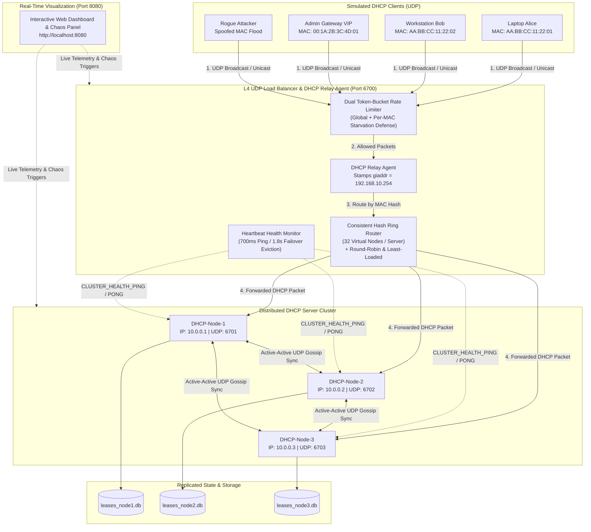

# Distributed & Load-Balanced DHCP Server in Java
## Complete Feature Architecture & Visualization Guide

---

## Table of Contents
1. [Project Overview](#1-project-overview)
2. [System Architecture & Topology Diagrams](#2-system-architecture--topology-diagrams)
3. [Primary DHCP Features (RFC 2131 & RFC 2132)](#3-primary-dhcp-features-rfc-2131--rfc-2132)
4. [Advanced System Design & Distributed Systems Features](#4-advanced-system-design--distributed-systems-features)
5. [RFC 2131 Binary Packet Format Visualized](#5-rfc-2131-binary-packet-format-visualized)
6. [Complete Guide: How to Run & Visualize Everything](#6-complete-guide-how-to-run--visualize-everything)
7. [Step-by-Step Live Demonstration Script (For Presentations / Viva)](#7-step-by-step-live-demonstration-script-for-presentations--viva)

---

## 1. Project Overview & Summary of What We Built

Traditional academic DHCP implementations use a single UDP socket on a single server process, creating a **Single Point of Failure (SPOF)** and making the server vulnerable to **traffic bottlenecks** and **DHCP Starvation Attacks**.

This project implements a **production-inspired, Distributed & Load-Balanced DHCP Server Cluster in pure Java** (zero external dependencies) that combines low-level Computer Networking with Distributed Systems engineering.

### Summary of What We Built:

#### Primary DHCP Features (RFC 2131):
- **Full binary DORA lifecycle** (`DHCPDISCOVER` $\rightarrow$ `DHCPOFFER` $\rightarrow$ `DHCPREQUEST` $\rightarrow$ `DHCPACK` / `DHCPNAK`), plus **`DHCPRELEASE`**, **`DHCPINFORM`**, and **`DHCPDECLINE`**.
- **Binary BOOTP/DHCP packet encoder/decoder** with Magic Cookie (`99.130.83.99`) and TLV DHCP Options (`53`, `1`, `3`, `6`, `50`, `51`, `54`, `255`).
- **Dynamic IP Pool allocation**, **Static MAC-to-IP VIP reservations**, and a background **Lease Expiration Reaper**.

#### System Design & Distributed Systems Features:
- **UDP Load Balancer & DHCP Relay Agent (`giaddr`)** using **Consistent Hashing (with Virtual Nodes)** on client MAC addresses, plus toggleable **Round-Robin** and **Least-Loaded** strategies.
- **3-Node Distributed DHCP Cluster** with **Active-Active Peer Lease Replication (Gossip Sync)** so any surviving node can renew or manage leases if a node fails.
- **Heartbeat Health Monitor & Automatic Failover** that detects crashed nodes and rebalances traffic automatically.
- **Token-Bucket Rate Limiter** to block **DHCP Starvation Attacks** (rogue MAC flooding).
- **Write-Ahead / Disk Lease Persistence** so server restarts retain active leases.
- **Real-Time Web Dashboard (`http://localhost:8080`) & CLI Simulator** to visualize the cluster, trigger multi-client DORA storms, send `INFORM`/`RELEASE`/`DECLINE` packets, simulate node crashes/recovery, and test rate limiting live.

---

## 2. System Architecture & Topology Diagrams

### 2.1 High-Level Distributed Cluster Topology



---

### 2.2 End-to-End DORA + Gossip Replication + Failover Sequence Diagram

```mermaid
sequenceDiagram
    autonumber
    participant Client as DHCP Client (Alice)
    participant LB as UDP Load Balancer (6700)
    participant N1 as DHCP-Node-1 (6701)
    participant N2 as DHCP-Node-2 (6702)
    participant N3 as DHCP-Node-3 (6703)

    Note over Client,N3: Phase 1: Normal 4-Way DORA Handshake via Consistent Hashing
    Client->>LB: DHCPDISCOVER (chaddr=AA:BB:CC:11:22:01)
    LB->>LB: Token-Bucket Check + Stamp giaddr=192.168.10.254
    LB->>N1: Route via Consistent Hash(MAC) -> Node-1
    N1->>N1: Reserve Offer 192.168.10.10 (30s window)
    par Active-Active Gossip Sync
        N1--)N2: CLUSTER_PEER_SYNC (192.168.10.10 = OFFERED)
        N1--)N3: CLUSTER_PEER_SYNC (192.168.10.10 = OFFERED)
    end
    N1->>LB: DHCPOFFER (yiaddr=192.168.10.10, ServerID=10.0.0.1)
    LB->>Client: DHCPOFFER (yiaddr=192.168.10.10)

    Client->>LB: DHCPREQUEST (Requested IP=192.168.10.10)
    LB->>N1: Route via Consistent Hash(MAC) -> Node-1
    N1->>N1: Commit Lease 192.168.10.10 (ACTIVE, TTL=120s) + Write Disk
    par Active-Active Gossip Sync
        N1--)N2: CLUSTER_PEER_SYNC (192.168.10.10 = ACTIVE)
        N1--)N3: CLUSTER_PEER_SYNC (192.168.10.10 = ACTIVE)
    end
    N1->>LB: DHCPACK (yiaddr=192.168.10.10, Mask, Router, DNS, Lease=120s)
    LB->>Client: DHCPACK (DORA Complete)

    Note over Client,N3: Phase 2: Node-1 Crashes & Seamless Failover Renewal
    rect rgb(60, 20, 20)
        N1-xN1: SIMULATED CRASH (Node-1 Offline)
        LB->>N1: CLUSTER_HEALTH_PING (Timeout > 1.8s)
        LB->>LB: Evict Node-1 (6701) from Consistent Hash Ring!
    end

    Client->>LB: DHCPDISCOVER / DHCPREQUEST (Renew AA:BB:CC:11:22:01)
    LB->>N3: Next clockwise node on Hash Ring -> Node-3
    N3->>N3: Lookup Replicated Lease for AA:BB:CC:11:22:01 -> Found 192.168.10.10!
    N3->>LB: DHCPOFFER / DHCPACK (yiaddr=192.168.10.10, ServerID=10.0.0.3)
    LB->>Client: Seamless Lease Renewal without IP change!
```



---

## 3. Primary DHCP Features (RFC 2131 & RFC 2132)

| Feature | Implementation File | Broad Description |
| :--- | :--- | :--- |
| **1. Full 4-Way DORA Lifecycle** | [`DhcpServerNode.java`](file:///c:/Users/aritr/OneDrive/Desktop/CN%20Project/src/dhcp/cluster/DhcpServerNode.java) | Implements `DHCPDISCOVER` $\rightarrow$ `DHCPOFFER` $\rightarrow$ `DHCPREQUEST` $\rightarrow$ `DHCPACK` (and `DHCPNAK` when an invalid or conflicting IP is requested). |
| **2. Extended DHCP Messages (`RELEASE`, `INFORM`, `DECLINE`)** | [`DhcpServerNode.java`](file:///c:/Users/aritr/OneDrive/Desktop/CN%20Project/src/dhcp/cluster/DhcpServerNode.java) | - **`DHCPRELEASE`**: Immediately frees a client's active lease back into the pool.<br/>- **`DHCPINFORM`**: Returns DNS, Router, and Domain parameters to clients with static IPs.<br/>- **`DHCPDECLINE`**: Marks an IP address as `DECLINED` when a client detects an ARP collision. |
| **3. Binary RFC 2131 Packet Parser & Serializer** | [`DhcpPacket.java`](file:///c:/Users/aritr/OneDrive/Desktop/CN%20Project/src/dhcp/protocol/DhcpPacket.java) | Encodes and decodes real 240+ byte binary DHCP packets over `DatagramSocket` (`ByteBuffer`), validates the 4-byte Magic Cookie (`99.130.83.99`), and parses TLV options. |
| **4. Dynamic IP Pool Management** | [`LeaseManager.java`](file:///c:/Users/aritr/OneDrive/Desktop/CN%20Project/src/dhcp/cluster/LeaseManager.java) | Manages the configurable subnet range `192.168.10.10` – `192.168.10.150` using thread-safe `ConcurrentHashMap` structures, ensuring zero duplicate IP assignments. |
| **5. Static VIP MAC Reservations** | [`LeaseManager.java`](file:///c:/Users/aritr/OneDrive/Desktop/CN%20Project/src/dhcp/cluster/LeaseManager.java) | Maps specific critical MAC addresses to permanent reserved IPs outside the dynamic pool (e.g., `00:1A:2B:3C:4D:01` $\rightarrow$ `192.168.10.5` for `gateway-admin-vip`). |
| **6. Background Lease Expiration Reaper** | [`LeaseManager.java`](file:///c:/Users/aritr/OneDrive/Desktop/CN%20Project/src/dhcp/cluster/LeaseManager.java) | A daemon `ScheduledExecutorService` runs every 2 seconds to inspect lease TTLs and automatically reclaim expired offers and expired active leases. |

---

## 4. Advanced System Design & Distributed Systems Features

### 4.1 L4 UDP Load Balancer & DHCP Relay Agent (`giaddr`)
- **File**: [`DhcpLoadBalancer.java`](file:///c:/Users/aritr/OneDrive/Desktop/CN%20Project/src/dhcp/lb/DhcpLoadBalancer.java)
- **How it works**: Clients communicate with a single front-end Virtual IP/Port (`127.0.0.1:6700`). Acting as both an L4 UDP Load Balancer and an RFC 2131 **DHCP Relay Agent**, it increments the `hops` counter, stamps its relay IP (`giaddr = 192.168.10.254`), attaches the client's return port, and forwards the packet to a selected backend server (`6701`, `6702`, or `6703`).

### 4.2 Consistent Hashing Ring with Virtual Nodes (+ Switchable Algorithms)
- **File**: [`ConsistentHashRouter.java`](file:///c:/Users/aritr/OneDrive/Desktop/CN%20Project/src/dhcp/lb/ConsistentHashRouter.java)
- **Why Consistent Hashing matters for DHCP**: A DHCP handshake is stateful across multiple UDP packets (`DISCOVER` followed by `REQUEST`). If a load balancer uses naive Round-Robin, `DISCOVER` might hit `Node-1` while `REQUEST` hits `Node-2`.
- **How it works**:
  - Uses an `MD5`-based 32-bit hash ring (`TreeMap<Long, Integer>`) with **32 Virtual Nodes per physical DHCP server** to prevent data skew.
  - Hashing the client's MAC address (`chaddr`) guarantees that both `DHCPDISCOVER` and `DHCPREQUEST` from the same client deterministically land on the exact same node.
  - If one node crashes, only $\approx \frac{1}{N}$ of clients are remapped to the next clockwise node on the ring.
  - Also supports switching live at runtime to **Round-Robin** or **Least-Loaded** to compare behavior!

### 4.3 Active-Active Peer State Replication (UDP Gossip Sync)
- **File**: [`DhcpServerNode.java`](file:///c:/Users/aritr/OneDrive/Desktop/CN%20Project/src/dhcp/cluster/DhcpServerNode.java)
- **How it works**: Whenever any node creates an `OFFERED`, `ACTIVE`, `DECLINED`, or `EXPIRED` lease, it asynchronously broadcasts a `CLUSTER_PEER_SYNC` UDP message to all peer nodes (`6701`, `6702`, `6703`).
- **Benefit**: Every node maintains a synchronized view of all cluster leases. Even if you switch the Load Balancer to **Round-Robin** or crash a node mid-handshake, the surviving nodes already have the lease state!

### 4.4 Heartbeat Health Monitor & Automatic Failover
- **File**: [`DhcpLoadBalancer.java`](file:///c:/Users/aritr/OneDrive/Desktop/CN%20Project/src/dhcp/lb/DhcpLoadBalancer.java)
- **How it works**: Every `700ms`, the Load Balancer sends a lightweight `CLUSTER_HEALTH_PING` packet to each backend DHCP node.
- If a node fails to reply with `CLUSTER_HEALTH_PONG` within `1800ms`, the Load Balancer logs a `FAILOVER TRIGGERED` alert and removes all 32 virtual nodes of that server from the Consistent Hash Ring. When the node recovers, it is automatically added back into the ring.

### 4.5 Dual Token-Bucket Rate Limiter (DHCP Starvation Defense)
- **File**: [`RateLimiter.java`](file:///c:/Users/aritr/OneDrive/Desktop/CN%20Project/src/dhcp/lb/RateLimiter.java)
- **What is a DHCP Starvation Attack?**: An attacker floods a DHCP server with hundreds of `DHCPDISCOVER` packets using randomly spoofed MAC addresses (`DE:AD:BE:EF:...`) to exhaust the entire IP pool in seconds, denying service to legitimate users.
- **How our defense works**:
  1. **Per-MAC Token Bucket**: Limits individual noisy clients (burst of 8 packets, refills at 4 packets/sec).
  2. **Global Cluster Token Bucket**: Caps total cluster ingress burst (burst of 25 packets, refills at 15 packets/sec) so spoofed-MAC floods are dropped right at the Load Balancer edge before reaching the DHCP nodes.

### 4.6 Write-Ahead Disk Persistence
- **File**: [`LeaseManager.java`](file:///c:/Users/aritr/OneDrive/Desktop/CN%20Project/src/dhcp/cluster/LeaseManager.java)
- **How it works**: Active leases are persisted to `data/leases_node1.db`, `data/leases_node2.db`, and `data/leases_node3.db` and automatically reloaded on startup.

---

## 5. RFC 2131 Binary Packet Format Visualized

Every packet sent between `DhcpClientSimulator`, `DhcpLoadBalancer`, and `DhcpServerNode` follows this exact binary layout implemented in [`DhcpPacket.java`](file:///c:/Users/aritr/OneDrive/Desktop/CN%20Project/src/dhcp/protocol/DhcpPacket.java):

```text
 0                   1                   2                   3
 0 1 2 3 4 5 6 7 8 9 0 1 2 3 4 5 6 7 8 9 0 1 2 3 4 5 6 7 8 9 0 1
+-+-+-+-+-+-+-+-+-+-+-+-+-+-+-+-+-+-+-+-+-+-+-+-+-+-+-+-+-+-+-+-+
|     op (1)    |   htype (1)   |   hlen (1)    |   hops (1)    |
+---------------+---------------+---------------+---------------+
|                            xid (4)                            |
+-------------------------------+-------------------------------+
|           secs (2)            |           flags (2)           |
+-------------------------------+-------------------------------+
|                          ciaddr (4)                           |  Client IP
+---------------------------------------------------------------+
|                          yiaddr (4)                           |  'Your' Assigned IP
+---------------------------------------------------------------+
|                          siaddr (4)                           |  Server IP (10.0.0.x)
+---------------------------------------------------------------+
|                          giaddr (4)                           |  Relay Agent IP (192.168.10.254)
+---------------------------------------------------------------+
|                          chaddr (16)                          |  Client MAC Address
+---------------------------------------------------------------+
|                          sname (64)                           |
+---------------------------------------------------------------+
|                          file (128)                           |
+---------------------------------------------------------------+
|                  Magic Cookie: 99.130.83.99 (4)               |
+---------------------------------------------------------------+
|                 Options (Variable TLV Format)                 |
|   [53: MsgType] [1: SubnetMask] [3: Router] [6: DNS]          |
|   [50: ReqIP] [51: LeaseTime] [54: ServerID] [255: END]       |
+---------------------------------------------------------------+
```

---

## 6. Complete Guide: How to Run & Visualize Everything

### Step 1: Start the Project
Open PowerShell or Command Prompt in `c:\Users\aritr\OneDrive\Desktop\CN Project` and run:
```powershell
.\run.bat
```
When it starts, it automatically boots:
1. **`DHCP-Node-1`** (`10.0.0.1:6701`)
2. **`DHCP-Node-2`** (`10.0.0.2:6702`)
3. **`DHCP-Node-3`** (`10.0.0.3:6703`)
4. **`DhcpLoadBalancer`** (`127.0.0.1:6700`, Relay `giaddr=192.168.10.254`)
5. **`DashboardServer`** (`http://localhost:8080`)
6. Runs the 4-part automated startup verification demo and opens the interactive CLI menu.

---

### Step 2: Visualize via the Real-Time Web Dashboard (`http://localhost:8080`)
Open your browser and go to:
> **http://localhost:8080**

The dashboard updates live every `1 second` and is divided into **4 visual panels**:

```text
+-----------------------------------------------------------------------------------+
|  Distributed DHCP Server Cluster & L4 Load Balancer   [LB Strategy: CONSISTENT]   |
+-----------------------------------------------------------------------------------+
|  INTERACTIVE SYSTEM DESIGN & CHAOS CONTROLS                                       |
|  [+ Simulate 1 Client] [+ Simulate 5 Clients] [Test Static VIP]                   |
|  [Send DHCPINFORM] [Send DHCPRELEASE] [Send DHCPDECLINE] [Starvation Flood]       |
|  LB Algorithm: [Consistent Hashing] [Round Robin] [Least Loaded]                  |
|  Token-Bucket Rate Limiter — Allowed Packets: 40 | Dropped Flood Packets: 10      |
+-----------------------------------------------------------------------------------+
|  +-----------------------+  +-----------------------+  +-----------------------+  |
|  | (o) DHCP-Node-1 :6701 |  | (o) DHCP-Node-2 :6702 |  | (o) DHCP-Node-3 :6703 |  |
|  | Status: HEALTHY       |  | Status: HEALTHY       |  | Status: HEALTHY       |  |
|  | Routed Requests: 13   |  | Routed Requests: 15   |  | Routed Requests: 12   |  |
|  | OFFER / ACK: 6 / 4    |  | OFFER / ACK: 7 / 5    |  | OFFER / ACK: 6 / 6    |  |
|  | Peer Gossip Syncs: 25 |  | Peer Gossip Syncs: 23 |  | Peer Gossip Syncs: 24 |  |
|  | [Simulate Crash]      |  | [Simulate Crash]      |  | [Simulate Crash]      |  |
|  +-----------------------+  +-----------------------+  +-----------------------+  |
+-----------------------------------------------------------------------------------+
|  REPLICATED ACTIVE IP LEASES (18 / 143)    |  REAL-TIME PACKET EVENT STREAM       |
|  IP            MAC               Node  TTL |  23:16:27 [Node-1] DHCPOFFER 10.10   |
|  192.168.10.5  00:1A:2B:3C:4D:01 VIP   INF |  23:16:27 [Node-3] DHCPINFORM ACK    |
|  192.168.10.10 AA:BB:CC:11:22:01 Node1 95s |  23:16:27 [Node-3] DHCPDECLINE 10.12 |
|  192.168.10.12 CONFLICT-AA:BB..  Node3 DEC |  23:16:33 [LB] RATE LIMIT DROP       |
+--------------------------------------------+--------------------------------------+
```

---

### Step 3: Visualize via the Interactive CLI Menu (Terminal)
In the terminal where `.\run.bat` is running, you can type options `1` through `7` at any time:
- **`1`**: Simulate 1 new client DORA handshake and watch the packet trace (`DISCOVER` $\rightarrow$ `OFFER` $\rightarrow$ `REQUEST` $\rightarrow$ `ACK`).
- **`2`**: Simulate 5 concurrent clients simultaneously to see multi-threaded load distribution across `Node-1`, `Node-2`, and `Node-3`.
- **`3`**: Print the formatted **Cluster Node Metrics Table** and **Active Replicated Lease Table** right in the terminal.
- **`4`**: Cycle the Load Balancer algorithm (`CONSISTENT_HASHING` $\rightarrow$ `ROUND_ROBIN` $\rightarrow$ `LEAST_LOADED`).
- **`5`**: Crash or recover `DHCP-Node-1` and watch the Load Balancer evict or restore it.
- **`6`**: Fire a 40-packet DHCP Starvation Attack and watch the Token-Bucket Rate Limiter block the flood.
- **`7`**: Send **`DHCPINFORM`** (local config query), **`DHCPDECLINE`** (ARP conflict alert), and **`DHCPRELEASE`** (graceful lease release) test packets.

---

## 7. Step-by-Step Live Demonstration Script (For Presentations / Viva)

If you are demonstrating this project to an instructor or interviewer, follow this **2-minute sequence** on `http://localhost:8080`:

1. **Demonstrate Load-Balanced DORA & Gossip Replication**:
   - Click **"+ Simulate 5 Concurrent Clients"** on the dashboard.
   - Point out how the **LB Routed Requests** and **DHCPOFFER / DHCPACK** counters increase across all 3 nodes (`6701`, `6702`, `6703`), while the **Peer Gossip Syncs Received** counter increments on every node so they all share the exact same **Replicated Active IP Leases** table.
2. **Demonstrate Static VIP Reservation & Extended RFC 2131 Messages (`INFORM`, `RELEASE`, `DECLINE`)**:
   - Click **"Test Static VIP MAC"** and show that MAC `00:1A:2B:3C:4D:01` (`gateway-admin-vip`) always receives reserved IP `192.168.10.5` with `STATIC VIP` (infinite TTL).
   - Click **"Send DHCPINFORM"** to show a static printer querying DNS/Gateway/Domain parameters without consuming an IP from the pool.
   - Click **"Send DHCPDECLINE (ARP Conflict)"** to show an IP marked as `DECLINED` (`CONFLICT-...`) across all nodes via Gossip Sync.
   - Click **"Send DHCPRELEASE"** to watch an active lease immediately disappear from the lease table and return to the pool.
3. **Demonstrate Chaos Engineering & Automatic Failover**:
   - Click **"Simulate Crash"** on the **DHCP-Node-1** card.
   - Within 1.8 seconds, watch its status dot turn **Red** and its status change to **`EVICTED (Failover)`** as the Load Balancer's heartbeat detector removes `Node-1` from the Consistent Hash Ring.
   - Click **"+ Simulate 5 Concurrent Clients"** again — 100% of new traffic now routes cleanly to `DHCP-Node-2` and `DHCP-Node-3` with zero failed handshakes!
   - Click **"Recover Node"** on `DHCP-Node-1` and watch it automatically rejoin the ring (`HEALTHY`).
4. **Demonstrate DHCP Starvation Attack Defense**:
   - Click **"Launch DHCP Starvation Flood (40 pkts)"**.
   - Watch the **Dropped Flood Packets** counter jump in red and see `RATE LIMIT DROP: Blocked packet from MAC DE:AD:BE:EF:...` appear in the Real-Time Packet Event Stream.
