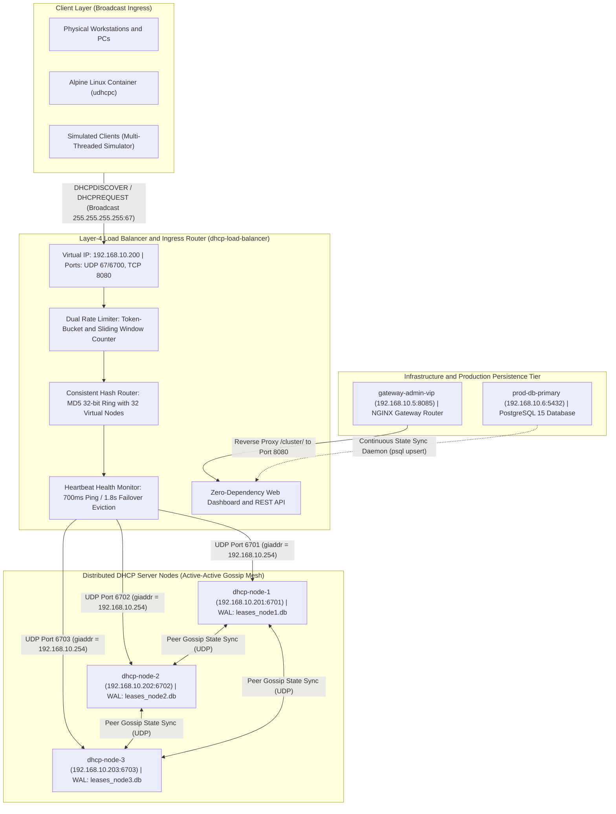

# Distributed & Load-Balanced DHCP Server System in Java

A production-inspired, highly available **RFC 2131 DHCP Server Cluster** built from scratch in pure Java (zero external dependencies) and containerized with Docker, incorporating modern **Computer Networking**, **System Design**, and **Distributed Systems** principles.

---

## 1. High-Level Architecture & 6-Container Topology

### A. Visual System Architecture Diagram



### B. ASCII Network Subnet & Container Topology Map

```
                                  +------------------------------------+
                                  |   Client Devices / Docker Alpine   |
                                  +------------------------------------+
                                                    |
                                      UDP Port 67 (or Port 6700)
                                                    v
+-------------------------------------------------------------------------------------------------------+
|  dhcp-load-balancer (192.168.10.200:67 / :8080)                                                       |
|  • RFC 2131 DHCP Relay Agent (giaddr = 192.168.10.254, hops++)                                        |
|  • Dual Rate Limiter: Switchable Token-Bucket & Weighted Sliding Window Counter                       |
|  • Consistent Hash Router: MD5 32-bit ring (32 virtual nodes) + Round-Robin & Least-Loaded            |
|  • 700ms Heartbeat Health Monitor & 1.8s Failover Eviction                                            |
|  • Zero-Dependency HTTP Dashboard & REST API (http://localhost:8080)                                   |
+-------------------------------------------------------------------------------------------------------+
              |                                     |                                     |
       UDP Port 6701                         UDP Port 6702                         UDP Port 6703
              v                                     v                                     v
+---------------------------+         +---------------------------+         +---------------------------+
|        dhcp-node-1        |         |        dhcp-node-2        |         |        dhcp-node-3        |
|     (192.168.10.201)      |<=======>|     (192.168.10.202)      |<=======>|     (192.168.10.203)      |
| • Dynamic Pool (.10-.150) |  Active | • Dynamic Pool (.10-.150) |  Active | • Dynamic Pool (.10-.150) |
| • Static VIP Reservations |  Active | • Static VIP Reservations |  Active | • Static VIP Reservations |
| • Expiration Reaper (2s)  |  Gossip | • Expiration Reaper (2s)  |  Gossip | • Expiration Reaper (2s)  |
| • Disk WAL: leases_node1  |  Sync   | • Disk WAL: leases_node2  |  Sync   | • Disk WAL: leases_node3  |
+---------------------------+         +---------------------------+         +---------------------------+
              |                                     |                                     |
              +-------------------------------------+-------------------------------------+
                                                    |
                                                    v
+---------------------------------------------------+---------------------------------------------------+
|  gateway-admin-vip (192.168.10.5)                 |  prod-db-primary (192.168.10.6:5432)              |
|  • Core Network Gateway & Router (NGINX)          |  • Production PostgreSQL 15 Database              |
|  • Static VIP MAC: 00:1A:2B:3C:4D:01              |  • Static VIP MAC: 00:1A:2B:3C:4D:02              |
|  • Admin VIP Portal: http://localhost:8085        |  • Table: dhcp_leases & cluster_audit_log         |
|  • Reverse-proxies /cluster/ to Load Balancer     |  • Continuous Background Sync Daemon              |
+---------------------------------------------------+---------------------------------------------------+
```

---

## 2. Key Features

### A. Primary RFC 2131 DHCP Protocol Compliance
* **Full 4-Way DORA Lifecycle**:
  1. `DHCPDISCOVER`: Client broadcasts discovery to find available DHCP servers.
  2. `DHCPOFFER`: Server offers an IP from its pool with Subnet Mask, Gateway, DNS, and Lease Time.
  3. `DHCPREQUEST`: Client formally requests and accepts the offered IP.
  4. `DHCPACK` / `DHCPNAK`: Server commits the lease (`DHCPACK`) or rejects invalid/conflicting requests (`DHCPNAK`).
* **Extended RFC 2131 Message Types**:
  - `DHCPRELEASE`: Gracefully unbinds and reclaims an IP immediately upon client disconnection.
  - `DHCPINFORM`: Supplies network parameters (DNS, Gateway, Domain) to clients with statically configured IPs.
  - `DHCPDECLINE`: Places an IP into a **2-minute quarantine** when a client reports an ARP address collision on the LAN.
* **Binary BOOTP/DHCP Packet Encoder & Decoder**:
  - Encodes and decodes the 236-byte BOOTP header, 4-byte Magic Cookie (`99.130.83.99`), and TLV (Type-Length-Value) DHCP Options (`1`, `3`, `6`, `12`, `15`, `50`, `51`, `53`, `54`, `56`, `255`).
  - Implements **RFC 1542 300-byte minimum padding** so real OS network stacks (Windows, Linux, Android, iOS) accept replies without dropping them as runts.
* **Dynamic Pool Allocation & Static VIPs**:
  - Dynamic pool allocator (`192.168.10.10` to `192.168.10.150`).
  - Permanent Static VIP reservations (Gateway `192.168.10.5` and Database `192.168.10.6`) with infinite TTL.
  - Background daemon **Lease Expiration Reaper** running every 2 seconds to reclaim expired leases.

### B. System Design & Distributed Systems Engineering
* **L4 UDP Load Balancer & DHCP Relay Agent (`giaddr`)**:
  - Operates as an RFC 2131 Relay Agent by stamping `giaddr = 192.168.10.254` and incrementing BOOTP `hops`.
  - Supports 3 live-switchable load balancing algorithms:
    1. **Consistent Hashing**: MD5 32-bit ring with **32 virtual nodes per physical server**, guaranteeing deterministic session stickiness by client MAC address and minimal key remapping during failover.
    2. **Round-Robin**: Strict cyclic rotation across active healthy nodes.
    3. **Least-Loaded**: Routes requests to the node with the lowest active packet counter.
* **Active-Active Peer Gossip Replication (UDP Sync)**:
  - Asynchronously replicates committed, declined, and released leases across all nodes over UDP.
  - Guarantees zero downtime: if the node that issued a lease crashes, surviving peer nodes already have the lease record in memory and can renew or release it seamlessly.
* **Heartbeat Health Monitoring & Automatic Failover**:
  - Load Balancer transmits `CLUSTER_HEALTH_PING` probes every 700ms.
  - Unresponsive nodes are evicted from the Consistent Hash ring after **1.8 seconds** (2.5 missed heartbeats), automatically shifting traffic to surviving healthy nodes.
  - Re-adds recovered nodes to the ring upon receiving a fresh `CLUSTER_HEALTH_PONG`.
* **Dual-Algorithm DDoS Defense (DHCP Starvation Protection)**:
  - Defends against rogue botnets flooding spoofed MAC addresses to exhaust the IP pool.
  - Live-switchable between two algorithms directly from the dashboard:
    1. **Token-Bucket (Default)**: Burst capacity of 30 global / 20 per-MAC tokens with continuous token refill.
    2. **Sliding Window Counter**: Weighted sliding window counter (Cloudflare edge algorithm) calculating request progression across 1-second time blocks.
* **Multi-Tier Persistence**:
  - Tier 1: In-memory bidirectional hash maps for $O(1)$ lookup speed.
  - Tier 2: Subnet-aware Write-Ahead Log (WAL) on disk (`data/leases_node*.db`).
  - Tier 3: Real relational **PostgreSQL 15** production database container (`prod-db-primary`) with automatic background sync.

---

## 3. Project Structure: Which Code is Where

```
c:\Users\aritr\OneDrive\Desktop\CN Project\DHCP\
├── src/
│   └── dhcp/
│       ├── Main.java                          # CLI orchestrator & cluster bootstrapper
│       ├── protocol/
│       │   ├── DhcpMessageType.java           # RFC 2131 message types & cluster RPC tags
│       │   └── DhcpPacket.java                # Binary BOOTP/DHCP parser, TLV encoder & helpers
│       ├── model/
│       │   └── LeaseRecord.java               # Immutable lease model & pipe-delimited serializer
│       ├── cluster/
│       │   ├── LeaseManager.java              # Thread-safe IP pool, VIP map & expiration reaper
│       │   └── DhcpServerNode.java            # Autonomous worker node & peer gossip engine
│       ├── lb/
│       │   ├── DhcpLoadBalancer.java          # L4 UDP Load Balancer & DHCP Relay Agent (giaddr)
│       │   ├── ConsistentHashRouter.java      # MD5 ring (32 virtual nodes), RR & Least-Loaded
│       │   └── RateLimiter.java               # Switchable Token-Bucket & Sliding Window Counter
│       ├── client/
│       │   └── DhcpClientSimulator.java       # DORA simulator, 5x concurrent & starvation attacker
│       └── dashboard/
│           └── DashboardServer.java           # Zero-dependency HTTP UI & REST API (Port 8080)
├── gateway/
│   ├── nginx.conf                             # Nginx gateway reverse-proxy configuration
│   └── html/index.html                        # Core Gateway Admin VIP Portal (Port 8085)
├── database/
│   ├── Dockerfile                             # PostgreSQL 15 image with curl & jq
│   ├── init.sql                               # SQL schema for dhcp_leases and audit log
│   ├── sync_daemon.sh                         # Continuous JSON-to-PostgreSQL lease sync daemon
│   └── entrypoint.sh                          # Database container entrypoint script
├── Dockerfile                                 # Alpine JDK 11 build image for cluster components
├── docker-compose.yml                         # 6-container production microservices definition
├── run.bat                                    # Native Windows simulation mode launcher
├── run_lan.bat                                # Windows Direct LAN Mode (Port 67) launcher
└── README.md                                  # This documentation
```

---

## 4. How to Start the Server and Check Everything

### Quick Reference: Primary Commands

| Operation | Command |
|---|---|
| **Start Cluster (Docker)** | `docker compose up -d` |
| **Check Cluster Status** | `docker compose ps` |
| **View Live Packet Logs** | `docker compose logs -f dhcp-load-balancer` |
| **Check Web Dashboard** | Open `http://localhost:8080` in browser (or `curl http://localhost:8080/api/state`) |
| **Check Database Leases** | `docker exec prod-db-primary psql -U postgres -d dhcp_db -c "SELECT ip, mac, hostname, state FROM dhcp_leases;"` |
| **Test Real Linux Client** | `docker run --rm -it --network dhcp_dhcp_lan alpine sh` then `udhcpc -i eth0 -n -q` |
| **Stop the Cluster** | `docker compose down` |

---

### Method A: Production 6-Container Cluster (Docker Compose — Recommended)

#### Step 1: Start the Cluster
Open your terminal (PowerShell or Command Prompt) and run:
```powershell
cd "c:\Users\aritr\OneDrive\Desktop\CN Project\DHCP"
docker compose up -d
```
*(If you modified any Java source code and want to rebuild the container images, run `docker compose up --build -d` instead).*

#### Step 2: Check Running Containers & Health
Verify that all 6 services are up and running:
```powershell
docker compose ps
```
You should see:
```text
NAME                 IMAGE                     STATUS          PORTS
dhcp-load-balancer   dhcp-dhcp-load-balancer   Up (healthy)    0.0.0.0:8080->8080/tcp, 0.0.0.0:6700->67/udp
dhcp-node-1          dhcp-dhcp-node-1          Up (healthy)    67/udp, 6700-6703/udp, 8080/tcp
dhcp-node-2          dhcp-dhcp-node-2          Up (healthy)    67/udp, 6700-6703/udp, 8080/tcp
dhcp-node-3          dhcp-dhcp-node-3          Up (healthy)    67/udp, 6700-6703/udp, 8080/tcp
gateway-admin-vip    nginx:alpine              Up              0.0.0.0:8085->80/tcp
prod-db-primary      dhcp-prod-db-primary      Up (healthy)    0.0.0.0:5432->5432/tcp
```

#### Step 3: Check and Access Web Portals
Open your browser to:
* **DHCP Cluster Dashboard**: [http://localhost:8080](http://localhost:8080) — Live node status, active leases, rate limiter stats, and event stream.
* **Core Gateway VIP Portal**: [http://localhost:8085](http://localhost:8085) — Nginx administrative router portal.

Or check from terminal via `curl`:
```powershell
curl http://localhost:8080/api/state
```

#### Step 4: Stream Live Cluster Logs
Follow the live packet flow (D-O-R-A handshakes, failovers, rate limiter drops):
```powershell
# Follow the central Load Balancer logs
docker compose logs -f dhcp-load-balancer

# Follow an individual backend node's logs
docker compose logs -f dhcp-node-1
```
*(Press `Ctrl + C` anytime to exit the log stream without stopping the servers).*

#### Step 5: Check the Synchronized Database
Query PostgreSQL directly to verify persistent lease records:
```powershell
docker exec prod-db-primary psql -U postgres -d dhcp_db -c "SELECT ip, mac, hostname, state, lease_duration FROM dhcp_leases;"
```

#### Step 6: Test with a Real Linux Client
Spin up an independent Alpine Linux container on the cluster network and request an IP lease via the standard Linux DHCP client (`udhcpc`):
```powershell
docker run --rm -it --network dhcp_dhcp_lan alpine sh
```
Inside the container prompt:
```sh
udhcpc -i eth0 -n -q
```
You will see Alpine obtain a lease from `192.168.10.200`, and the lease will instantly appear on the Web Dashboard and in PostgreSQL!

#### Step 7: Stop the Server Cluster
When done testing, shut down all containers:
```powershell
docker compose down
```

---

### Method B: Native Java Execution (Without Docker)

If you wish to compile and start the server natively in Windows:

#### Step 1: Compile the Code
```powershell
cd "c:\Users\aritr\OneDrive\Desktop\CN Project\DHCP"
javac -d out src/dhcp/protocol/*.java src/dhcp/model/*.java src/dhcp/cluster/*.java src/dhcp/lb/*.java src/dhcp/client/*.java src/dhcp/dashboard/*.java src/dhcp/Main.java
```

#### Step 2: Start the Server on Port 8080
```powershell
java -cp out dhcp.Main
```
*(Or use `.\run.bat`)*

You will see:
```text
[LOAD-BALANCER] Started on 0.0.0.0:6700 [Strategy=CONSISTENT_HASHING]
[DASHBOARD] Live Web UI started at http://localhost:8080
```

#### Step 3: Check Active Port Binding
In another terminal, verify port 8080 is listening:
```powershell
netstat -ano | findstr 8080
```

---

### Method C: Run Automated Verification Test Suite

To run the full end-to-end unit and integration test suite:
```powershell
java -cp out dhcp.Main --verify
```
*(Or `.\run.bat --verify`)*

Executes:
1. Scenario 1: Multi-Client DORA handshakes via Consistent Hashing.
2. Scenario 2: Static VIP MAC reservations & extended RFC messages (`INFORM`, `DECLINE`, `RELEASE`).
3. Scenario 3: Chaos engineering node crash and 1.8s automatic failover.
4. Scenario 4: 40-packet DHCP Starvation attack vs. Rate Limiter.

---

## 5. Live Demonstration & Viva Guide (For Presentations)

### Step 1: Open the Portals
* Open `http://localhost:8085` (Core Gateway Router on `192.168.10.5`).
* Open `http://localhost:8080` (DHCP Cluster Dashboard). Point out the clean starting state with only the 2 Static VIPs.

### Step 2: DORA Handshake & Consistent Hashing
* On `http://localhost:8080`, click **`+ Simulate 1 Client (DORA)`**.
* Show the 4 steps logged in the Real-Time Event Stream:
  ```text
  1. Sent DHCPDISCOVER
  2. Received DHCPOFFER (192.168.10.10)
  3. Sent DHCPREQUEST
  4. DORA COMPLETE (DHCPACK)
  ```
* Click **`+ Simulate 5 Concurrent Clients`** and show that the MD5 Consistent Hash ring distributes the clients across Node 1, Node 2, and Node 3.

### Step 3: Query the PostgreSQL Database
In a second terminal, query the real PostgreSQL database:
```powershell
docker exec prod-db-primary psql -U postgres -d dhcp_db -c "SELECT ip, mac, hostname, state, last_synced FROM dhcp_leases;"
```
Shows all committed leases stored as relational SQL rows inside PostgreSQL.

### Step 4: Real Unmodified Linux OS Client (Alpine)
In PowerShell, launch an independent Linux container on the cluster network:
```powershell
docker run --rm -it --network dhcp_dhcp_lan alpine sh
```
Inside the container, run the Linux DHCP client:
```sh
udhcpc -i eth0 -n -q
```
Show the output:
```text
udhcpc: broadcasting discover
udhcpc: broadcasting select for 192.168.10.10, server 192.168.10.200
udhcpc: lease of 192.168.10.10 obtained from 192.168.10.200, lease time 120
```
Refresh `http://localhost:8080` to see Alpine's MAC address counting down in the Active Leases table!

### Step 5: Chaos Engineering & Failover
* On `http://localhost:8080`, click the orange **`Simulate Crash`** button on **`DHCP-Node-1`**.
* The node turns red. Within **1.8 seconds**, the Heartbeat Monitor marks it **`EVICTED (Failover)`**.
* Click **`+ Simulate 1 Client (DORA)`**: The client still receives an IP instantly from Node 2 or Node 3 (zero downtime).
* Click **`Recover Node`**: Node 1 rejoins the ring within 700ms.

### Step 6: Cybersecurity: Starvation Defense
* Click **`Sliding Window Counter`** under Rate Limiter.
* Click **`Launch DHCP Starvation Flood (40 pkts)`**.
* Show that the rate limiter clamps down on the flood:
  ```text
  [LOAD-BALANCER] RATE LIMIT DROP: Blocked packet from MAC DE:AD:BE:EF:00:1E (DHCP Starvation Protection)
  ```
* Show the telemetry line: `Allowed Packets: 45 | Dropped Flood Packets: 5`. The IP pool remains intact for legitimate clients!

---

## 6. Protocols & Standards Reference
* **RFC 2131**: Dynamic Host Configuration Protocol (DORA, Options, State Machine)
* **RFC 2132**: DHCP Options and BOOTP Vendor Extensions
* **RFC 1542**: Clarifications and Extensions for the Bootstrap Protocol (300-byte minimum padding)
* **RFC 3074**: DHC Load Balancing Algorithm
* **Cloudflare Sliding Window Counter**: Rate limiting algorithm using weighted consecutive time blocks
