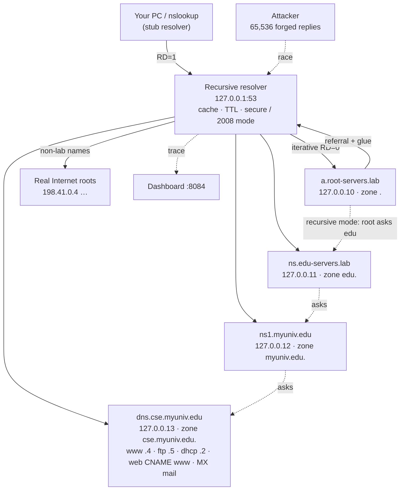
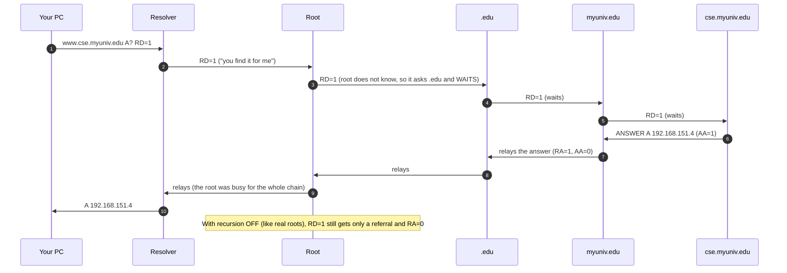
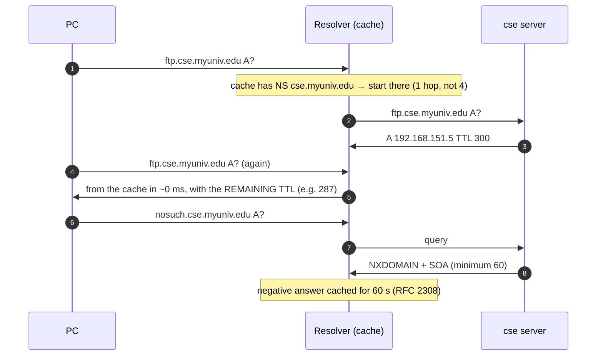
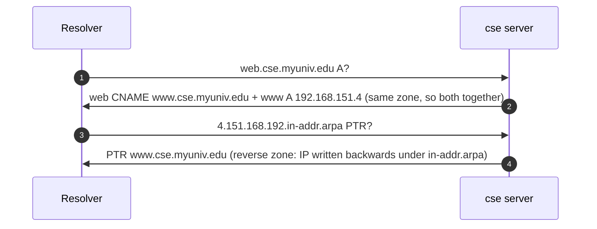
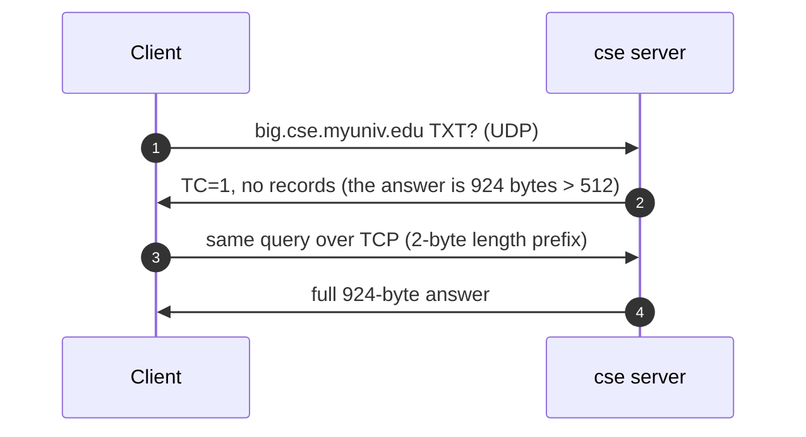

# DNS Naming Hierarchy, Recursive & Iterative Resolution
## Complete Protocol Reference, Architecture & Live Demonstration Guide

---

## Table of Contents
1. [Project Overview & What We Built](#1-project-overview--what-we-built)
2. [RFC 1035 Message Format](#2-rfc-1035-message-format)
3. [System Architecture & Naming Hierarchy](#3-system-architecture--naming-hierarchy)
4. [Detailed Protocol Workflows & Sequence Diagrams](#4-detailed-protocol-workflows--sequence-diagrams)
   - [4.1 Iterative Resolution (Referrals and Glue)](#41-iterative-resolution-referrals-and-glue)
   - [4.2 Recursive Resolution (The Chain)](#42-recursive-resolution-the-chain)
   - [4.3 Caching, TTL and Negative Caching](#43-caching-ttl-and-negative-caching)
   - [4.4 CNAME Chasing and Reverse Lookup (PTR)](#44-cname-chasing-and-reverse-lookup-ptr)
   - [4.5 Truncation: UDP → TCP Fallback](#45-truncation-udp--tcp-fallback)
   - [4.6 Cache Poisoning (2008-Style) vs a Modern Resolver](#46-cache-poisoning-2008-style-vs-a-modern-resolver)
5. [How to Run & Visualize Everything](#5-how-to-run--visualize-everything)
6. [Step-by-Step Live Demonstration Script (For Presentation / Viva)](#6-step-by-step-live-demonstration-script-for-presentation--viva)
7. [Viva & Technical Examination Questions](#7-viva--technical-examination-questions)

---

## 1. Project Overview & What We Built

The **Domain Name System** (RFC 1034 / 1035) turns names like `www.cse.myuniv.edu` into addresses. No server knows every name. The name space is a tree split into **zones**, and each zone's server knows only its own names and **who is in charge of each child zone**.

This module builds a **miniature Internet naming tree from real DNS servers**, all in pure Java (JDK 11+, zero dependencies):

1. **Four authoritative name servers**, each on its own loopback address and answering real DNS packets over UDP and TCP:
   - a lab **root** (`127.0.0.10`);
   - **`.edu`** (`.11`);
   - **`myuniv.edu`** (`.12`);
   - **`cse.myuniv.edu`** (`.13`), with the **Assignment 6, Q7 records**.
2. **RFC 1035 wire format**:
   - the header and all four sections;
   - **name compression pointers**;
   - A, NS, CNAME, SOA, PTR, MX, TXT and AAAA records;
   - a byte-by-byte dissector.
3. **A recursive resolver** on `127.0.0.1:53` (the **real DNS port**) and `:5300`. It does both kinds of resolution:
   - **Iterative**: the resolver walks root → TLD → authoritative, following referrals and glue.
   - **Recursive**: one RD=1 query to the root; each server asks the next and relays the answer back.
4. **A TTL cache**:
   - live countdowns;
   - negative caching (RFC 2308);
   - separate lab and Internet views.
5. **Truncation**: answers larger than 512 bytes set **TC=1**, and the client retries over **TCP**.
6. **Security**:
   - a live **cache-poisoning race** (65,536 forged replies) that defeats a 2008-style resolver but not a modern one (random port + random ID + 0x20 + source check);
   - **interception detection** for networks that hijack UDP 53.
7. **Our own `dig`-style client**, which also works against 8.8.8.8 and the real root servers.
8. **Dashboard** (`http://localhost:8084`), designed as a telephone directory:
   - the naming tree walk;
   - a side-by-side **recursive vs iterative stepper** (Forward ▶);
   - a packet hex view, the cache, zone files, the forgery race and a switchboard log.
9. **Verification**:
   - 31 automated checks;
   - 13 interop checks with **Windows' own `nslookup`** and hand-built Python packets.

| Server | Address | Zone |
|---|---|---|
| recursive resolver | 127.0.0.1:53 and :5300 | — (does lookups for clients) |
| a.root-servers.lab | 127.0.0.10:53 / :5300 | `.` |
| ns.edu-servers.lab | 127.0.0.11 | `edu.` |
| ns1.myuniv.edu | 127.0.0.12 | `myuniv.edu.` |
| dns.cse.myuniv.edu | 127.0.0.13 | `cse.myuniv.edu.`, `151.168.192.in-addr.arpa.` |
| Dashboard | HTTP 8084 | |

---

## 2. RFC 1035 Message Format

```
 Header (12 bytes)
 0  1  2  3  4  5  6  7  8  9 10 11 12 13 14 15
+--+--+--+--+--+--+--+--+--+--+--+--+--+--+--+--+
|                      ID                       |   matches a reply to its query
+--+--+--+--+--+--+--+--+--+--+--+--+--+--+--+--+
|QR|  Opcode   |AA|TC|RD|RA|   Z    |   RCODE   |   flags
+--+--+--+--+--+--+--+--+--+--+--+--+--+--+--+--+
|                    QDCOUNT                    |   questions
|                    ANCOUNT                    |   answers
|                    NSCOUNT                    |   authority (referrals, SOA)
|                    ARCOUNT                    |   additional (glue)
+--+--+--+--+--+--+--+--+--+--+--+--+--+--+--+--+

 Question:  QNAME (labels: 3 www 3 cse 6 myuniv 3 edu 0) | QTYPE (2) | QCLASS (2)
 Resource record:  NAME | TYPE (2) | CLASS (2) | TTL (4) | RDLENGTH (2) | RDATA

 Name compression:  a repeated name is replaced by 2 bytes  11xxxxxx xxxxxxxx
                    e.g. C0 0C = "go to offset 12" (where the question's name starts)
```

| Flag | Meaning |
|:--|:--|
| QR | 0 query / 1 response |
| AA | the answer comes from the zone's own authoritative server |
| TC | truncated: the answer did not fit in 512 bytes of UDP, so retry over TCP |
| RD | recursion desired (set by the asker) |
| RA | recursion available (set by the server) |
| RCODE | 0 NOERROR, 2 SERVFAIL, 3 NXDOMAIN, 5 REFUSED |

---

## 3. System Architecture & Naming Hierarchy



---

## 4. Detailed Protocol Workflows & Sequence Diagrams

### 4.1 Iterative Resolution (Referrals and Glue)

```mermaid
sequenceDiagram
    autonumber
    participant PC as Your PC
    participant R as Resolver
    participant Root as Root (.10)
    participant Edu as .edu (.11)
    participant Uni as myuniv.edu (.12)
    participant Cse as cse.myuniv.edu (.13)
    PC->>R: www.cse.myuniv.edu A?  RD=1  ("do the whole job")
    R->>Root: www.cse.myuniv.edu A?  RD=0
    Root->>R: REFERRAL: NS edu. → ns.edu-servers.lab + glue 127.0.0.11
    R->>Edu: same question, RD=0
    Edu->>R: REFERRAL: NS myuniv.edu. → ns1.myuniv.edu + glue 127.0.0.12
    R->>Uni: same question
    Uni->>R: REFERRAL: NS cse.myuniv.edu. → dns.cse.myuniv.edu + glue 127.0.0.13
    R->>Cse: same question
    Cse->>R: ANSWER (AA=1): www.cse.myuniv.edu A 192.168.151.4, TTL 120
    R->>PC: A 192.168.151.4  (RA=1); every referral and the answer are cached
```

### 4.2 Recursive Resolution (The Chain)



**Same number of messages (10), very different load.** In iterative mode the root answers once and is free. In recursive mode the root holds an open query until the whole chain answers. That is why real root and TLD servers set RA=0.

### 4.3 Caching, TTL and Negative Caching



### 4.4 CNAME Chasing and Reverse Lookup (PTR)



### 4.5 Truncation: UDP → TCP Fallback



### 4.6 Cache Poisoning (2008-Style) vs a Modern Resolver

```mermaid
sequenceDiagram
    autonumber
    participant R as Resolver
    participant A as Attacker
    participant Cse as cse server (slow: 1.5 s)
    R->>Cse: bank.cse.myuniv.edu A?  (2008 mode: fixed source port 5399, random 16-bit ID)
    loop 65,536 forged replies in ~0.5 s
        A->>R: "bank = 6.6.6.6", ID = 0,1,2,…
    end
    Note over R: 2008 mode: one forged ID matches → 6.6.6.6 cached for 86,400 s for EVERY user
    Cse->>R: real answer 192.168.151.20 (too late)
    Note over R: Modern mode: random source port + random ID + reply must come from the server asked<br/>+ 0x20 random letter case → every forgery is rejected; the real answer wins
```

---

## 5. How to Run & Visualize Everything

```powershell
cd DNS
.\run.bat                 # all servers + dashboard at http://localhost:8084
.\run.bat --verify        # 31 automated checks (stop the running lab first)
python interop_test.py    # Windows nslookup + raw packets (13 checks)
```

From Command Prompt while the lab runs:
```
nslookup www.cse.myuniv.edu 127.0.0.1                  ← through our resolver
nslookup -type=MX cse.myuniv.edu 127.0.0.1
nslookup 192.168.151.4 127.0.0.1                       ← reverse (PTR)
nslookup -norecurse www.cse.myuniv.edu 127.0.0.10      ← ITERATIVE: the root only refers
nslookup www.cse.myuniv.edu 127.0.0.10                 ← RECURSIVE: the root asks down the chain
```

| Dashboard section | What it shows |
|:--|:--|
| Masthead | "Directory assistance": look up any name through our resolver |
| 01 Who knows | the naming tree lights up hop by hop, with numbered steps showing what each server said (Iterative / Recursive switch) |
| 02 Rec · Iter | **both methods side by side, step by step with Forward ▶**: numbered arrows, captions, waiting halos, a "who is busy" strip and measured numbers |
| 03 Packet | our `dig`: every byte of the query and response explained, compression pointers outlined, the 16 flag bits |
| 04 Memory | the cache with TTL bars counting down; hits, misses, negative entries |
| 05 Listings | the BIND zone files; add or remove records live |
| 06 Forgery | the poisoning race against the 2008 resolver and the modern resolver |
| 07 Log | every DNS message from every server, with its meaning |

---

## 6. Step-by-Step Live Demonstration Script (For Presentation / Viva)

1. **Launch**: run `run.bat` and open `http://localhost:8084`.
2. **Real tool**: in Command Prompt run `nslookup www.cse.myuniv.edu 127.0.0.1`. It returns 192.168.151.4 from **our** resolver on port 53.
3. **Tree walk**: in section 01 click *Walk the tree (empty cache)*. Four servers light up: root, edu, myuniv, cse, with referrals and glue. Click *Ask again*: one step, **CACHE HIT**.
4. **Recursive vs iterative**: in section 02 click *Run both lookups*, then press **Forward ▶** for each message. Point at the busy strip: the root is busy for 8 of 10 steps in recursive mode and 2 of 10 in iterative. Untick *lab servers offer recursion*: recursive mode now gets only a referral (RA=0), just like real roots.
5. **nslookup both ways**: `nslookup -norecurse www.cse.myuniv.edu 127.0.0.10` returns a referral; without `-norecurse`, the root resolves it down the chain.
6. **Packet**: in section 03 choose the chip `web A @cse`. Point at the CNAME and at the `C0 0C` compression pointer: hover it and it says "offset 12". Choose `TC → TCP`: the UDP reply is truncated and the TCP retry gets 924 bytes.
7. **Cache**: in section 04 show the TTL bars counting down and the NXDOMAIN negative entry.
8. **Zone edit**: in section 05 add `lab A 192.168.151.6`, then run `nslookup lab.cse.myuniv.edu 127.0.0.1`. It resolves immediately.
9. **Forgery**: in section 06 launch the attack on the 2008 resolver: POISONED (bank → 6.6.6.6). Then on the modern resolver: DEFENDED.

---

## 7. Viva & Technical Examination Questions

**Q1: Recursive vs iterative resolution: who does the work?**
*Answer:*
- In **recursive** resolution, the server that was asked takes responsibility for the final answer. If it doesn't know, it asks the next server itself and waits.
- In **iterative** resolution, a server that doesn't know replies with a **referral** ("ask them"), and the asker contacts the next server itself.

On the real Internet, your PC asks its resolver recursively (RD=1), and the resolver resolves iteratively (RD=0). Our section 02 runs both and shows that the message count is the same (10) but the load differs.

**Q2: Why do root servers refuse recursion?**
*Answer:* Load and security. A recursive root would hold an open query for every lookup on Earth until the whole chain answered, and it would also be a cache-poisoning target. So roots and TLD servers set **RA=0** and only refer. We show this by switching recursion off on our lab root.

**Q3: What is glue, and why is it needed?**
*Answer:* A referral says, for example, "`cse.myuniv.edu` is served by `dns.cse.myuniv.edu`". But that host name is *inside* the zone being delegated, so you would need to resolve it in order to resolve it: a chicken-and-egg problem. The parent therefore also sends that server's **A record** in the Additional section. That record is the glue (`dns.cse.myuniv.edu A 127.0.0.13`).

**Q4: What is the bailiwick check?**
*Answer:* A resolver accepts glue and referrals only for names under the zone the replying server is responsible for. For example, the `.edu` server may not give us records for `google.com`. This stops a server from injecting unrelated records into our cache.

**Q5: Does DNS use UDP or TCP?**
*Answer:* Both, on port 53. Queries normally use **UDP**: one small question, one answer, no handshake. **TCP** is used when an answer does not fit, signalled by **TC=1** in a UDP reply over 512 bytes, and for zone transfers (AXFR). Our `big.cse.myuniv.edu` TXT record shows the fallback.

**Q6: What is name compression?**
*Answer:* Names repeat a lot in a response. After the first copy, a name (or the end of a name) is replaced by a 2-byte pointer with the top two bits set: `C0 0C` means "the rest of this name is at offset 12". It keeps responses small, which matters for the 512-byte UDP limit.

**Q7: What is TTL, and what is negative caching?**
*Answer:* Every record carries a TTL set by the zone owner: how many seconds others may cache it. Cached records are handed out with the *remaining* TTL. **Negative caching** (RFC 2308) caches "this name does not exist" (NXDOMAIN) too, for the SOA's minimum field. That way repeated typos don't hit the authoritative server every time.

**Q8: AA flag: what does it tell you?**
*Answer:* Authoritative Answer: the reply came from a server that holds the zone itself. Answers from a resolver's cache, or relayed in recursive mode, have AA=0.

**Q9: What are the main record types?**
*Answer:*
- **A**: IPv4 address. **AAAA**: IPv6 address.
- **CNAME**: an alias, such as `web` → `www`.
- **NS**: the name server for a zone.
- **SOA**: start of authority; holds the zone's serial number and timers.
- **MX**: mail exchanger, with a preference number.
- **PTR**: reverse lookup.
- **TXT**: free text, used for SPF and verification.

**Q10: How does reverse DNS work?**
*Answer:* The IP address is written backwards under `in-addr.arpa`: 192.168.151.4 becomes `4.151.168.192.in-addr.arpa`. A PTR record there gives the host name. It is reversed because DNS names grow more specific to the left, while IP addresses grow more specific to the right.

**Q11: Explain DNS cache poisoning and its defences.**
*Answer:* While a resolver waits for an answer, an attacker floods it with forged replies, trying to guess the 16-bit query ID. If the source port is fixed, there are only 65,536 IDs to try, and our 2008-mode resolver is poisoned in about 0.5 s. The defences are:
- a **random source port** (multiplying the guesses by about 60,000);
- a random ID;
- accepting replies only from the server asked;
- **0x20** random letter case that must be echoed exactly.

The real fix is **DNSSEC**, which signs the records.

**Q12: What did you find about "interception"?**
*Answer:* When our resolver asked a real root server about `www.wikipedia.org`, it got a full answer back in 6 ms. Real roots never answer that; they only refer you to `.org`. So something on the network path was answering UDP 53 in their place (a transparent DNS proxy). The resolver flags such a hop.

**Q13: Where are the Assignment 6 records?**
*Answer:* The `cse.myuniv.edu` zone holds them:
- dhcp 192.168.151.2;
- `dns` (.3 in Packet Tracer; in the lab it points at 127.0.0.13, where that server really listens, with a TXT record noting this);
- www .4 and ftp .5;
- `web` as a CNAME of www;
- the NS and SOA records.

We added an MX record pointing to our Mail module and PTR records for reverse lookups.
