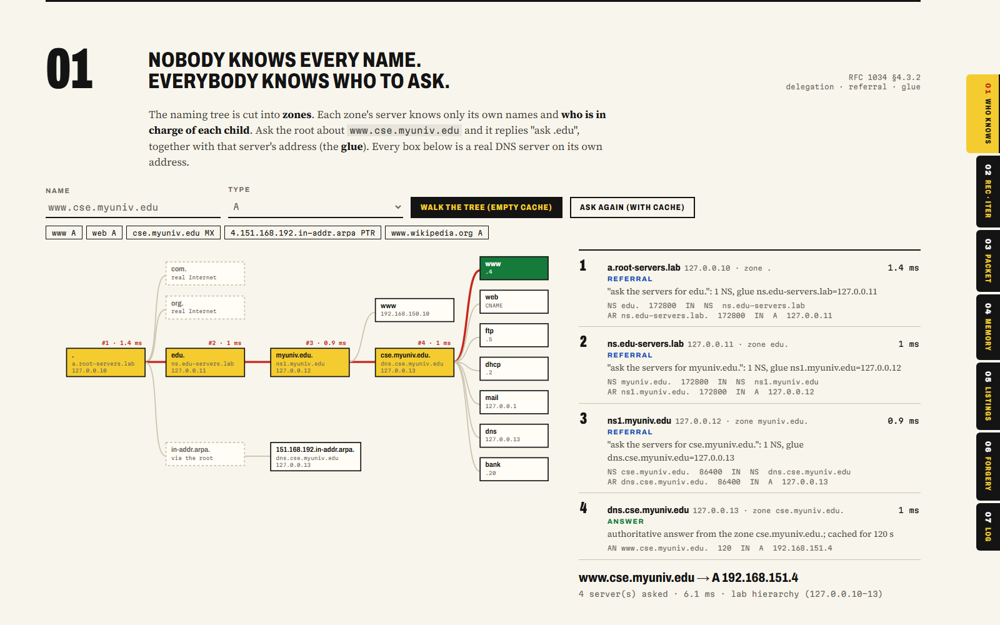
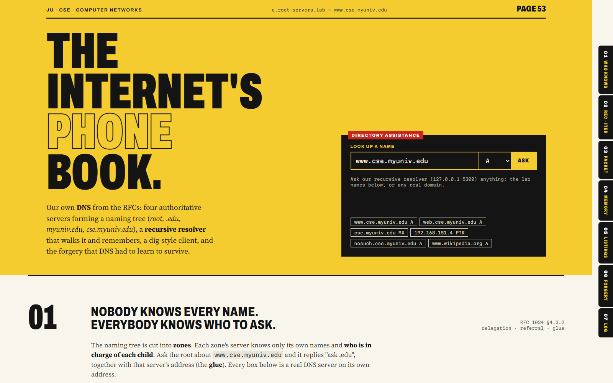
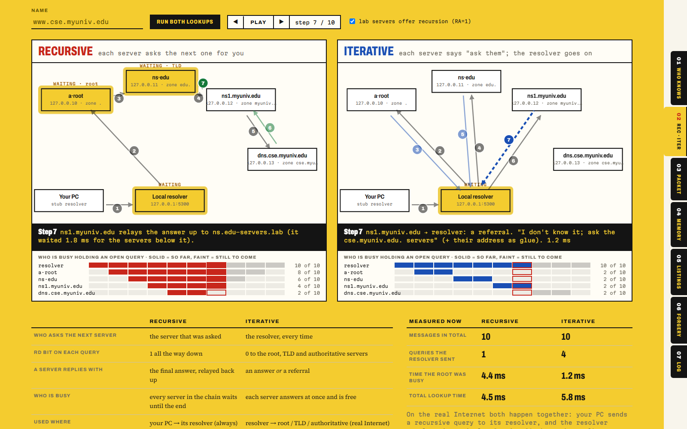
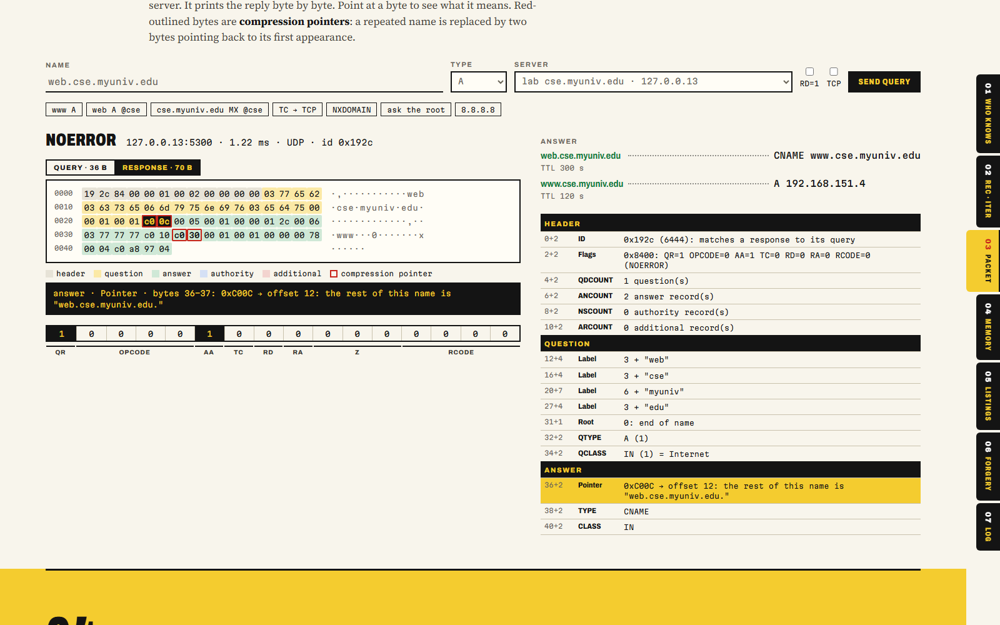
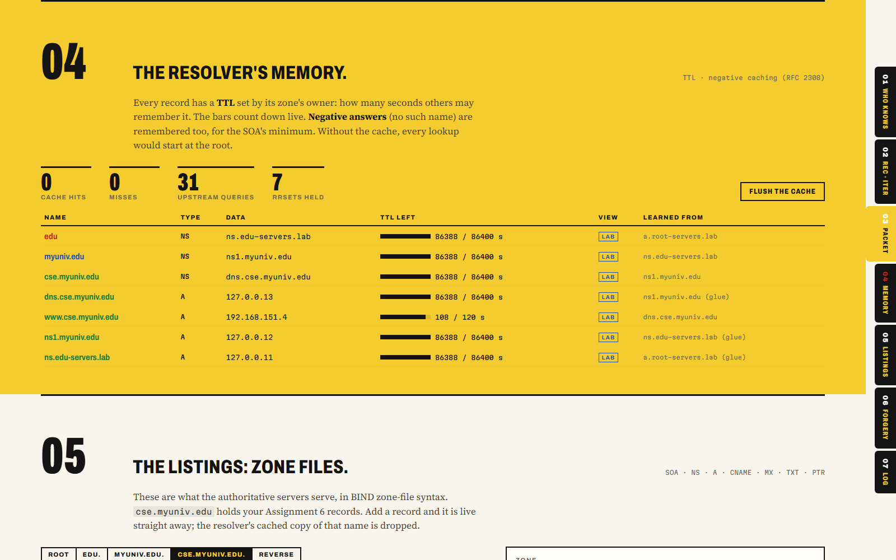
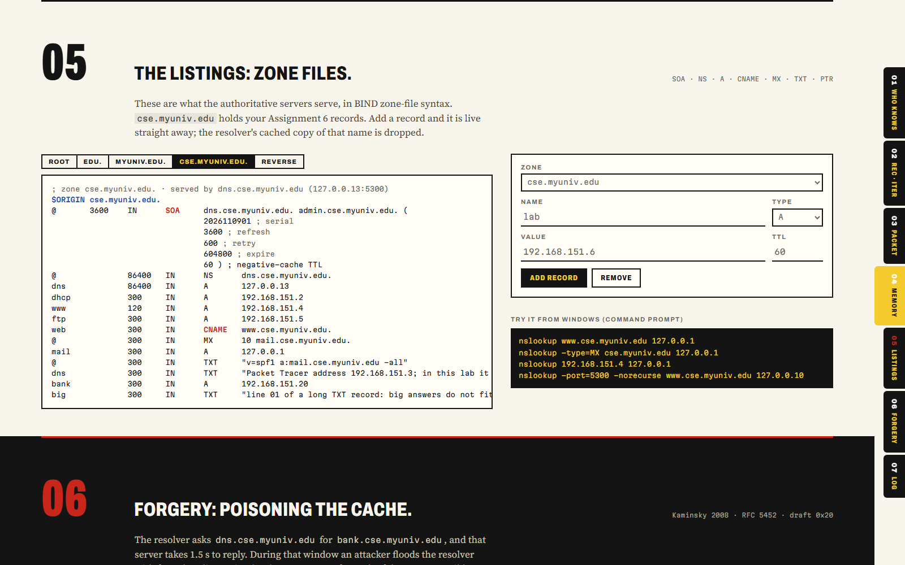
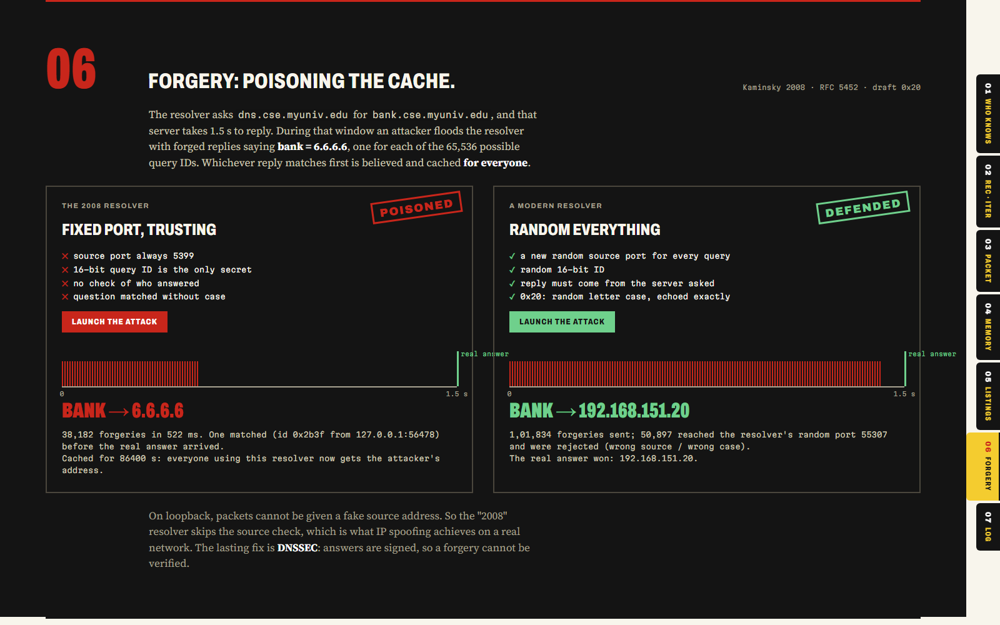
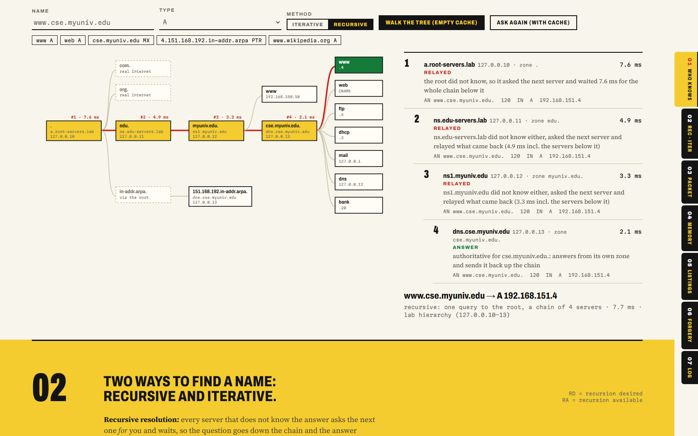
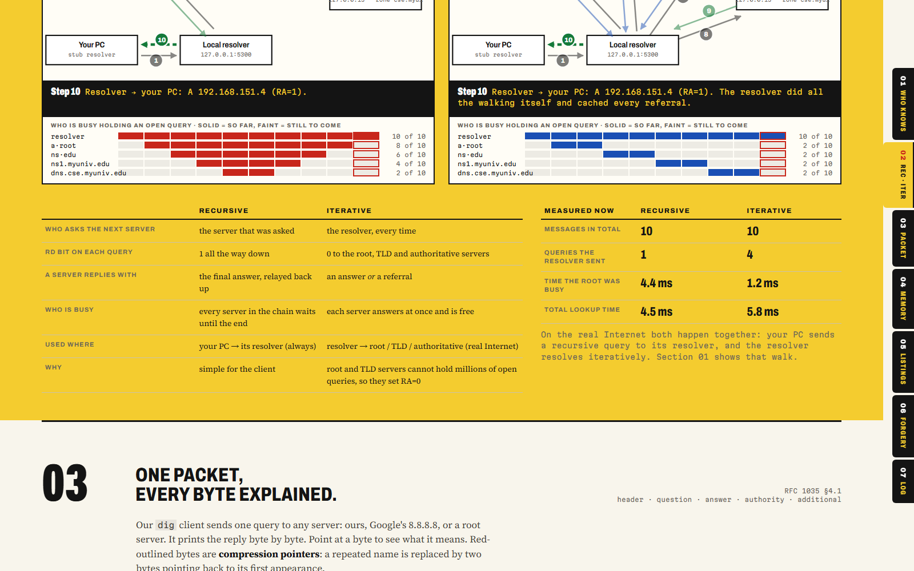

# JU DNS Lab: our own DNS hierarchy, resolver and client

This is pure Java (JDK 11+) with no libraries. Everything is built from RFC 1034/1035: the 12-byte header, name compression, referrals and glue, the TTL cache, and the UDP/TCP fallback. It has five parts:

- **Four authoritative name servers** form a small naming tree, each on its own loopback address.
- **A recursive resolver** walks that tree iteratively, caches what it learns and serves stub resolvers. It also listens on the real port **53**, so Windows' own `nslookup` works against it.
- **A dig-style client** queries any server (ours, 8.8.8.8, a root server) and dissects the reply byte by byte.
- **A cache-poisoning attacker** reproduces the 2008 Kaminsky-style race, and shows how a modern resolver defeats it.
- **A live dashboard** at `http://localhost:8084`.



## Run

```
cd DNS
run.bat                 :: compiles, starts every server, dashboard at http://localhost:8084
run.bat --verify        :: 31 automated end-to-end checks (stop the running lab first)
python interop_test.py  :: with the lab running: Windows nslookup + hand-built packets (13 checks)
```

| Server | Address | Zone | Role |
|---|---|---|---|
| recursive resolver | 127.0.0.1:53 and :5300 | — | does the lookups for clients (RD=1) |
| a.root-servers.lab | 127.0.0.10:5300 (+53) | `.` | refers `edu.` and the reverse zone |
| ns.edu-servers.lab | 127.0.0.11:5300 (+53) | `edu.` | refers `myuniv.edu.` |
| ns1.myuniv.edu | 127.0.0.12:5300 (+53) | `myuniv.edu.` | refers `cse.myuniv.edu.` |
| dns.cse.myuniv.edu | 127.0.0.13:5300 (+53) | `cse.myuniv.edu.`, `151.168.192.in-addr.arpa.` | the Assignment 6 records |

The `cse.myuniv.edu` zone reuses the Assignment 6 records:

- A records: `dhcp` .2, `www` .4, `ftp` .5
- `web` as a CNAME of `www`
- the NS and SOA records

It also adds an MX and A record for `mail` (pointing at the Mail module on 127.0.0.1), TXT records, and reverse PTR records.

Try these from Command Prompt while the lab runs:

```
nslookup www.cse.myuniv.edu 127.0.0.1
nslookup -type=MX cse.myuniv.edu 127.0.0.1
nslookup 192.168.151.4 127.0.0.1
nslookup -norecurse www.cse.myuniv.edu 127.0.0.10
nslookup www.cse.myuniv.edu 127.0.0.10
```

The last two commands ask the lab root directly, and show the two ways of resolving:

- With `-norecurse` (iterative) it returns only a referral to `edu.`.
- Without it (recursive) the root asks `.edu`, `.edu` asks `myuniv.edu`, `myuniv.edu` asks `cse.myuniv.edu`, and the answer comes back up the chain.

Every lab server also listens on port 53 of its own address when it is free.

## What is implemented

**Wire format** (`src/dns/wire`)
- Encode and decode of the header, question, answer, authority and additional sections.
- Name compression pointers.
- A, NS, CNAME, SOA, PTR, MX, TXT and AAAA records.
- A field-by-field dissector that the dashboard uses.

**Authoritative servers** (`src/dns/zone`, `src/dns/server/AuthServer`)
- Authoritative answers (AA=1) and CNAME chasing.
- Referrals with glue records.
- NXDOMAIN and NODATA, both with the SOA attached for negative caching.
- REFUSED for names outside their zones.
- UDP with the 512-byte limit: oversized answers get **TC=1**, followed by a **TCP** retry.
- BIND-style zone files.

**Both resolution methods**
- **Iterative:** the resolver asks root, then TLD, then authoritative itself, following referrals.
- **Recursive:** one RD=1 query to the root. Each lab server that cannot answer forwards the query to the next one and relays the answer back up (RA=1). With recursion switched off, a server answers RD=1 with only a referral and RA=0, which is what real root servers do.
- The dashboard animates both side by side, message by message, with a "who is busy" strip. Both methods use 10 messages for this lookup, but in recursive mode the root stays busy until the whole chain answers.

**Recursive resolver** (`src/dns/server/Resolver`)
- Iterative walk from the root hints: lab roots for lab names, the real 13 root servers for everything else.
- Referrals, with a bailiwick check on glue.
- CNAMEs, and glueless delegations (resolving the NS name first).
- TTL cache with countdown, and negative caching (RFC 2308).
- **Interception detection:** if a "root server" answers a full name itself, the resolver flags the hop. Some networks run a transparent DNS proxy on UDP 53, and this shows it.

**Poisoning race** (`src/dns/attack/Poisoner`)
- The setup: the real answer for `bank.cse.myuniv.edu` is delayed by 1.5 s. Meanwhile 65,536 forged replies (`bank = 6.6.6.6`) race it, one for each possible query ID.
- **2008-style resolver** (fixed source port, no checks): it is poisoned.
- **Modern resolver:** random source port, random ID, source-address check and 0x20 case randomisation. Every forgery is rejected.

## Dashboard

The page is designed as a telephone directory: yellow and white pages, thumb-index tabs, dot-leader listings, and "PAGE 53" in the running head.

1. **Who knows**: the naming tree lights up hop by hop as the resolver walks it.
2. **Recursive vs iterative**: both methods as textbook-style figures from real lookups. Numbered arrows appear one message at a time (Play / step), with a caption for each step and a halo on every server holding an open query. A "who is busy" strip and measured numbers show why real root servers refuse recursion.
3. **One packet**: query and response shown as a hex grid with every field explained, including compression pointers and the 16 flag bits.
4. **Memory**: the cache with TTL bars counting down, negative entries, hits and misses.
5. **Listings**: the zone files. Add or remove records live.
6. **Forgery**: the poisoning race, run against both resolvers.
7. **Switchboard log**: every DNS message from every server, with an explanation of each.

| | |
|---|---|
|  |  |
|  |  |
|  |  |
|  |  |
