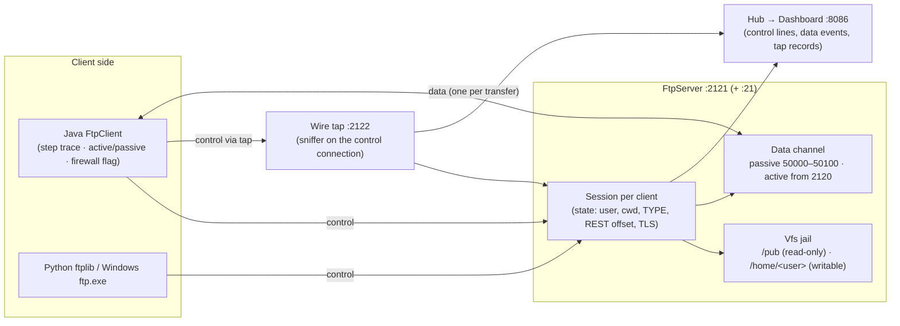
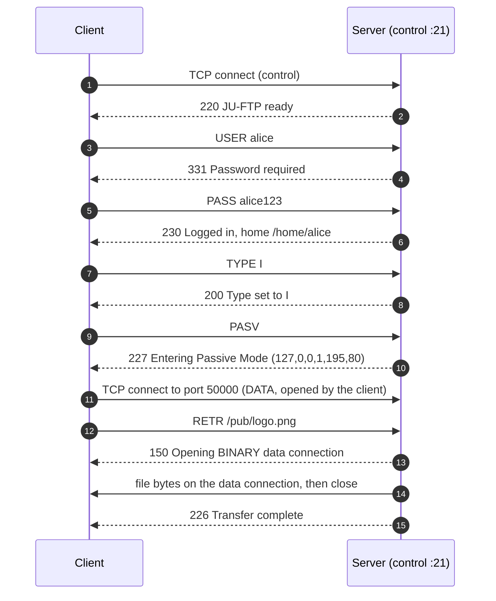
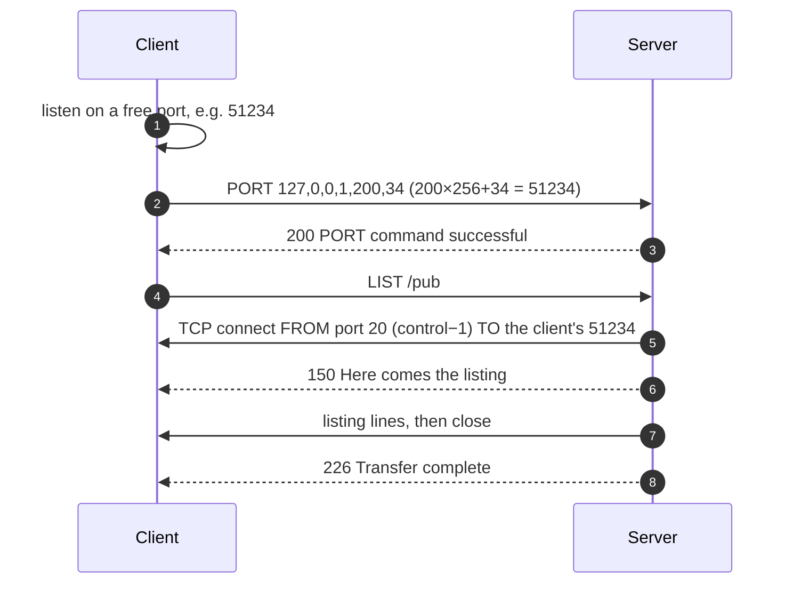
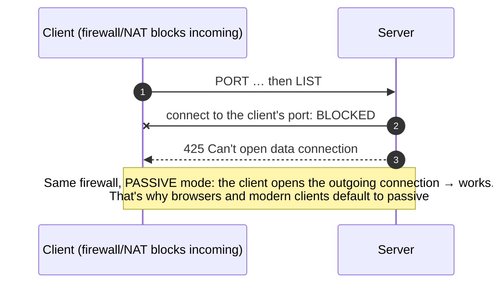
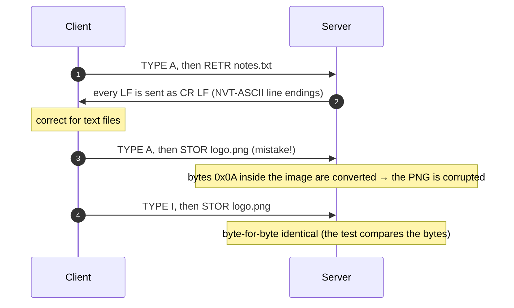
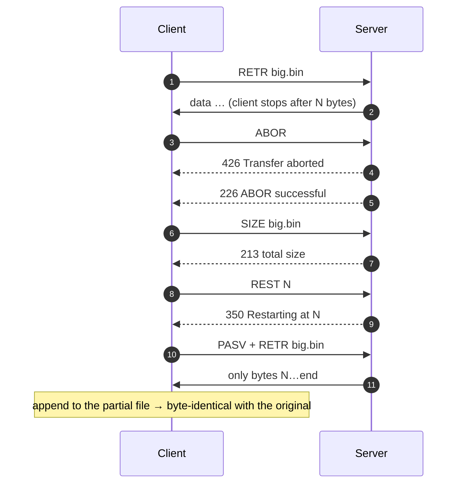
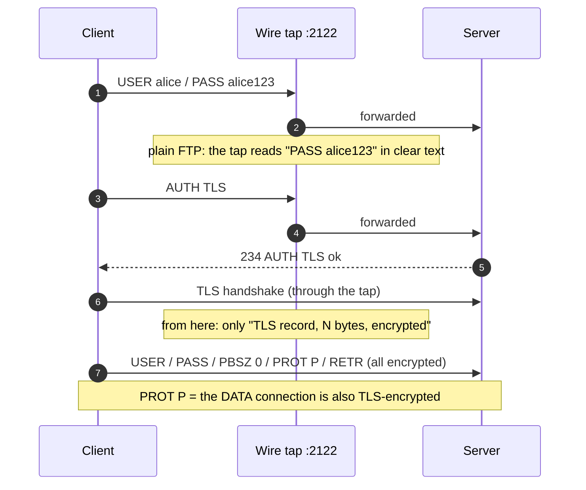
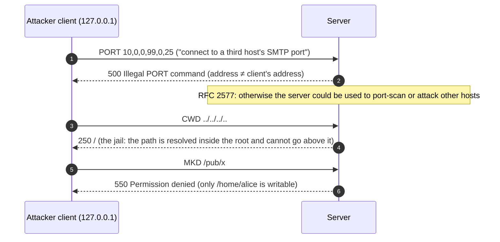

# FTP: File Transfer Protocol (RFC 959) with Active/Passive, Resume & FTPS
## Complete Protocol Reference, Architecture & Live Demonstration Guide

---

## Table of Contents
1. [Project Overview & What We Built](#1-project-overview--what-we-built)
2. [Command & Reply Formats](#2-command--reply-formats)
3. [System Architecture](#3-system-architecture)
4. [Detailed Protocol Workflows & Sequence Diagrams](#4-detailed-protocol-workflows--sequence-diagrams)
   - [4.1 Login and a Passive Download](#41-login-and-a-passive-download)
   - [4.2 Active Mode (PORT): the Server Connects Back](#42-active-mode-port-the-server-connects-back)
   - [4.3 Active Mode Behind a Client Firewall → 425](#43-active-mode-behind-a-client-firewall--425)
   - [4.4 ASCII (TYPE A) vs Binary (TYPE I)](#44-ascii-type-a-vs-binary-type-i)
   - [4.5 ABOR and Resume with REST](#45-abor-and-resume-with-rest)
   - [4.6 FTPS (AUTH TLS) and the Wire Tap](#46-ftps-auth-tls-and-the-wire-tap)
   - [4.7 Bounce-Attack Protection and the Jail](#47-bounce-attack-protection-and-the-jail)
5. [How to Run & Visualize Everything](#5-how-to-run--visualize-everything)
6. [Step-by-Step Live Demonstration Script (For Presentation / Viva)](#6-step-by-step-live-demonstration-script-for-presentation--viva)
7. [Viva & Technical Examination Questions](#7-viva--technical-examination-questions)

---

## 1. Project Overview & What We Built

FTP is the protocol with **two TCP connections**:
- a long-lived **control connection** (port 21) that carries text commands and 3-digit replies;
- a fresh **data connection** for every listing or file, which is closed when the transfer ends.

Sending control information on a separate connection is called **out-of-band control**. (TFTP, the UDP variant, is not in our syllabus and is not covered.)

This module implements RFC 959 from scratch in Java 11 with zero dependencies:

1. **FTP server** (`127.0.0.1:2121`, and also `:21` when that port is free):
   - USER/PASS, PWD/CWD/CDUP, LIST/NLST, RETR/STOR, DELE/MKD/RMD, RNFR/RNTO, SIZE/MDTM, FEAT, SYST, NOOP, QUIT;
   - **PORT/EPRT** (active) and **PASV/EPSV** (passive, ports 50000–50100);
   - **TYPE A / TYPE I**, **REST** + **ABOR**;
   - **AUTH TLS / PBSZ / PROT P** (FTPS, RFC 4217).
2. **Security**:
   - a **jail**: `CWD ../../..` never leaves the root;
   - users write only in `/home/<user>`;
   - **anonymous** is read-only and sees only `/pub`;
   - **PORT to another host is refused** (bounce protection, RFC 2577);
   - active data connections come from port **control − 1** (20, or 2120 in the lab).
3. **FTP client** (Java): every command and reply is recorded as a step trace.
   - Options: active or passive mode, and a simulated **client firewall** that blocks incoming connections.
   - It can stop a download half-way (ABOR) and resume it (REST).
4. **Wire tap** (`127.0.0.1:2122 → 2121`): a sniffer on the control connection.
   - Plain FTP: it reads `PASS alice123` in clear text.
   - After `AUTH TLS`: it sees only encrypted TLS records.
5. **Dashboard** (`http://localhost:8086`), designed as a **freight terminal**:
   - the control connection is the *signal wire*; the data connection is a *track* laid for one shipment and lifted afterwards;
   - **step mode**: Forward ▶, with optional Auto-play.
6. **Verification**:
   - 32 automated checks (`run.bat --verify`);
   - 10 interop checks: Python `ftplib` (plain and FTP_TLS) and **Windows `ftp.exe`** against our server.

Users: `alice/alice123`, `bob/bob123`, `subham/ju2026`, `anonymous` (read-only).

---

## 2. Command & Reply Formats

### 2.1 Commands: ASCII lines ending in CRLF

```
USER alice\r\n          PASS alice123\r\n        TYPE I\r\n
PASV\r\n                PORT 127,0,0,1,195,80\r\n  ← h1,h2,h3,h4,p1,p2 → port = 195×256+80 = 50000
EPSV\r\n                EPRT |1|127.0.0.1|50000|\r\n
REST 4096\r\n           RETR logo.png\r\n         STOR notes.txt\r\n   ABOR\r\n
```

### 2.2 Replies: a 3-digit code and text

| First digit | Meaning | Examples |
|:--|:--|:--|
| **1yz** | positive preliminary: "started, wait for another reply" | `150 Opening BINARY data connection` |
| **2yz** | positive completion | `220` welcome · `230` logged in · `226` transfer complete · `227 Entering Passive Mode (127,0,0,1,195,80)` · `229 (|||50000|)` · `257 "/home/alice"` |
| **3yz** | positive intermediate: "send the next command" | `331` password required · `350` REST/RNFR accepted |
| **4yz** | transient failure: try again | `425 Can't open data connection` · `426 Transfer aborted` |
| **5yz** | permanent failure | `530` not logged in · `550` no such file / permission · `553` not allowed (anonymous) · `502` not implemented · `500` illegal PORT |

The second digit gives the category: `x0z` syntax, `x2z` connections, `x3z` authentication, `x5z` file system. A multi-line reply starts with `211-` and ends with `211 End` (used by FEAT).

---

## 3. System Architecture



---

## 4. Detailed Protocol Workflows & Sequence Diagrams

### 4.1 Login and a Passive Download



### 4.2 Active Mode (PORT): the Server Connects Back



### 4.3 Active Mode Behind a Client Firewall → 425



### 4.4 ASCII (TYPE A) vs Binary (TYPE I)



### 4.5 ABOR and Resume with REST



### 4.6 FTPS (AUTH TLS) and the Wire Tap



### 4.7 Bounce-Attack Protection and the Jail



---

## 5. How to Run & Visualize Everything

```powershell
cd FTP
.\run.bat                 # server :2121 (+ :21), tap :2122, dashboard http://localhost:8086
.\run.bat --verify        # 32 automated checks (stop the running lab first)
python interop_test.py    # ftplib + FTP_TLS + Windows ftp.exe vs our server (10 checks)
ftp 127.0.0.1             # the real Windows client (it uses active mode)
```

The dashboard is a freight terminal of nine bays:

| Bay | What it shows |
|:--|:--|
| 01 Two lines | the signal wire (control) on top and the track (data) below; pick an operation, then step through it with Forward ▶ |
| 02 Active vs passive | both modes side by side, both real runs; turn on the client firewall: active ends in **425**, passive works |
| 03 ASCII vs binary | the same image in TYPE A vs TYPE I; LF → CR LF shown in hex; the corrupted image |
| 04 Resume | ABOR half-way (426, then 226), then REST N: only the rest is sent; byte check |
| 05 File manager | browse, upload, download, rename, delete, mkdir; every button is one real FTP session |
| 06 By hand | type raw FTP commands, like `telnet 127.0.0.1 21` |
| 07 Security | the wire tap: plain FTP shows the password; FTPS shows only TLS records; bounce/jail tests |
| 08 Reply codes | how to read 1yz–5yz and the second digit |
| 09 Real servers | the same Java client against any RFC 959 server |

The player bar has **Forward ▶** (→ / space / Enter), **Auto-play ▶▶** (off by default), speed, and restart.

---

## 6. Step-by-Step Live Demonstration Script (For Presentation / Viva)

1. **Launch**: run `run.bat` and open `http://localhost:8086`.
2. **Two connections**: in Bay 01, choose *RETR logo.png (passive)* and press **Forward ▶** for each step.
   - On the control wire: 220, USER/331, PASS/230, TYPE I/200, PASV/227.
   - The track is laid from client to server, the file moves across, the track is lifted, and 226 arrives.
3. **Active vs passive**: in Bay 02, step through both modes.
   - In **active**, the arrow on the track is reversed: the server connects from port control−1.
   - Turn on the **client firewall**: active fails with **425**, passive still works.
4. **TYPE A vs TYPE I**: in Bay 03, upload the image in ASCII mode and show that it is corrupted. Upload it again in binary: identical. Show `0A` → `0D 0A` in the hex view.
5. **Resume**: in Bay 04, abort half-way (426 + 226), then resume with `REST`. The byte check is ✓.
6. **Security**: in Bay 07, run a plain login through the tap and show **PASS alice123** visible. Run it again with **AUTH TLS**: only encrypted records appear.
7. **Bounce and jail**: show `PORT` to another host → 500 and `CWD ../../..` staying at `/`.
8. **Real client**: in a terminal, run `ftp 127.0.0.1`, log in as `alice`, then `binary`, `get /pub/logo.png`. The dashboard shows the session live.

---

## 7. Viva & Technical Examination Questions

**Q1: Why does FTP use two connections?**
*Answer:* Out-of-band control. The control connection stays open for the whole session, carrying commands and replies. Each file or listing uses its own data connection. So the client can send commands (such as ABOR) while a transfer runs, and the end of a file is simply the data connection closing, with no length header needed.

**Q2: Which port numbers does FTP use?**
*Answer:*
- Control: **21** on the server.
- Data, active mode: the server connects **from port 20** to the port the client named in PORT.
- Data, passive mode: the server opens a random high port, given in the 227 reply.

In our lab these are 2121 / 2120 / 50000–50100, and the server also binds 21 when that port is free.

**Q3: Active vs passive: who connects to whom?**
*Answer:*
- **Active (PORT)**: the client listens and the **server connects** to the client.
- **Passive (PASV)**: the server listens and the **client connects** to the server.

Passive is preferred because client-side firewalls and NAT block incoming connections. We demonstrate the 425 failure in active mode.

**Q4: Decode `227 Entering Passive Mode (127,0,0,1,195,80)`.**
*Answer:* The first four numbers are the IP address, 127.0.0.1. The port is 195×256 + 80 = **50000**. EPSV (`229 (|||50000|)`) gives only the port. It works with IPv6, and NAT cannot get the address wrong because there isn't one.

**Q5: What is the difference between TYPE A and TYPE I?**
*Answer:*
- **ASCII (A)** converts line endings to CRLF on the wire, which is correct for text across operating systems.
- **Image/binary (I)** sends the bytes unchanged.

Sending an image in ASCII mode corrupts it, because any 0x0A byte becomes 0x0D 0x0A. Our test proves this.

**Q6: Is FTP stateful or stateless?**
*Answer:* Stateful. The server remembers for each session:
- the logged-in user;
- the current directory;
- TYPE, the REST offset and the pending PORT/PASV;
- the TLS state.

HTTP, by comparison, is stateless.

**Q7: How does resuming work?**
*Answer:* After an interrupted transfer, the client asks `SIZE` and checks how many bytes it already has (N). It sends `REST N` (reply 350), then `RETR`. The server starts at byte N, and the client appends the rest. ABOR stops a running transfer: 426 for the aborted transfer, then 226.

**Q8: Why is plain FTP insecure, and what fixes it?**
*Answer:* Everything is in clear text, including USER/PASS and the file data; our wire tap shows the password. Two fixes:
- **FTPS** (RFC 4217): `AUTH TLS` upgrades the control connection; `PBSZ 0` + `PROT P` also encrypt the data connection.
- **SFTP**: a different protocol that runs over SSH, not FTP at all.

**Q9: What is an FTP bounce attack?**
*Answer:* With `PORT`, a client can tell the server to open a data connection to **any** IP and port. An attacker can then use the FTP server to port-scan or send data to a third machine, which hides the attacker. Defence (RFC 2577): accept PORT only to the client's own address and to ports ≥ 1024. Our server replies **500**.

**Q10: How does anonymous FTP work?**
*Answer:* User `anonymous`, with any password (traditionally an email address). In our server it is read-only and jailed to `/pub`, so STOR gives **553**.

**Q11: What does reply code 1yz mean, and why is it needed?**
*Answer:* "Positive preliminary": the action has started, so wait for another reply. RETR gets `150` when the data connection opens, then `226` when it completes. So one command can produce two replies.

**Q12: How does the server stop `CWD ../../..` from escaping?**
*Answer:* Every path is resolved inside a virtual root: `..` above `/` stays at `/`, and the result must still lie under the jail directory. Writes are allowed only under `/home/<user>`.

**Q13: FTP vs TFTP vs HTTP?**
*Answer:*

| | FTP | TFTP | HTTP |
|:--|:--|:--|:--|
| Transport | TCP 21 + data connection | UDP 69 | TCP 80, 1 connection |
| Login | yes | no | optional |
| Listing, rename, delete | yes | no | no (only GET/PUT) |
| State | stateful | lock-step | stateless |

TFTP is used to load boot images (see BOOTP).
