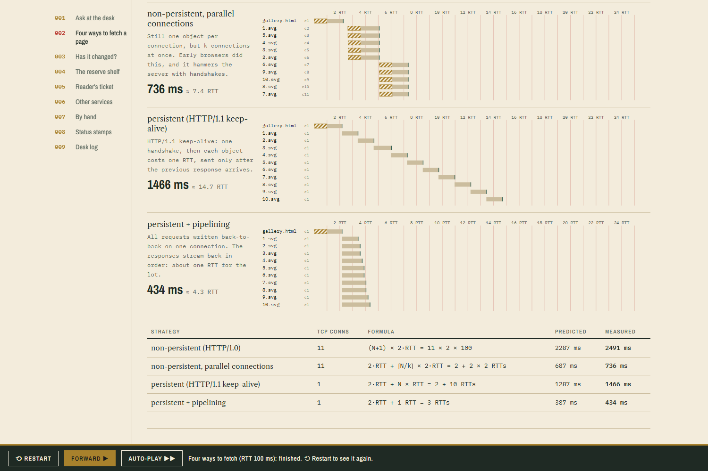
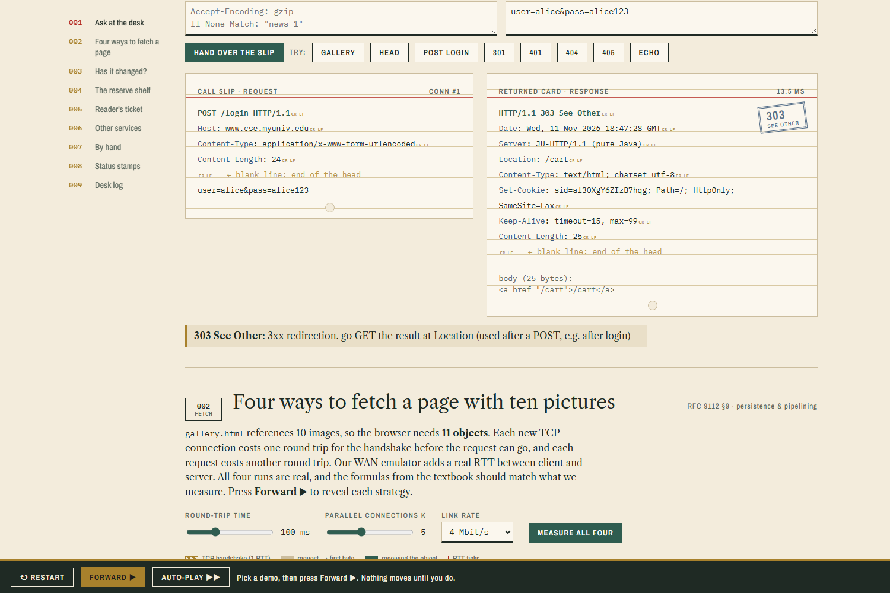
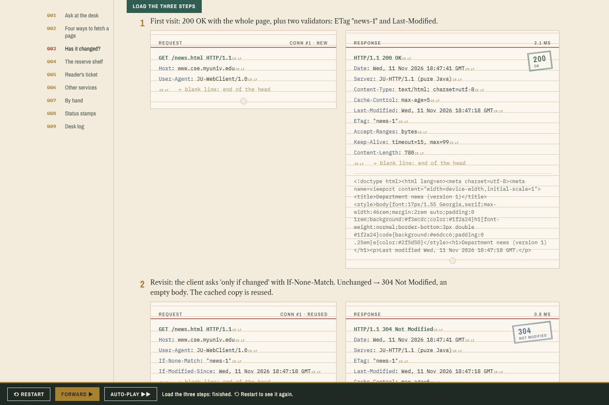
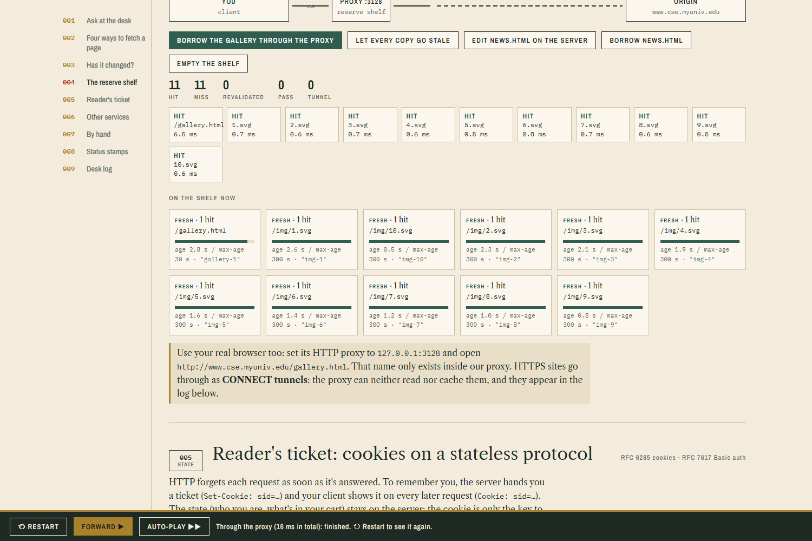
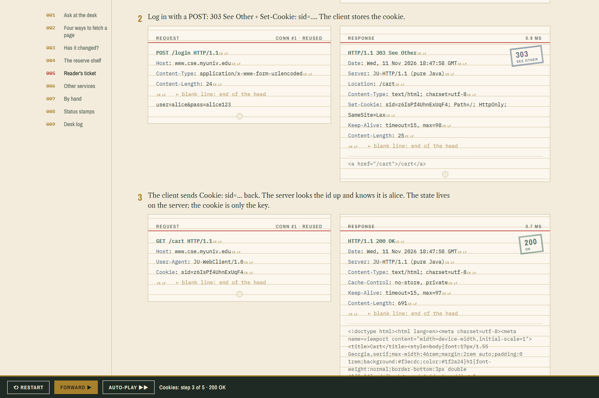
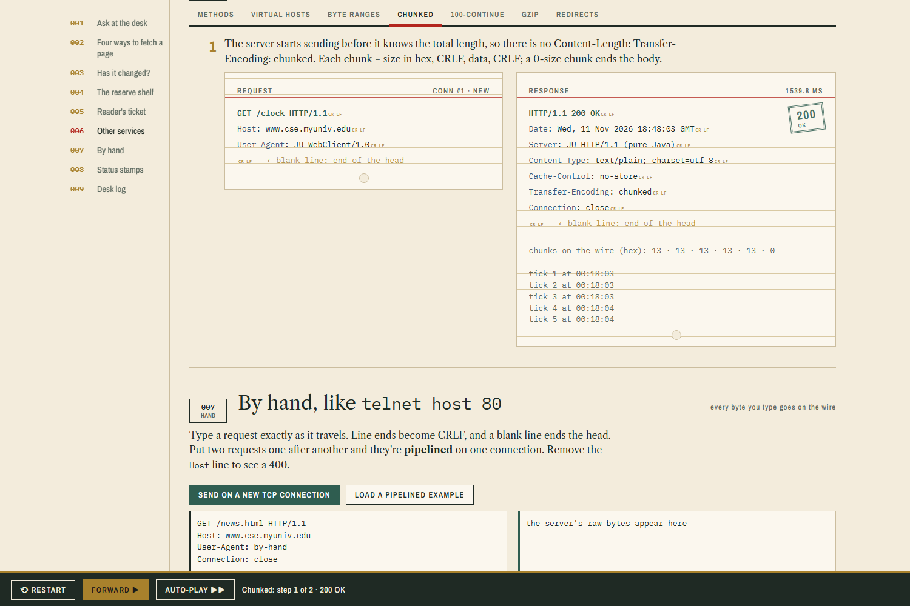
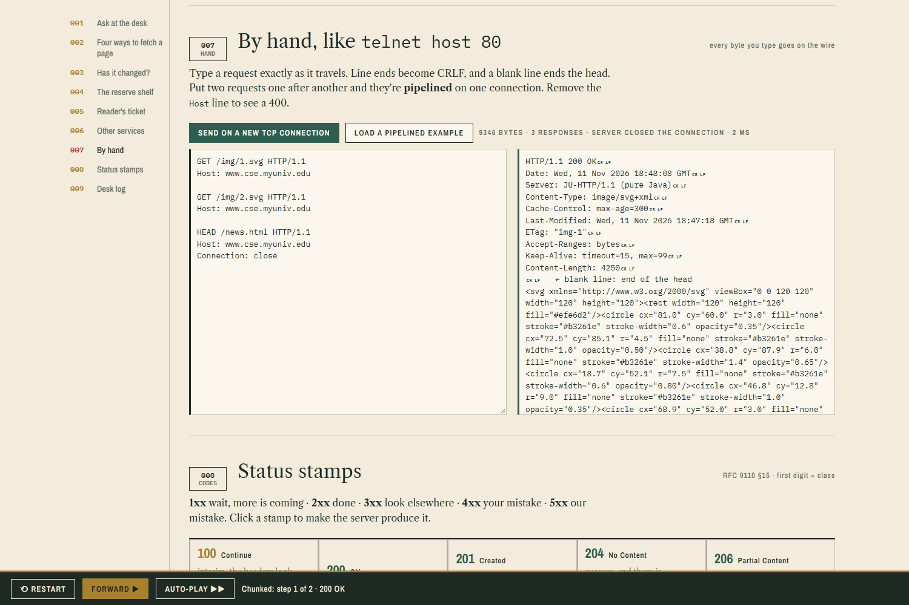

# JU HTTP Lab: HTTP/1.1 from the RFCs

HTTP is the request/response protocol of the web: a client sends a **request** (method, target, version, header fields, optional body) and the server sends back a **response** (status line, header fields, body). It is plain text over TCP, and the server remembers nothing between requests.

This module builds HTTP/1.1 from RFC 9110 (semantics), RFC 9112 (message format) and RFC 9111 (caching) in pure Java (JDK 11+, no libraries):
- our own **origin server**;
- our own **client**;
- a **WAN emulator**, so connection strategies can be measured;
- a **caching proxy**.



## Run

```
cd HTTP
run.bat                 :: compiles, starts everything, dashboard at http://localhost:8087
run.bat --verify        :: 52 automated checks (stop the running lab first)
python interop_test.py  :: with the lab running: Python http.client / urllib and curl vs our server and proxy (11 checks)
```

| Part | Address | Real-world equivalent |
|---|---|---|
| Origin server | `127.0.0.1:8800` (and `:80` when free) | a web server on port 80 |
| WAN emulator | `127.0.0.1:8801 → 8800` | the Internet between you and the server (adds RTT + bandwidth, like Linux `netem`) |
| Caching proxy | `127.0.0.1:3128` | a university web cache (Squid's port) |
| Dashboard | `http://localhost:8087` | |

Open `http://localhost:8800/` in your browser: the pages come from our server. Users for the login page and `/private/`: `alice/alice123`, `bob/bob123`, `subham/ju2026`.

## What it demonstrates

| Feature | Where | What you see |
|---|---|---|
| Request and response format | 001 Ask at the desk | the raw request and response with every CRLF marked, plus a stamped status code |
| **Persistent vs non-persistent, pipelining** | 002 Four ways to fetch | 1 page + 10 images through a 100 ms RTT link: HTTP/1.0 (11 connections) ≈ 22 RTT, k parallel connections, keep-alive ≈ 12 RTT, pipelined ≈ 3 RTT; measured against the textbook formulas |
| **Conditional GET** | 003 Has it changed? | `ETag` / `Last-Modified` → `If-None-Match` → **304 Not Modified**, no body |
| **Caching proxy** | 004 The reserve shelf | MISS (crosses the WAN) → HIT (local, no WAN) → stale → REVALIDATED (304); `Age`, `Via`, `X-Cache` |
| **Cookies** | 005 Reader's ticket | `Set-Cookie: sid=…` → `Cookie:` → the server recognises you (state on a stateless protocol) |
| Basic authentication | 005 | 401 + `WWW-Authenticate` → `Authorization: Basic` (only base64, not encryption) |
| Methods | 006 | GET, HEAD, POST, PUT (201 / 204), DELETE, OPTIONS (Allow), 405, 501 |
| Virtual hosting | 006 | same IP and port, different `Host:` → different site; 1.1 without Host → 400 |
| Byte ranges | 006 | `Range: bytes=…` → **206 Partial Content**, 416 |
| Chunked transfer coding | 006 | `/clock` streams chunks (hex size, CRLF, data); chunked uploads |
| `Expect: 100-continue` | 006 | interim **100 Continue** before the body |
| gzip content coding | 006 | `Accept-Encoding: gzip` → `Content-Encoding: gzip`, `Vary` |
| Redirects | 006 | 301, 302, 303 (after POST) |
| By hand | 007 | type raw bytes like `telnet host 80`; two requests back-to-back are pipelined |
| Status codes | 008 | click a code to make the server produce it |

Every demo steps with **Forward ▶** (→ / space). **Auto-play** is optional.

## How it works

- `src/http/core/Msg.java`: one HTTP/1.x message. It reads and writes the start line, header fields, and body framing (Content-Length, chunked, or read until close).
- `src/http/server/Origin.java`: one thread per TCP connection. It answers requests **strictly in order**, which is what makes pipelining work and what causes head-of-line blocking. It also handles the keep-alive timeout (15 s), `Connection: close` and the HTTP/1.0 rules.
- `src/http/server/Site.java`: the two virtual hosts and every feature listed above.
- `src/http/link/Link.java`: the WAN emulator.
  - The client's first bytes are held for 1 RTT (the TCP handshake).
  - Every chunk is delayed by RTT/2 in each direction.
  - Each direction is serialised at the link rate.
- `src/http/client/PageLoad.java`: the four page-load strategies and their formulas.
- `src/http/proxy/Proxy.java`: freshness (`max-age`, `Expires`, the 10% heuristic), validation (`If-None-Match` / `If-Modified-Since`), `no-store` / `private`, and `CONNECT` tunnels for HTTPS (which cannot be cached).

## Using the proxy from a real browser

Set your browser's HTTP proxy to `127.0.0.1:3128`, then open `http://www.cse.myuniv.edu/gallery.html`. That host name only exists inside our proxy, which serves it from the lab server. Load it twice: the dashboard log shows MISS, then HIT. HTTPS sites still work through the proxy as **CONNECT tunnels**.

| | |
|---|---|
|  |  |
|  |  |
|  |  |
