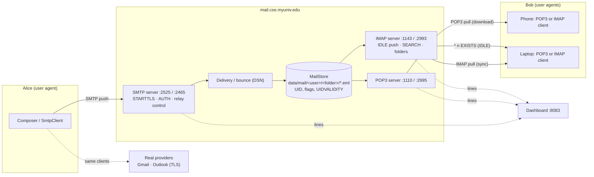
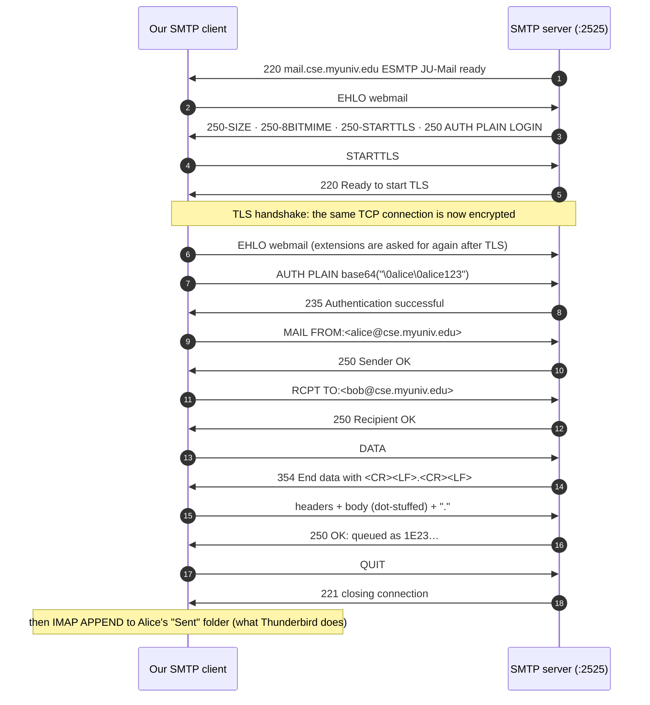
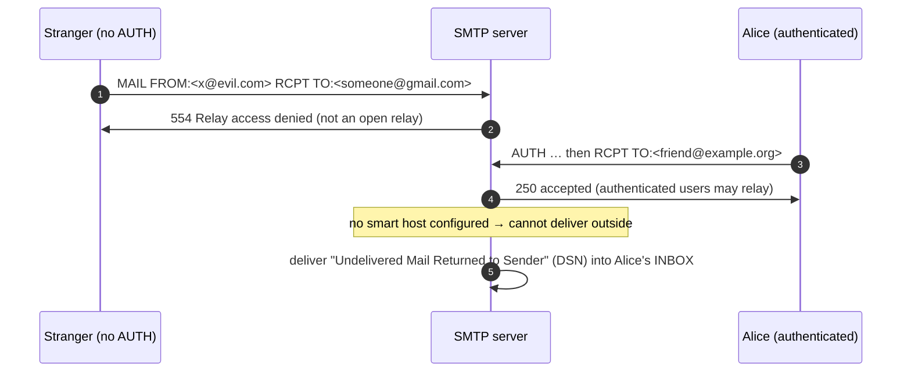
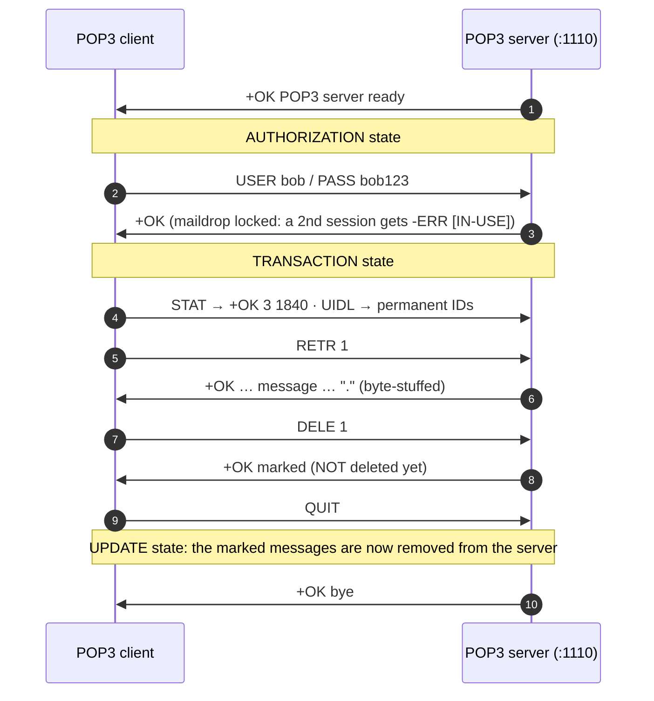
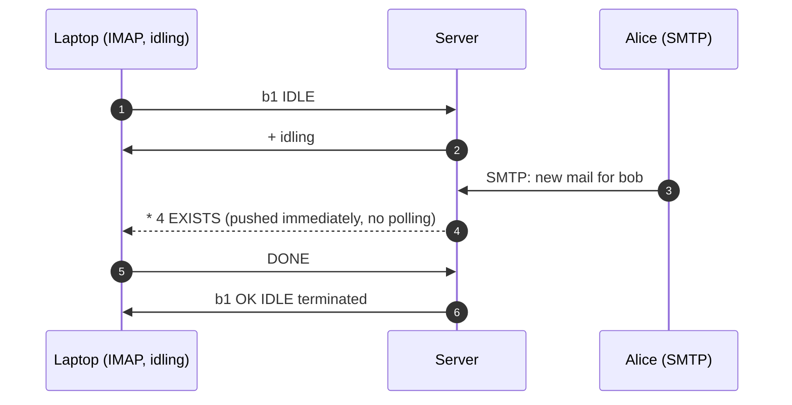
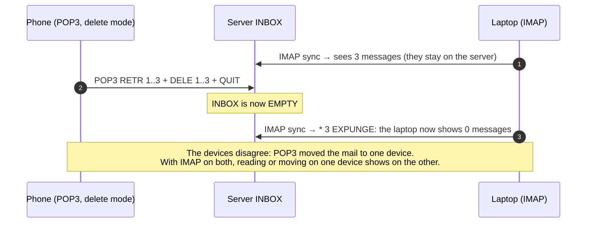

# E-Mail Protocol Suite: SMTP, POP3 & IMAP4 Servers and Clients
## Complete Protocol Reference, Architecture & Live Demonstration Guide

---

## Table of Contents
1. [Project Overview & What We Built](#1-project-overview--what-we-built)
2. [Message & Command Formats](#2-message--command-formats)
3. [System Architecture & Topology](#3-system-architecture--topology)
4. [Detailed Protocol Workflows & Sequence Diagrams](#4-detailed-protocol-workflows--sequence-diagrams)
   - [4.1 Sending: SMTP with STARTTLS and AUTH](#41-sending-smtp-with-starttls-and-auth)
   - [4.2 Relay Protection and Bounces](#42-relay-protection-and-bounces)
   - [4.3 Downloading: POP3 (Delete Mode)](#43-downloading-pop3-delete-mode)
   - [4.4 Accessing: IMAP4 and Server-Side State](#44-accessing-imap4-and-server-side-state)
   - [4.5 IMAP IDLE Push](#45-imap-idle-push)
   - [4.6 The POP3 vs IMAP Two-Device Experiment](#46-the-pop3-vs-imap-two-device-experiment)
5. [How to Run & Visualize Everything](#5-how-to-run--visualize-everything)
6. [Step-by-Step Live Demonstration Script (For Presentation / Viva)](#6-step-by-step-live-demonstration-script-for-presentation--viva)
7. [Viva & Technical Examination Questions](#7-viva--technical-examination-questions)

---

## 1. Project Overview & What We Built

E-mail uses **three protocols**:
- **SMTP** *pushes* a message from the sender's user agent to a mail server, and from server to server.
- **POP3** or **IMAP4** *pull* it from the mailbox to the receiver's user agent.

The textbook names the parts: the user agent (UA), the message transfer agent (MTA, i.e. SMTP), and the message access agent (MAA, i.e. POP3 or IMAP).

This module implements **all three servers and all three clients** in pure Java (JDK 11+, zero dependencies), straight from the RFCs. The same clients also connect to **real providers** (Gmail, Outlook) over TLS.

1. **SMTP server (RFC 5321)**:
   - EHLO extensions (SIZE, 8BITMIME, PIPELINING, STARTTLS, AUTH PLAIN/LOGIN);
   - `MAIL FROM` / `RCPT TO` / `DATA` with dot-stuffing;
   - Received and Return-Path headers;
   - unknown users rejected (550), and **no open relay** (554 without AUTH);
   - **bounce messages (DSN)**.
2. **POP3 server (RFC 1939)**:
   - the AUTHORIZATION → TRANSACTION → UPDATE states;
   - `UIDL`, `TOP`, `DELE` (which only marks) and `RSET`;
   - maildrop locking, byte-stuffing and `STLS`.
3. **IMAP4rev1 server (RFC 3501)**:
   - tagged commands and literals;
   - folders, FLAGS and server-side SEARCH;
   - FETCH of ENVELOPE, BODYSTRUCTURE and partial bodies;
   - COPY / MOVE / APPEND / EXPUNGE;
   - **IDLE push**;
   - live updates when another session changes the mailbox.
4. **MIME**: multipart attachments, base64, quoted-printable, and RFC 2047 encoded subjects.
5. **TLS everywhere**: STARTTLS / STLS on the plain ports, and implicit TLS on 2465 / 2995 / 2993.
6. **Live dashboard** (`http://localhost:8083`), designed as a post office:
   - an animated route map;
   - a composer with a reply-code ledger;
   - the **POP3 vs IMAP two-device demo**;
   - pigeon-hole folders with a MIME viewer;
   - a raw command console;
   - a real-provider form.
7. **Verification**:
   - 39 automated checks (`run.bat --verify`);
   - 20 interop checks with Python's `smtplib`, `poplib` and `imaplib` (`interop_test.py`).

| Protocol | Plain (+STARTTLS) | Implicit TLS | Real-world ports |
|---|---|---|---|
| SMTP | 2525 | 2465 | 25 / 587 / 465 |
| POP3 | 1110 | 2995 | 110 / 995 |
| IMAP | 1143 | 2993 | 143 / 993 |
| Dashboard | HTTP 8083 | | |

Users `alice/alice123`, `bob/bob123`, `subham/ju2026`, all `@cse.myuniv.edu` (the domain from Assignment 6, Q7).

---

## 2. Message & Command Formats

### 2.1 Replies

```
SMTP   3-digit code:   220 ready · 250 ok · 354 start mail input · 221 bye
                       4xx try later · 535 auth failed · 550 no such user · 554 relay denied
POP3   status word:    +OK ...   |   -ERR ...        multi-line answers end with a line "."
IMAP   tagged:         a4 OK [READ-WRITE] SELECT completed
       untagged data:  * 3 EXISTS   * FLAGS (\Seen \Flagged ...)   * 1 FETCH (FLAGS (\Seen))
       continuation:   + ready for literal / + idling
```

### 2.2 An E-Mail on the Wire (MIME, multipart)

```
Return-Path: <alice@cse.myuniv.edu>                    ← added by our MTA
Received: from webmail (127.0.0.1) by mail.cse.myuniv.edu ...   ← added by our MTA
From: Alice <alice@cse.myuniv.edu>
To: bob@cse.myuniv.edu
Subject: =?UTF-8?Q?Report_draft?=                     ← RFC 2047 encoded word
MIME-Version: 1.0
Content-Type: multipart/mixed; boundary="=_JUMAIL_..."

--=_JUMAIL_...
Content-Type: text/plain; charset=UTF-8
Content-Transfer-Encoding: quoted-printable

Gr=C3=BC=C3=9Fe   (Grüße)
--=_JUMAIL_...
Content-Type: application/octet-stream; name="report.txt"
Content-Transfer-Encoding: base64
Content-Disposition: attachment; filename="report.txt"

Q04gTGFiIEFzc2lnbm1lbnQgNg==
--=_JUMAIL_...--
```

**Dot-stuffing:** the message ends with a line containing only `.`. So a body line that starts with `.` is sent as `..`, and the receiver removes the extra dot.

---

## 3. System Architecture & Topology



---

## 4. Detailed Protocol Workflows & Sequence Diagrams

### 4.1 Sending: SMTP with STARTTLS and AUTH



### 4.2 Relay Protection and Bounces



### 4.3 Downloading: POP3 (Delete Mode)



### 4.4 Accessing: IMAP4 and Server-Side State

```mermaid
sequenceDiagram
    autonumber
    participant C as IMAP client
    participant S as IMAP server (:1143)
    S->>C: * OK [CAPABILITY IMAP4rev1 IDLE MOVE UIDPLUS …] ready
    C->>S: a1 LOGIN bob bob123
    S->>C: a1 OK   (NOT AUTHENTICATED → AUTHENTICATED)
    C->>S: a2 SELECT INBOX
    S->>C: * 3 EXISTS · * FLAGS (…) · * OK [UIDVALIDITY …] · a2 OK [READ-WRITE]
    C->>S: a3 UID SEARCH UNSEEN
    S->>C: * SEARCH 7 9 · a3 OK   (the search runs on the server)
    C->>S: a4 UID FETCH 7 (BODY.PEEK[HEADER.FIELDS (FROM SUBJECT)])
    S->>C: * 1 FETCH (… {120} literal …) · a4 OK   (PEEK: \Seen is NOT set)
    C->>S: a5 UID FETCH 7 BODY[]
    S->>C: whole message; the server sets \Seen
    C->>S: a6 UID MOVE 7 Projects
    S->>C: * OK [COPYUID …] · * 1 EXPUNGE · a6 OK
```

### 4.5 IMAP IDLE Push



### 4.6 The POP3 vs IMAP Two-Device Experiment



---

## 5. How to Run & Visualize Everything

```powershell
cd Mail
.\run.bat                 # compiles, starts all servers, dashboard at http://localhost:8083
.\run.bat --verify        # 39 automated checks (stop the running servers first)
python interop_test.py    # with the servers running: Python smtplib/poplib/imaplib (20 checks)
```

Thunderbird also works: IMAP `localhost:1143`, SMTP `localhost:2525`, user `bob`. By hand: `telnet localhost 2525`.

| Dashboard section | What it shows |
|:--|:--|
| 01 Route | UA → MTA → mailbox → MAA as a transit map; envelopes move along it for every real protocol line |
| 02 Post | the composer (an airmail envelope with a postmark) and a ledger where every SMTP reply code is explained |
| 03 POP3 vs IMAP | Bob's phone and laptop, each with its own protocol; the server's INBOX in the middle; a live "do the devices agree?" table; IDLE toasts |
| 04 Sorting | folders as pigeon-holes with UID, flags and UIDVALIDITY; the MIME tree with each part shown on the wire and decoded |
| 05 Console | type SMTP, POP3 or IMAP commands yourself, with one-click command chips |
| 06 Real servers | our clients on Gmail and Outlook (an app password is needed; passwords are masked) |
| 07 Atlas | the SMTP / POP3 / IMAP4 comparison table |

---

## 6. Step-by-Step Live Demonstration Script (For Presentation / Viva)

1. **Launch**: run `run.bat` and open `http://localhost:8083`.
2. **Send**: in section 02, send Alice → Bob with STARTTLS and an attachment. In the ledger, show `220 → EHLO → 250 extensions → STARTTLS → 220 → AUTH → 235 → MAIL/RCPT 250 → DATA 354 → 250 queued`. The postmark stamps.
3. **Dot-stuffing**: the body line starting with `.` arrives intact. Point at the ledger note "dot-stuffed lines un-stuffed".
4. **Relay protection**: send to an outside address. It is accepted after AUTH, and a **bounce** arrives in Alice's INBOX (no smart host). In the console, try `RCPT TO:<x@gmail.com>` without AUTH: **554 relay denied**.
5. **POP3 vs IMAP**:
   - in section 03, put the laptop on IMAP and press Check mail;
   - put the phone on POP3-delete and press Check mail: the server column becomes **empty**;
   - press Check mail on the laptop: 0 messages, and the table shows **"the devices disagree"**.
6. **IMAP sync**: reset, put both devices on IMAP, open a letter on the laptop, then check the phone. It shows the letter as read, because `\Seen` is stored on the server. **Move to Projects** works only on IMAP.
7. **IDLE**: tick "IMAP IDLE" and press "Alice posts Bob a letter". A push toast appears (`* n EXISTS`).
8. **MIME**: in section 04, open the attachment mail. The tree shows `multipart/mixed` → `text/plain` (quoted-printable) + `application/octet-stream` (base64), each part on the wire and decoded.
9. **Console**: connect to POP3 and run `USER bob`, `PASS bob123`, `STAT`, `DELE 1`, `RSET`. Then connect to IMAP and run `a1 LOGIN …`, `a2 SELECT INBOX`, `a3 SEARCH UNSEEN`.

---

## 7. Viva & Technical Examination Questions

**Q1: Why does e-mail need two kinds of protocol, push and pull?**
*Answer:* SMTP is a **push** protocol: the sender's side opens the connection. The receiver's PC is not always on and has no fixed address, so mail cannot be pushed all the way to it. Mail waits in a mailbox on an always-on server, and the receiver **pulls** it with POP3 or IMAP when it connects.

**Q2: Which TCP ports, and what is the difference between 25, 587 and 465?**
*Answer:*
- **25** is server-to-server relay.
- **587** is *submission* by users: plain at first, upgraded with STARTTLS, and AUTH required.
- **465** is submission over implicit TLS from the first byte.

POP3 uses 110 (995 with TLS). IMAP uses 143 (993 with TLS).

**Q3: STARTTLS vs implicit TLS?**
*Answer:* STARTTLS starts in plaintext on the normal port and then upgrades the **same TCP connection** after a command (`STARTTLS` / `STLS`). The client must send `EHLO` again afterwards, because the extension list can change. Implicit TLS begins the TLS handshake immediately on a dedicated port (465 / 995 / 993).

**Q4: What is an open relay and how did you prevent it?**
*Answer:* An open relay is an SMTP server that accepts mail from anyone for any destination, so spammers can use it. Ours accepts outside recipients only after `AUTH`; otherwise it replies **554 relay access denied**. Mail for local users is accepted without AUTH, because that is incoming mail.

**Q5: Envelope vs header: what is the difference?**
*Answer:* The **envelope** is `MAIL FROM` and `RCPT TO`, given to the SMTP server; it decides delivery (and BCC works this way). The **headers** (`From:`, `To:`, `Subject:`) are part of the message content shown to the reader. They can differ, which is why spoofed `From:` headers exist (and why SPF and DKIM were invented).

**Q6: What is dot-stuffing?**
*Answer:* In `DATA`, the end of the message is a line containing only `.`. If a body line starts with `.`, the client adds another dot (`..`) and the server removes it. Our test sends a line starting with `.` and checks it arrives unchanged. POP3 does the same ("byte-stuffing") in multi-line replies.

**Q7: POP3 vs IMAP: give three concrete differences.**
*Answer:*
1. **Where the mail lives:** POP3 downloads it (and usually deletes it from the server); IMAP keeps it on the server.
2. **State:** the read/flag state is local to each device in POP3, but stored on the server in IMAP, so all devices agree.
3. **Features:** IMAP has folders, server-side SEARCH, partial fetch (headers only, or one MIME part) and IDLE push. POP3 has only INBOX.

Our two-device demo shows the first two live.

**Q8: In POP3, when is a message actually deleted?**
*Answer:* `DELE` only **marks** it. The deletion happens in the **UPDATE** state, after `QUIT`. If the connection drops, or the client sends `RSET`, nothing is deleted. Our test checks that the message count is unchanged after DELE and smaller after QUIT.

**Q9: What are IMAP tags and untagged responses?**
*Answer:* Every IMAP command starts with a client-chosen **tag** (`a1`, `a2`…), so replies can be matched even when commands overlap. Lines starting with `*` are **untagged** data (`* 3 EXISTS`, `* SEARCH 2 5`). The line with the tag (`a2 OK`) ends that command. `+` asks the client to continue, for example with a literal or IDLE.

**Q10: What does `BODY.PEEK[]` do differently from `BODY[]`?**
*Answer:* `BODY[]` fetches the content **and sets `\Seen`**. `BODY.PEEK[]` fetches without changing any flags. That is how a client can show previews without marking the mail read.

**Q11: What is UIDVALIDITY?**
*Answer:* A number the server attaches to a folder. A client caches messages by UID; if UIDVALIDITY changes (for example because the folder was recreated), all cached UIDs are invalid and the client must resynchronise. Sequence numbers shift as messages are expunged, but UIDs never change.

**Q12: How does IMAP IDLE give "push" e-mail?**
*Answer:* After `IDLE`, the server keeps the connection open and sends untagged updates (`* 4 EXISTS`, `* 2 EXPUNGE`) as soon as they happen. The client ends it with `DONE`. Without IDLE, the client would have to poll with `NOOP` or `STATUS`.

**Q13: Why is MIME needed, and what are base64 and quoted-printable for?**
*Answer:* Original SMTP carries only 7-bit ASCII text lines. MIME adds:
- content types;
- multipart bodies, for attachments;
- transfer encodings:
  - **base64** turns any 3 bytes into 4 ASCII characters (about 33% larger), and is used for binary data;
  - **quoted-printable** keeps mostly-ASCII text readable and encodes only special bytes as `=XX`.

Non-ASCII subjects use RFC 2047 "encoded words" (`=?UTF-8?Q?…?=`).

**Q14: Where would DNS come in for real delivery?**
*Answer:* To deliver to `bob@example.org`, an MTA looks up the **MX record** of `example.org`, then the A record of that mail host. Our DNS module serves `cse.myuniv.edu MX 10 mail.cse.myuniv.edu`, which points at this Mail module on 127.0.0.1.
