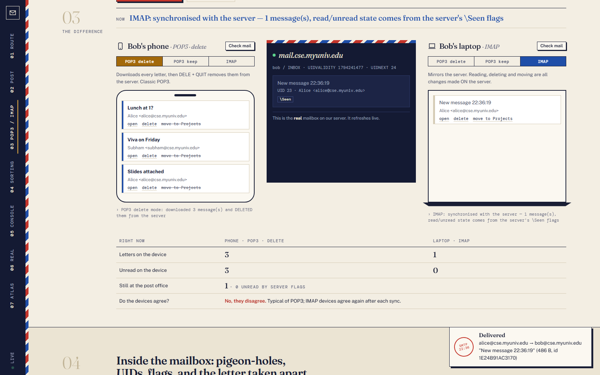
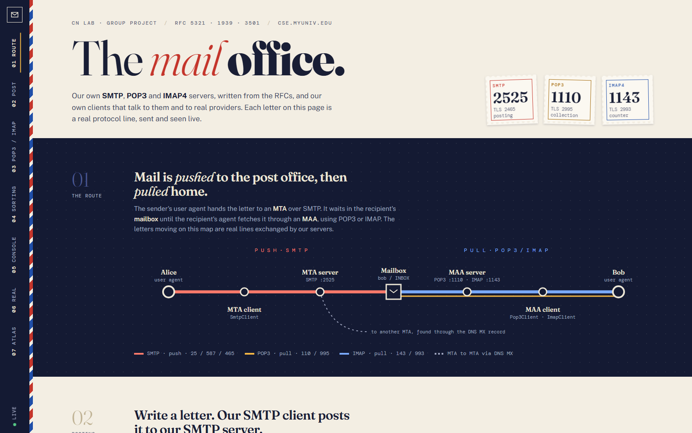
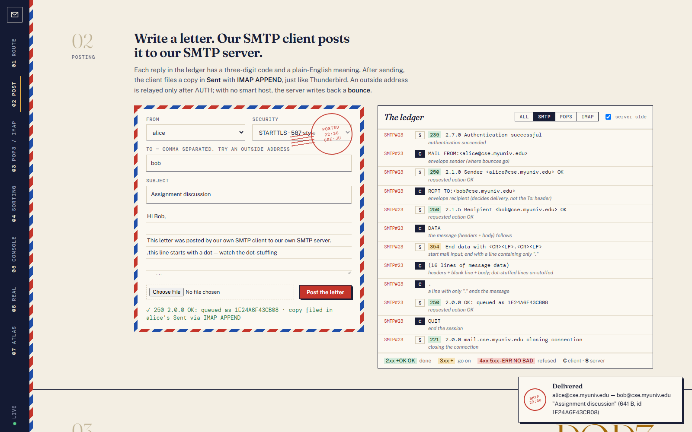
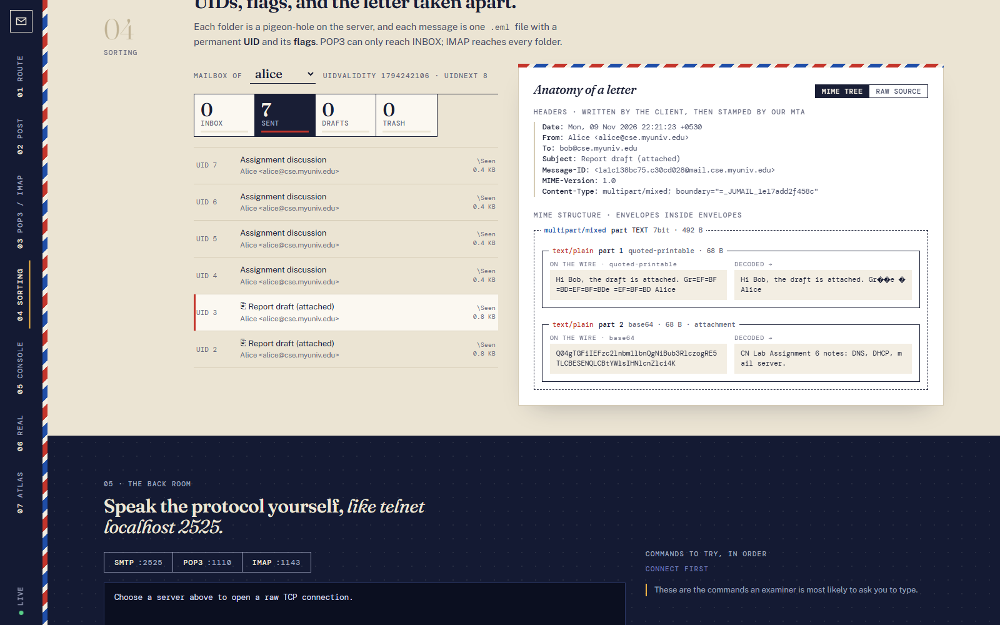
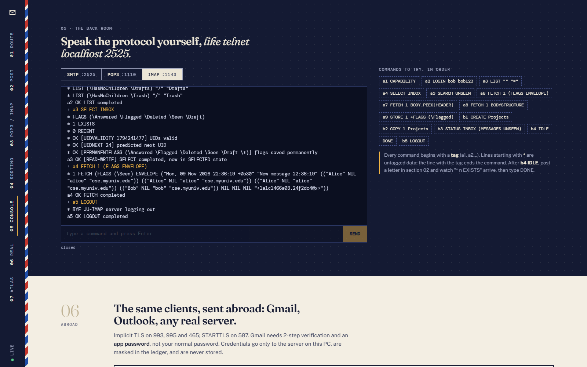
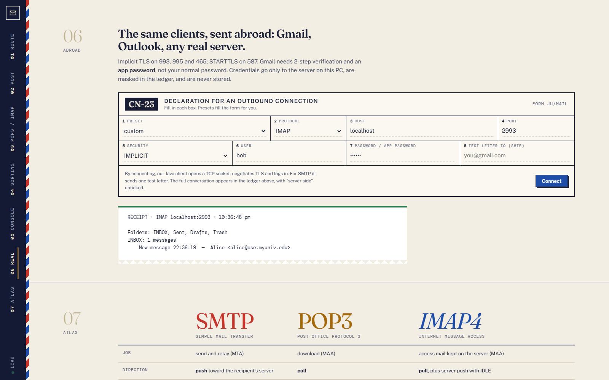
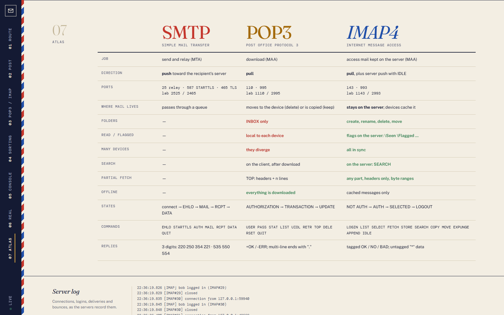

# JU Mail Lab: our own SMTP, POP3 and IMAP4 servers and clients

Pure Java (JDK 11+, no libraries). This module contains:

- **Servers** that follow the RFCs: SMTP (RFC 5321), POP3 (RFC 1939) and IMAP4rev1 (RFC 3501), with STARTTLS/STLS and implicit-TLS ports.
- **Clients** for all three protocols. They talk to our servers **and to real providers** such as Gmail and Outlook.
- A **live dashboard** that shows every protocol line, a visual **POP3 vs IMAP** comparison, a MIME viewer and a raw console.



## Run

```
cd Mail
run.bat                 :: compiles, starts all servers, dashboard at http://localhost:8083
run.bat --verify        :: 39 automated end-to-end checks (stop the running servers first)
python interop_test.py  :: with servers running: Python's smtplib/poplib/imaplib vs our servers (20 checks)
```

| Protocol | Plain (+STARTTLS) | Implicit TLS | Real-world ports |
|---|---|---|---|
| SMTP | 2525 | 2465 | 25 / 587 / 465 |
| POP3 | 1110 | 2995 | 110 / 995 |
| IMAP | 1143 | 2993 | 143 / 993 |

- **Users:** `alice/alice123`, `bob/bob123`, `subham/ju2026`, all at `cse.myuniv.edu`.
- **TLS:** a self-signed certificate is created automatically in `data/mail-tls.p12` using `keytool`.
- **Mailbox storage:** each message is saved as a separate `.eml` file in `data/mail/<user>/<folder>/`.

You can also use **Thunderbird** with IMAP `localhost:1143` and SMTP `localhost:2525` (user `bob`), or try it by hand with `telnet localhost 2525`.

## What is implemented

**SMTP server**
- EHLO extensions: SIZE, 8BITMIME, PIPELINING, STARTTLS, AUTH PLAIN/LOGIN.
- MAIL, RCPT and DATA, with dot-stuffing.
- Adds Return-Path and Received headers.
- Rejects unknown users with 550.
- Is **not an open relay**: an outside recipient without AUTH gets 554.
- With no smart host configured, sends a bounce (DSN). An optional smart host relays outside mail through a real provider (`data/smarthost.properties`).

**POP3 server**
- States: AUTHORIZATION → TRANSACTION → UPDATE.
- Commands: USER/PASS, STAT, LIST, UIDL, RETR, TOP, DELE (marks only), RSET, CAPA, STLS.
- Locks the maildrop and byte-stuffs output.

**IMAP4rev1 server**
- Tags, literals and sequence/UID sets.
- LIST, SELECT/EXAMINE and STATUS.
- FETCH (FLAGS, ENVELOPE, BODYSTRUCTURE, BODY[section]<partial>, PEEK) and STORE.
- SEARCH, COPY/MOVE (UIDPLUS), APPEND, EXPUNGE, CREATE/DELETE/RENAME.
- **IDLE push**, plus live sync of other sessions' changes (EXISTS, EXPUNGE, FETCH FLAGS).

**Clients** (`src/mail/client`)
- `SmtpClient`, `Pop3Client` and `ImapClient`.
- Support plain connections, STARTTLS and implicit TLS.
- Passwords are masked in the transcript when the client connects to a real provider.

**MIME** (`src/mail/mime`)
- multipart/mixed attachments.
- base64, quoted-printable, and RFC 2047 encoded subjects.

## Dashboard sections

1. Architecture: UA → MTA (SMTP push) → mailbox → MAA (POP3/IMAP pull), animated by real traffic.
2. Compose and send with our SMTP client, plus a live, colour-coded transcript with an explanation for each reply code.
3. **POP3 vs IMAP**: Bob's phone and laptop share one mailbox.
   - POP3 in delete mode empties the server.
   - Read state stays on each device under POP3, but is kept on the server under IMAP.
   - Folders exist only with IMAP.
   - IDLE push notifications.
4. Server mailbox with UIDs and flags, and a MIME tree that shows each part as sent on the wire and after decoding.
5. Raw console for typing SMTP, POP3 or IMAP commands yourself.
6. Our clients connecting to a **real provider**, for example Gmail with an app password.
7. Comparison table of SMTP, POP3 and IMAP4.

The dashboard is designed as "the post office": airmail stripes, port stamps, a transit-map route, pigeon-hole folders and a customs-form connection panel.

| | |
|---|---|
|  |  |
|  |  |
|  |  |
