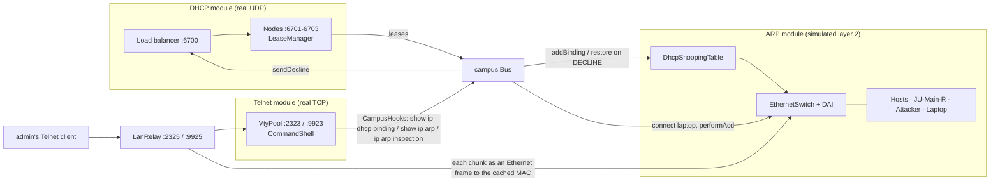
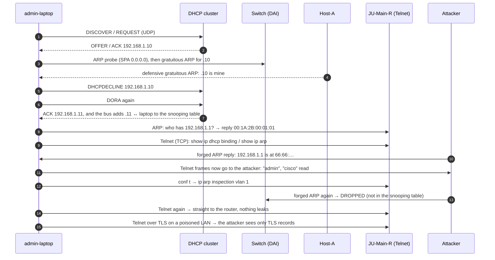

# Main Project: ARP + DHCP + Telnet as One Campus LAN
## Integration Architecture, Story & Live Demonstration Guide

---

## Table of Contents
1. [Why These Three Belong Together](#1-why-these-three-belong-together)
2. [The Campus Network](#2-the-campus-network)
3. [Integration Architecture](#3-integration-architecture)
4. [The Story, Step by Step](#4-the-story-step-by-step)
5. [How to Run & Visualize Everything](#5-how-to-run--visualize-everything)
6. [Live Demonstration Script (For Presentation / Viva)](#6-live-demonstration-script-for-presentation--viva)
7. [Viva & Technical Examination Questions](#7-viva--technical-examination-questions)

---

## 1. Why These Three Belong Together

A host on a LAN needs three things before it can be managed: an **address**, the **link-layer address of its next hop**, and a **management session**. DHCP, ARP and Telnet provide them, in that order. They also depend on each other's security:

- ARP is unauthenticated, so an attacker can redirect traffic (cache poisoning).
- The defence, **Dynamic ARP Inspection (DAI)**, needs a trusted table of who owns which IP. That table is built by **DHCP snooping**.
- The traffic worth stealing is the **Telnet** login, which is clear text. Telnet is also how the administrator switches DAI on.

## 2. The Campus Network

| Station | Switch port | IP | MAC | Role |
|:--|:-:|:--|:--|:--|
| Host-A | Fa0/1 | 192.168.1.10 (static) | AA:AA:AA:11:11:11 | causes the address conflict |
| Host-B | Fa0/2 | 192.168.1.20 (static) | BB:BB:BB:22:22:22 | |
| Host-C | Fa0/3 | 192.168.1.30 (static) | CC:CC:CC:33:33:33 | |
| JU-Main-R | Fa0/4 (trusted) | 192.168.1.1 | 00:1A:2B:00:01:01 | gateway + Telnet VTY lines |
| Kali-Attacker | Fa0/5 | 192.168.1.66 | 66:66:66:66:66:66 | ARP poisoning / MITM |
| admin-laptop | Fa0/6 | from DHCP (.10 declined → .11) | 3C:52:82:AD:00:01 | the newcomer |

DHCP cluster: three nodes plus a load balancer (consistent hashing), pool 192.168.1.10–.150, gateway 192.168.1.1.

## 3. Integration Architecture



## 4. The Story, Step by Step



| Step | Module(s) | What to point at |
|:-:|:--|:--|
| 1 | DHCP | the lease .10 appears in all three nodes' table |
| 2 | ARP → DHCP | Host-A defends .10; lease .10 shows **DECLINED** |
| 3 | DHCP → ARP | lease .11; snooping table gains `.11 ↔ 3C:52:82:AD:00:01` on Fa0/6 |
| 4 | ARP | laptop's ARP cache: 192.168.1.1 → 00:1A:2B:00:01:01; MAC table learns port 6 |
| 5 | Telnet ↔ DHCP / ARP | the Telnet transcript shows the live bindings and ARP table |
| 6 | ARP | the cache entry turns red: gateway → 66:66:… |
| 7 | ARP → Telnet | the attacker's notebook: `admin`, `cisco` |
| 8 | Telnet → ARP | DAI ON, forged ARPs dropped, the cache is correct again |
| 9 | all | the notebook stays unchanged |
| 10 | Telnet (TLS) | the notebook shows only "TLS record, N bytes (encrypted)" |

## 5. How to Run & Visualize Everything

```powershell
cd MainProject
.\run.bat             # story http://localhost:8089 · DHCP :8080 · Telnet :8081 · ARP :8082
.\run.bat --verify    # 18 end-to-end checks
telnet 127.0.0.1 2325 # by hand, across the simulated LAN (admin / cisco)
```

## 6. Live Demonstration Script (For Presentation / Viva)

1. Run `run.bat` and open http://localhost:8089. Optionally open the three module dashboards in other tabs.
2. Press **Forward ▶** through steps 1–3. Show the DECLINED lease, then the binding that appears in the snooping table.
3. Steps 4–5: open the Telnet transcript. `show ip dhcp binding` on the router reads the DHCP cluster; `show ip arp` reads the ARP lab.
4. Steps 6–7: the red poisoned path in the closet, then the password in the attacker's notebook.
5. Step 8: DAI ON, with the drop count rising. Explain that the switch drops the forged ARP because DHCP never leased 192.168.1.1 to 66:66:….
6. Steps 9–10: nothing leaks, and TLS hides everything even on a poisoned LAN.
7. Optional, by hand: `telnet 127.0.0.1 2325`, log in, `conf t`, `no ip arp inspection vlan 1`, and watch the ARP dashboard.

## 7. Viva & Technical Examination Questions

**Q1: Why did you integrate these three protocols, and in this order?**
*Answer:* A host must first get an IP address (DHCP), then resolve its next hop's MAC (ARP), then the router is managed over the network (Telnet). The security chain runs the same way: DHCP snooping builds the IP ↔ MAC table that ARP inspection checks, and that protects the Telnet login.

**Q2: How does DAI decide that an ARP reply is forged?**
*Answer:* On an untrusted port, the sender IP and sender MAC in the ARP packet must match a DHCP-snooping binding. The attacker claims "192.168.1.1 is at 66:66:66:66:66:66", but the binding for .1 says 00:1A:2B:00:01:01, so the packet is dropped. The router's uplink port is trusted, so its own ARP is not checked.

**Q3: Where do the snooping bindings come from in your project?**
*Answer:* From the DHCP module's lease managers. Every ACTIVE lease is added (`DhcpSnoopingTable.addBinding`). When a lease is declined, its binding is removed and the one it replaced is restored. On a real switch, DHCP snooping builds this table by watching the DHCPACKs that pass through.

**Q4: What is DHCPDECLINE, and how did ARP trigger it?**
*Answer:* After a DHCPACK, the client checks with ARP that nobody else uses the address (RFC 2131 §3.1, RFC 5227). Host-A, which owns .10 statically, defends it with a gratuitous ARP. The laptop sees the conflict and sends DHCPDECLINE. The server marks .10 unusable and the next DORA gives .11.

**Q5: The ARP lab is a simulation and Telnet is a real TCP connection. How can ARP poisoning affect the Telnet session?**
*Answer:* The session goes through `LanRelay`. The real bytes go over TCP to the router, and every chunk is also sent as an Ethernet frame on the simulated switch, addressed to the MAC in the sender's ARP cache. When the cache is poisoned, that frame is delivered to the attacker's node, which logs it. So the ARP state decides who sees the Telnet traffic; we state this honestly in the viva.

**Q6: Why is the password visible in step 7 but not in step 10?**
*Answer:* Plain Telnet sends every keystroke as an unencrypted byte. Telnet over TLS wraps the same session in TLS records, so the attacker sees only ciphertext (and its length), even though it still receives every frame.

**Q7: Which change was needed in each module?**
*Answer:*
- **DHCP:** none.
- **ARP:** one compile fix in `Hub.java`, where a `final` field was assigned in both a `try` and its `catch`.
- **Telnet:** a `CampusHooks` interface and six new router commands.

All the joining code lives in `MainProject/src/campus` and uses only public APIs. Each module still runs on its own.

**Q8: What would a real network add?**
*Answer:* Port security and DHCP snooping's rate limiting (which the ARP and DHCP modules also demonstrate separately), SSH instead of Telnet, and a management VLAN for router access.
