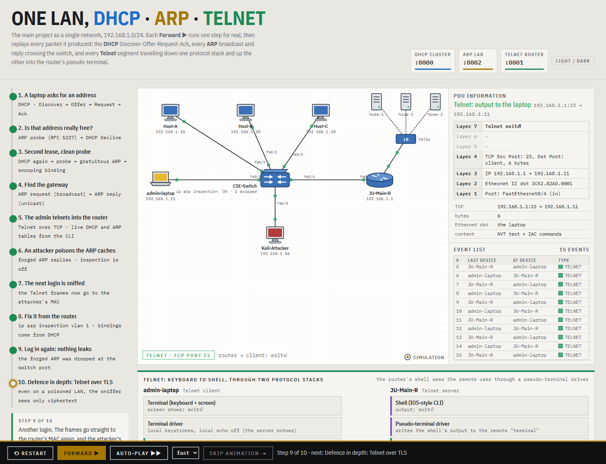
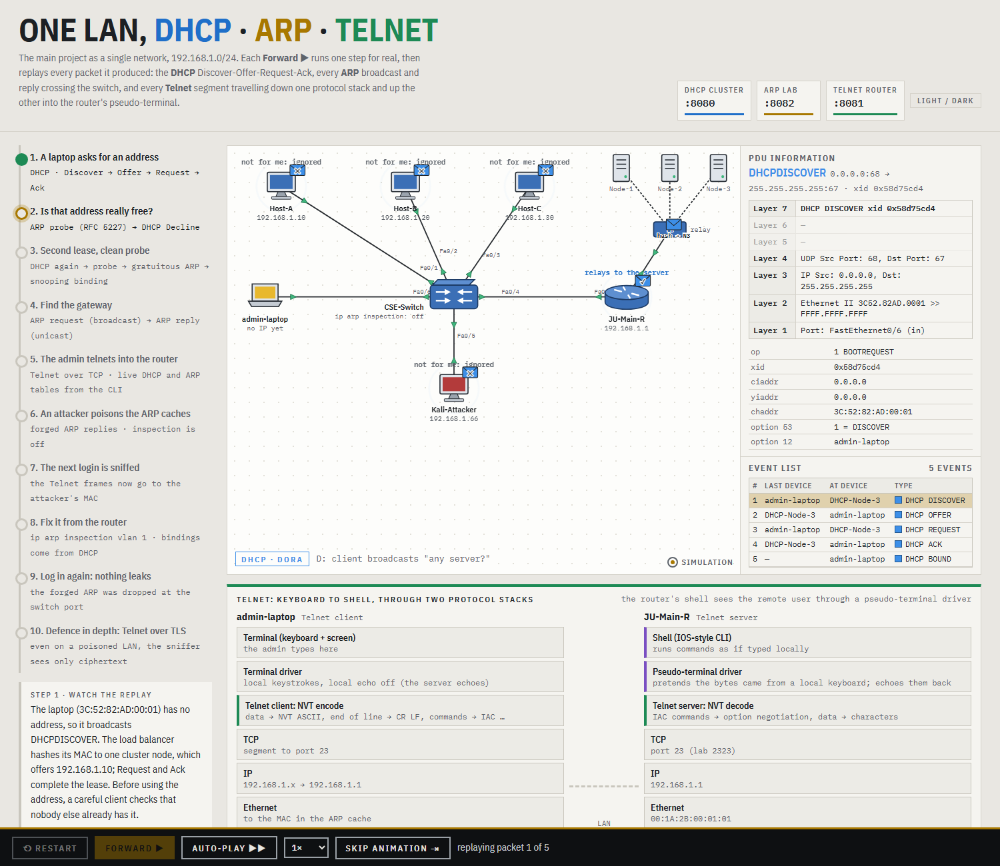
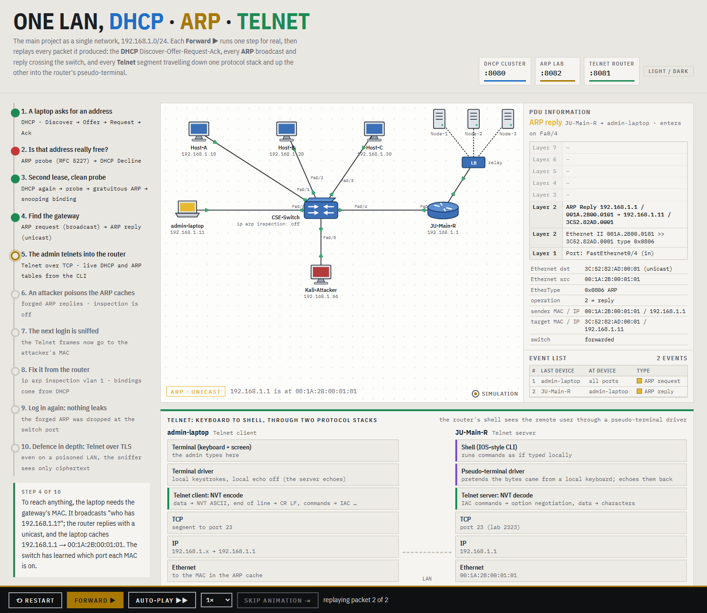
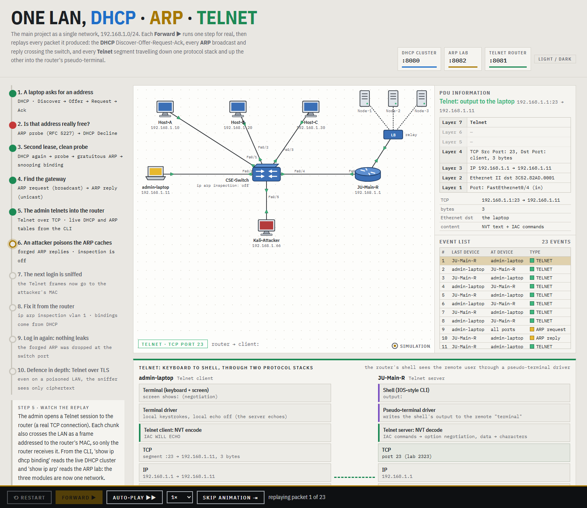
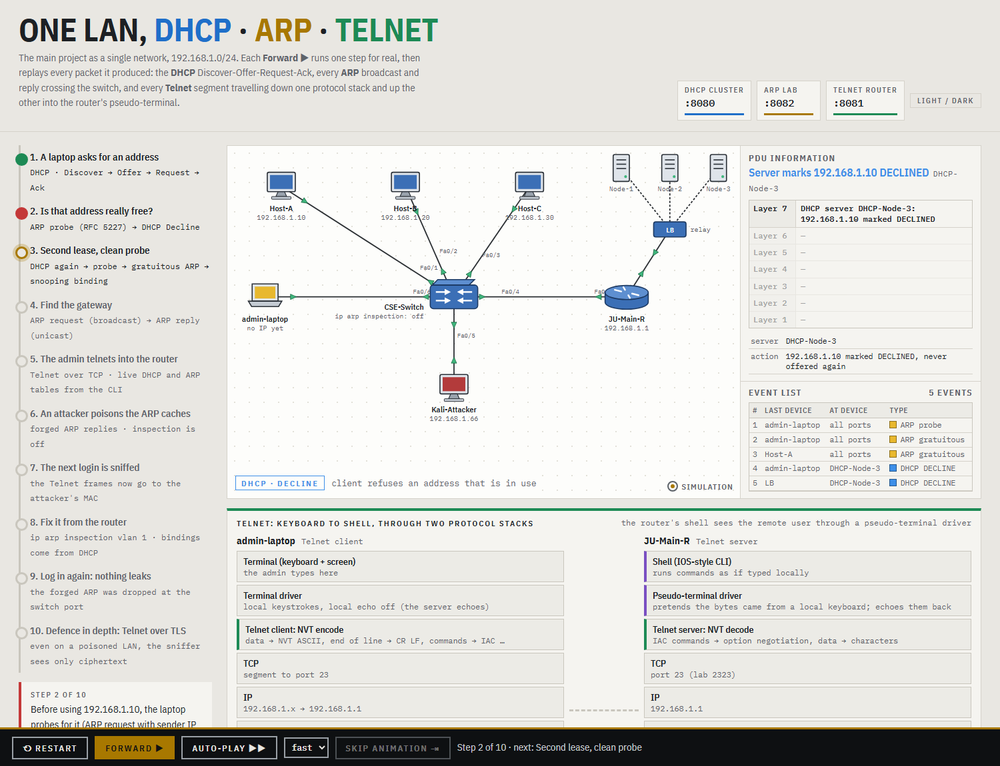
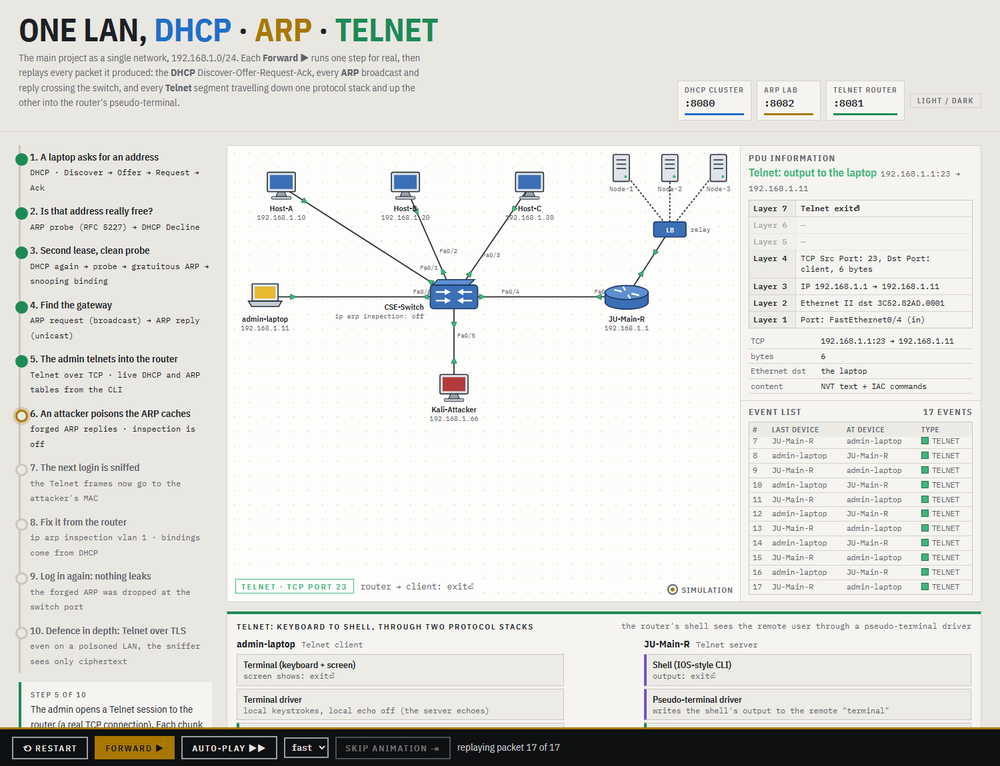
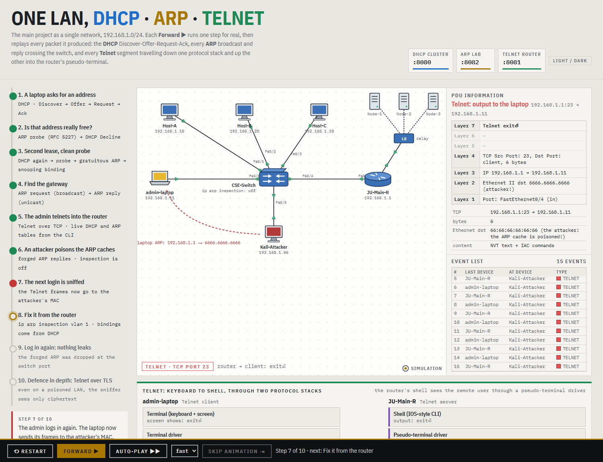
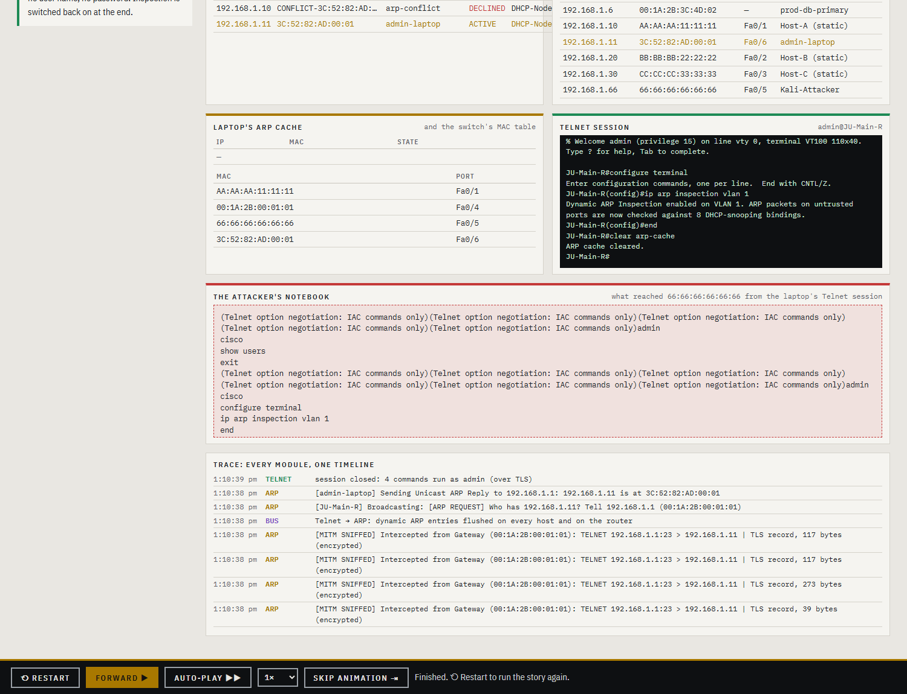

# Main Project: ARP + DHCP + Telnet as One Campus LAN

The three main-project modules are built separately. **ARP** and **DHCP** are by teammates; **Telnet** is mine. This folder runs them together as **one network**, 192.168.1.0/24, and tells one story in which each protocol needs the others:

1. A laptop gets an address from the **DHCP** cluster (real UDP: Discover, Offer, Request, Ack).
2. **ARP** checks the address is free. Host-A already uses .10 and defends it, so the laptop sends **DHCPDECLINE** and gets .11.
3. The lease goes into the switch's **DHCP-snooping table** (DHCP → ARP).
4. The laptop ARPs for the gateway, and the admin **Telnets** into router JU-Main-R. The router CLI shows live DHCP and ARP tables.
5. An attacker **poisons ARP**. The next Telnet login travels to the attacker's MAC, which reads `admin` / `cisco` in clear text.
6. From the same Telnet session the admin types `ip arp inspection vlan 1`. **Dynamic ARP Inspection** checks every ARP against the bindings DHCP created, and the forged replies are dropped.
7. Defence in depth: with inspection off and the LAN poisoned again, **Telnet over TLS** leaks only encrypted records.



## Run

```
cd MainProject
run.bat               :: compiles ARP + DHCP + Telnet + the campus package, story at http://localhost:8089
run.bat --verify      :: 18 end-to-end checks
```

Stop the separate ARP, DHCP and Telnet labs first, because they use the same ports. Each module still runs on its own from its own folder.

| What | Where |
|---|---|
| Campus story (one step per **Forward ▶**) | http://localhost:8089 |
| DHCP cluster dashboard | http://localhost:8080 (load balancer UDP 6700, nodes 6701–6703) |
| Telnet router dashboard | http://localhost:8081 (Telnet 2323, TLS 9923, wire taps 2324 / 9924) |
| ARP lab dashboard (the same switch, hosts and attacker) | http://localhost:8082 |
| Telnet by hand, **across the simulated LAN** | `telnet 127.0.0.1 2325` (admin / cisco), then `show ip dhcp binding`, `show ip arp`, `show mac address-table`, `conf t` → `ip arp inspection vlan 1` |

## How the modules are joined

All three are compiled from their own folders (`run.bat` uses `-sourcepath ..\ARP\src;..\DHCP\src;..\Telnet\src;src`). The joins are in `src/campus` and use only the modules' public APIs. Two changes were made outside this folder:
- Telnet gained the `CampusHooks` interface and router commands.
- `ARP/src/arp/core/Hub.java` got a compile fix.

| Link | How |
|---|---|
| DHCP → ARP | the bus reads every node's `LeaseManager`. Each ACTIVE lease becomes a `DhcpSnoopingTable` binding; a DECLINED one removes it and restores the binding it replaced. |
| DHCP → ARP | a client that finishes DORA is plugged into `EthernetSwitch` port 6 as a new `HostNode` |
| ARP → DHCP | when the address's owner defends it (RFC 5227 §2.4), the laptop gives it up and sends a real DHCPDECLINE (`DhcpClientSimulator.sendDecline`) |
| Telnet → ARP | `LanRelay` (2325 → 2323, 9925 → 9923) passes the real TCP session through, and sends every chunk as an Ethernet frame across the ARP lab's switch, addressed to whatever MAC the sender's ARP cache holds. ARP poisoning therefore really decides who receives it, and the attacker's `onReceiveFrame` logs it. |
| Telnet → DHCP / ARP | `telnet.server.CampusHooks`: `show ip dhcp binding`, `show ip arp`, `show mac address-table`, `show ip arp inspection`, `clear arp-cache`, `[no] ip arp inspection vlan 1` |

## Packet Tracer–style simulation view

Each **Forward ▶** runs one step for real, then **replays every packet it produced** on the topology, the way Packet Tracer's simulation mode does:
- **DHCP DORA:** the DISCOVER and REQUEST are layer-2 broadcasts. The envelope fans out to every port: PCs drop it (✕) and the router relays it to the load balancer, which hashes the MAC to one cluster node. The OFFER and ACK come back to the laptop.
- **ARP:** a request floods all ports, with ✓ at the owner and ✕ elsewhere; the reply is unicast back. Probes, gratuitous ARPs, forged replies, and drops by inspection at the switch are all shown.
- **Telnet:** each TCP segment travels down the client's stack (terminal → terminal driver → Telnet client/NVT → TCP → IP → Ethernet) and up the router's (Ethernet → IP → TCP → Telnet server → **pseudo-terminal driver** → shell). The real NVT bytes are shown (e.g. `IAC DO ECHO` = `FF FD 01`). When the cache is poisoned, the frames detour through the attacker.
- **PDU information:** the OSI layers (L7 to L1) of the packet on screen, with its fields.
- **Event list:** every packet of the step: last device, at device, type.

These records come from the modules themselves: DHCP's send and receive log lines, the ARP lab's frame capture at the switch, and the bytes on the Telnet relay.

| | |
|---|---|
|  |  |
|  |  |

## The step-by-step story

Each step performs real actions, and the page shows their effect on:
- the wiring closet (switch ports, cables, the poisoned path drawn in red);
- the DHCP leases and the snooping table;
- the laptop's ARP cache and the switch's MAC table;
- the Telnet transcript and the attacker's notebook;
- a single timeline of DHCP, ARP, Telnet and bus events.

| | |
|---|---|
|  |  |
|  |  |

See `PROJECT_GUIDE_AND_VISUALIZATION.md` for sequence diagrams and viva questions.
