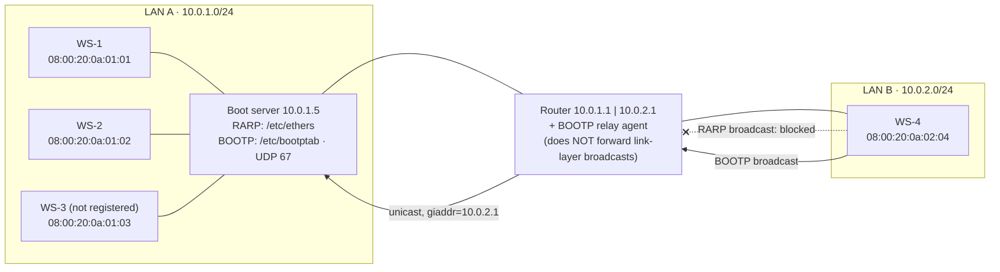
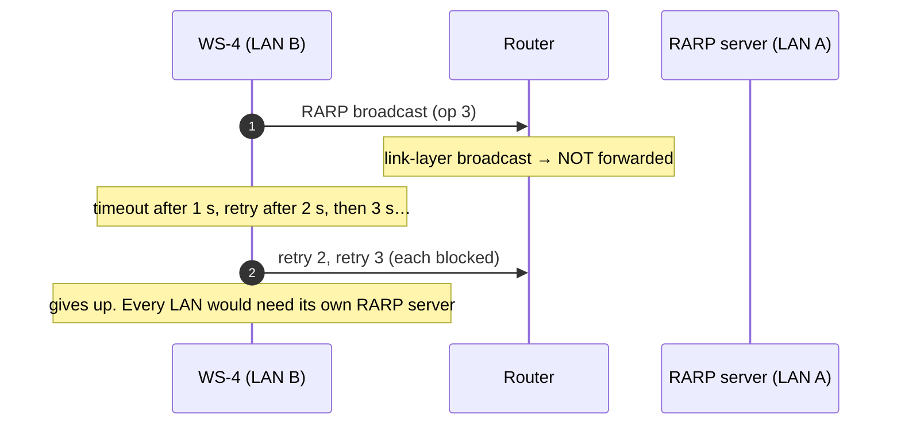
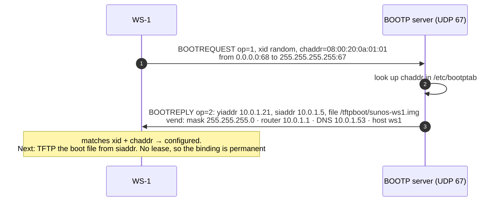
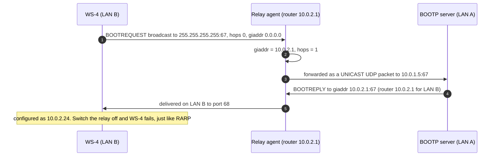
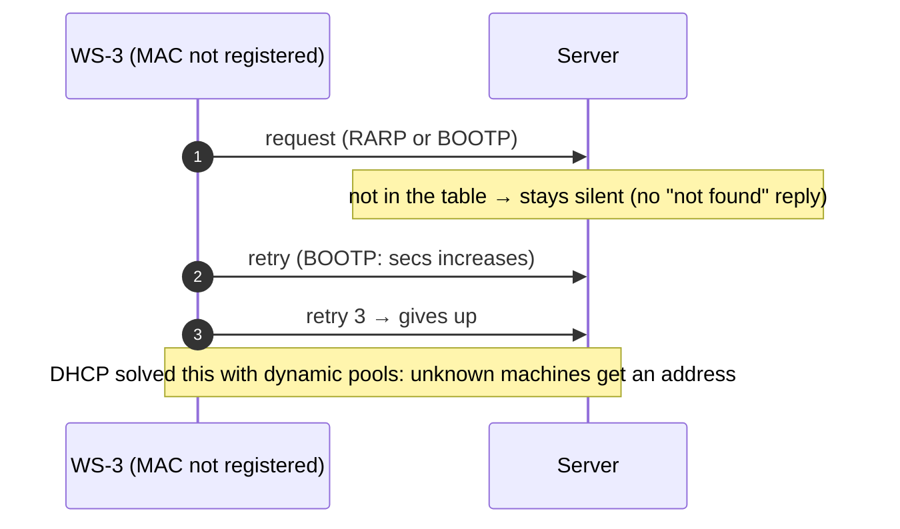

# RARP & BOOTP: Bootstrapping Before DHCP
## Complete Protocol Reference, Architecture & Live Demonstration Guide

---

## Table of Contents
1. [Project Overview & What We Built](#1-project-overview--what-we-built)
2. [Packet Formats](#2-packet-formats)
3. [System Architecture & Lab Network](#3-system-architecture--lab-network)
4. [Detailed Protocol Workflows & Sequence Diagrams](#4-detailed-protocol-workflows--sequence-diagrams)
   - [4.1 RARP on the Same LAN](#41-rarp-on-the-same-lan)
   - [4.2 RARP Cannot Cross a Router](#42-rarp-cannot-cross-a-router)
   - [4.3 BOOTP on the Same LAN](#43-bootp-on-the-same-lan)
   - [4.4 BOOTP Through a Relay Agent](#44-bootp-through-a-relay-agent)
   - [4.5 Unknown Machines and Retries](#45-unknown-machines-and-retries)
5. [How to Run & Visualize Everything](#5-how-to-run--visualize-everything)
6. [Step-by-Step Live Demonstration Script (For Presentation / Viva)](#6-step-by-step-live-demonstration-script-for-presentation--viva)
7. [Viva & Technical Examination Questions](#7-viva--technical-examination-questions)

---

## 1. Project Overview & What We Built

A **diskless workstation** powers on knowing only one thing: the **MAC address** burned into its network card. Before it can use IP, it must find out its IP address. Before DHCP (1993), two protocols did this:

| | **RARP** (RFC 903, 1984) | **BOOTP** (RFC 951, 1985) |
|---|---|---|
| Layer | link layer, EtherType **0x8035** | UDP, ports **67** (server) and **68** (client) |
| Packet | 28 bytes, the ARP layout with opcodes 3 / 4 | always 300 bytes |
| Gives the client | an IP address only | IP, boot server, boot file, mask, router, DNS, host name |
| Crosses routers | **no** | **yes**, via a relay agent (giaddr, hops) |

This module builds both from their RFCs in pure Java (JDK 11+, zero dependencies):

1. **RARP**:
   - real 60-byte frames (Ethernet header + 28-byte payload + padding) on a **simulated Ethernet**;
   - the Ethernet is simulated because Java sockets cannot send raw link-layer frames;
   - two LANs and a router: a broadcast reaches every station on its own LAN and stops at the router.
2. **BOOTP over real UDP**:
   - the full 300-byte message, with the vendor area: magic cookie `99.130.83.99` and RFC 1497 options;
   - a server (port 1067, standing in for 67) and clients (1068, for 68);
   - a **relay agent (RFC 1542)** on the router (2067).
3. **Static tables**: `/etc/ethers` for RARP and `/etc/bootptab` for BOOTP. Unknown MACs get silence.
4. **Dashboard** (`http://localhost:8085`), drawn as a 1984 engineering blueprint:
   - the LAN drawing with moving frames;
   - every frame and packet shown byte by byte;
   - a lineage sheet: RARP → BOOTP → DHCP;
   - **step mode: nothing moves until you press Forward ▶**; Auto-play is optional.
5. **Verification**:
   - 19 automated checks (`run.bat --verify`);
   - 7 interop checks with a BOOTP client written independently in Python.

---

## 2. Packet Formats

### 2.1 RARP Frame (60 bytes on the wire, plus 4-byte FCS)

```
+-------------------+-------------------+----------------+
| Dest MAC (6)      | Src MAC (6)       | EtherType (2)  |
| ff:ff:ff:ff:ff:ff | 08:00:20:0a:01:01 | 0x8035 (RARP)  |   ARP is 0x0806
+-------------------+-------------------+----------------+
| HTYPE 1 (2) | PTYPE 0x0800 (2) | HLEN 6 | PLEN 4 | OPER (2) |   OPER 3 = request, 4 = reply
| Sender MAC (6)  | Sender IP (4)  | Target MAC (6) | Target IP (4) |
+-----------------------------------------------------------+
| Padding (18 zero bytes): Ethernet minimum payload is 46 bytes |
+-----------------------------------------------------------+
Request: SHA = THA = my MAC, SPA = TPA = 0.0.0.0     ("my MAC is …, what is my IP?")
Reply:   THA = requester's MAC, TPA = its IP          (unicast back to the requester)
```

### 2.2 BOOTP Message (always 300 bytes)

```
 0       1       2       3
+-------+-------+-------+-------+
|  op   | htype | hlen  | hops  |   op: 1 BOOTREQUEST, 2 BOOTREPLY · hops: +1 per relay
+-------+-------+-------+-------+
|              xid              |   random transaction ID
+---------------+---------------+
|     secs      |    flags      |
+---------------+---------------+
|   ciaddr (client IP, if known)|
|   yiaddr ("your" IP)          |   ← the answer
|   siaddr (boot server IP)     |   ← where to TFTP the boot file from
|   giaddr (relay agent IP)     |   ← set by the relay: the client's LAN + where to reply
+-------------------------------+
|   chaddr (16): client MAC     |
|   sname (64): server name     |
|   file (128): boot file name  |   ← e.g. /tftpboot/sunos-ws1.img
|   vend (64): 99.130.83.99 + options (1 mask, 3 router, 6 DNS, 12 host name, 255 end)
+-------------------------------+
```

DHCP (RFC 2131) reuses exactly this layout: the vendor area became the options field. That is why DHCP servers still answer BOOTP clients.

---

## 3. System Architecture & Lab Network



---

## 4. Detailed Protocol Workflows & Sequence Diagrams

### 4.1 RARP on the Same LAN

```mermaid
sequenceDiagram
    autonumber
    participant W as WS-1 (diskless)
    participant L as LAN A (all stations)
    participant S as RARP server
    Note over W: powers on: knows only its MAC 08:00:20:0a:01:01
    W->>L: Ethernet broadcast ff:ff:ff:ff:ff:ff, EtherType 0x8035<br/>RARP request (op 3): "my MAC is …, what is my IP?"
    Note over L: every station on LAN A receives it; only the server answers
    S->>S: look up the MAC in /etc/ethers → 10.0.1.21
    S->>W: unicast RARP reply (op 4): TPA = 10.0.1.21
    Note over W: now has an IP. It still needs a mask, a router and a boot image from elsewhere
```

### 4.2 RARP Cannot Cross a Router



### 4.3 BOOTP on the Same LAN



### 4.4 BOOTP Through a Relay Agent



### 4.5 Unknown Machines and Retries



---

## 5. How to Run & Visualize Everything

```powershell
cd RARP-BOOTP
.\run.bat                 # dashboard at http://localhost:8085
.\run.bat --verify        # 19 automated checks (stop the running lab first)
python interop_test.py    # a Python BOOTP client vs our server and relay (7 checks)
```

**Player bar (bottom of the page):**
- **Forward ▶** (or →, space, Enter): advance exactly one step;
- **Auto-play ▶▶**: off by default;
- **Speed**: 0.5× to 2×;
- **⟲ Restart**: start the story again.

Nothing moves until you click Forward.

| Sheet | What it shows |
|:--|:--|
| 01 RARP | the LAN drawing; click a workstation to boot it. Broadcasts light up every station on its LAN; a red ✕ shows the router blocking them; the unicast reply moves to the requester. Every frame is shown byte by byte; /etc/ethers can be edited |
| 02 BOOTP | the same LAN over UDP; a toggle for the relay agent; the configuration card (IP, mask, router, DNS, host, boot server, boot file); every 300-byte packet byte by byte; /etc/bootptab |
| 03 Lineage | the timeline ARP 1982 → RARP 1984 → BOOTP 1985 → DHCP 1993; the RARP / BOOTP / DHCP comparison table |
| 04 Wire log | every frame and packet the lab has handled |

---

## 6. Step-by-Step Live Demonstration Script (For Presentation / Viva)

1. **Launch**: run `run.bat`, open `http://localhost:8085`, and press **Forward ▶**. The story starts and each click is one step.
2. **RARP on the same LAN**: WS-1 broadcasts. Every station on LAN A lights up, the server replies with a unicast, and WS-1 shows `10.0.1.21`. Click the reply row: TPA = 10.0.1.21, EtherType 0x8035, opcode 4.
3. **RARP across the router**: WS-4 broadcasts, and the router shows a red ✕ ("broadcast not forwarded"). Three retries follow, then failure, even though the server knows WS-4's MAC.
4. **BOOTP on the same LAN**: WS-1 receives the full configuration. Open the reply packet: yiaddr, siaddr, the `file` field, the magic cookie and the options.
5. **BOOTP through the relay**: WS-4 now succeeds. Open the RELAY → SERVER packet: **giaddr = 10.0.2.1, hops = 1**.
6. **Relay off**: untick "router runs a BOOTP relay agent" and boot WS-4 again. It fails, just like RARP.
7. **Unknown MAC**: boot WS-3 with either protocol. The server stays silent; then click **register** in the table and boot it again.
8. **Lineage**: point at the comparison table, then explain what DHCP added (pools and leases).

---

## 7. Viva & Technical Examination Questions

**Q1: ARP vs RARP?**
*Answer:*
- **ARP** maps a known IP to an unknown MAC ("who has 10.0.1.5?").
- **RARP** maps a known MAC to an unknown IP ("what is MY IP?").

They share the same 28-byte packet layout. ARP uses EtherType 0x0806 with opcodes 1/2; RARP uses EtherType 0x8035 with opcodes 3/4.

**Q2: Why can't RARP cross a router?**
*Answer:* It is a link-layer protocol: the request is an Ethernet broadcast with no IP header. Routers forward IP packets, not link-layer broadcasts, so the request never leaves the LAN. Every LAN therefore needed its own RARP server.

**Q3: Why was RARP hard to implement on a server?**
*Answer:* The server must send and receive raw Ethernet frames with a special EtherType, which needs privileged, OS-specific link-layer access. BOOTP uses ordinary UDP sockets, which every OS provides. (That is also why our RARP runs on a simulated Ethernet: Java sockets cannot send raw frames.)

**Q4: What does BOOTP give that RARP doesn't?**
*Answer:* Much more than an IP:
- the boot server address (siaddr) and a boot file name, to download with TFTP;
- in the vendor area, a subnet mask, router, DNS server and host name.

It also runs over UDP, so it can be relayed across routers.

**Q5: How does a client with no IP address send a UDP packet, and receive the reply?**
*Answer:* It sends from source IP 0.0.0.0, port 68, to the limited broadcast 255.255.255.255, port 67. The server cannot unicast to an address the client doesn't have yet. So it either broadcasts the reply to port 68 (the RFC 1542 broadcast flag) or unicasts using the MAC from `chaddr`. The client matches the reply by **xid** and **chaddr**.

**Q6: Why are there two well-known ports, 67 and 68, instead of one?**
*Answer:* Replies are often broadcast. If clients used ephemeral ports, a broadcast reply would wake up every application on every host. A fixed client port (68) means only BOOTP/DHCP clients listen for these broadcasts.

**Q7: What does a relay agent do? Explain giaddr and hops.**
*Answer:* A relay agent, usually the router, catches the client's broadcast on its LAN. It writes its own LAN-side address into **giaddr**, increments **hops**, and forwards the request as a unicast to the server. giaddr tells the server which subnet the client is on, so it chooses the right address and router option, and where to send the reply. hops limits loops. Cisco's `ip helper-address` (used in Assignment 6, Q6b) is exactly this.

**Q8: What is the magic cookie?**
*Answer:* The 4 bytes `99.130.83.99` at the start of the vendor area. They say the area contains RFC 1497 options (code, length, value…, ending with 255). DHCP keeps the same cookie.

**Q9: Why is a BOOTP message always 300 bytes?**
*Answer:* The format is fixed-size: 236 bytes of fields plus a 64-byte vendor area. DHCP lets the options field grow, but the minimum is still compatible.

**Q10: What did DHCP add over BOOTP?**
*Answer:*
- **Dynamic allocation from a pool**: unknown machines get an address; BOOTP stays silent for them.
- **Leases with renewal**: BOOTP bindings are permanent.
- More options.
- A message type (option 53), giving the DISCOVER / OFFER / REQUEST / ACK exchange.

**Q11: What happens after BOOTP configures a diskless machine?**
*Answer:* It downloads the boot image named in `file` from the server in `siaddr`, using **TFTP** (a simple UDP file transfer), then boots that operating system. Modern PXE network boot works the same way, with DHCP + TFTP.

**Q12: In your lab the packets carry 10.0.x.x addresses but travel on 127.0.0.1. Is that cheating?**
*Answer:* No. The 300-byte BOOTP messages are real and sent over real UDP sockets, and a Python client written separately decodes them correctly. Only the delivery is simplified: the client's broadcast is handed directly to the server or relay port on loopback. The addresses inside the packets describe the lab's virtual network.
