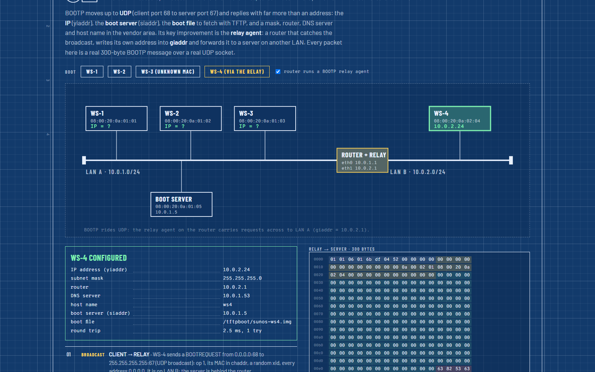
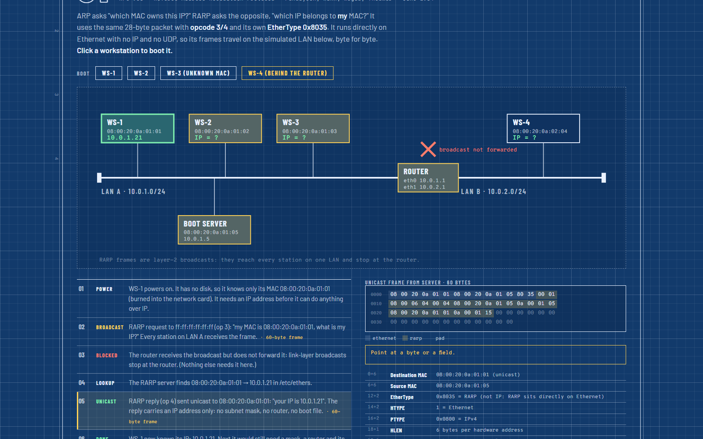
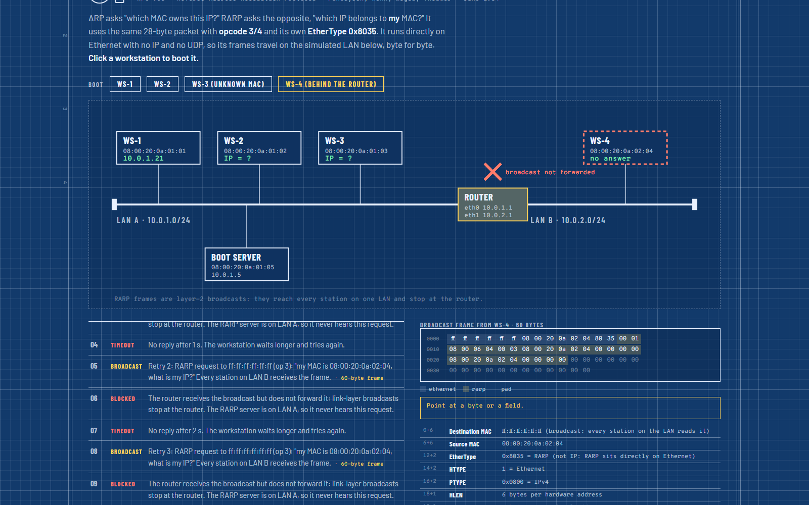
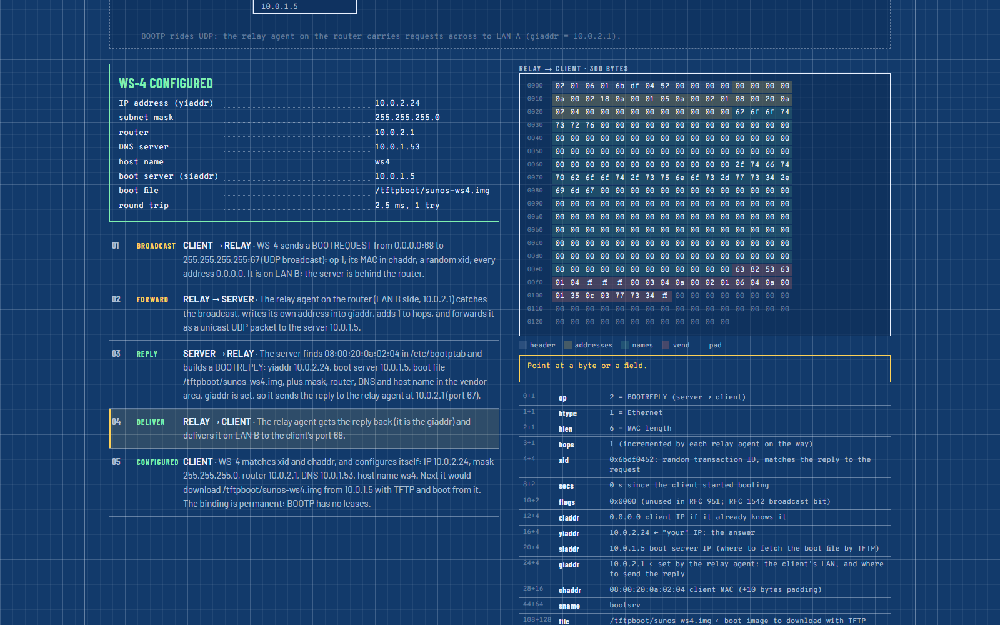
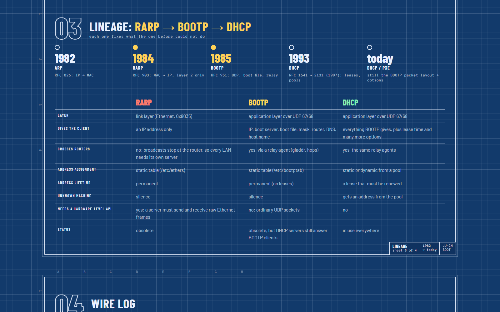

# JU Bootstrap Lab: RARP and BOOTP

A diskless workstation powers on knowing only its MAC address. Before DHCP, two protocols answered "what is my IP address?":

| | RARP (RFC 903, 1984) | BOOTP (RFC 951, 1985) |
|---|---|---|
| Layer | link layer, EtherType **0x8035** | UDP, ports **67** (server) / **68** (client) |
| Packet | 28 bytes, ARP layout with opcodes 3 / 4 | always 300 bytes |
| Gives the client | an IP address only | IP, boot server, boot file, mask, router, DNS, host name |
| Crosses routers | no | yes, via a **relay agent** (giaddr, hops) |

Both are obsolete. This module builds both from their RFCs in pure Java (JDK 11+, no libraries), with a dashboard you can play like a video.



## Run

```
cd RARP-BOOTP
run.bat                 :: compiles, starts the lab, dashboard at http://localhost:8085
run.bat --verify        :: 19 automated checks (stop the running lab first)
python interop_test.py  :: with the lab running: a BOOTP client written in Python vs our server (7 checks)
```

## The step-by-step simulation

Open `http://localhost:8085`. The player bar at the bottom controls everything, and nothing moves until you click.

- **Forward ▶** (or →, space, Enter) advances exactly **one step**: one frame or packet, with its animation and a caption that explains it. From the start it opens the story; pressing it again goes to the next step. The button pulses when it is waiting for you.
- **Auto-play ▶▶** (off by default) plays the remaining steps by themselves. Click it again to go back to stepping.
- **Speed** (0.5×–2×) sets how fast the packets move.
- **⟲ Restart** starts the story again from the beginning.

The same applies when you boot a workstation from its own button: each frame waits for **Forward**.

The story has six scenes:

1. RARP: WS-1 broadcasts "what is my IP?" and the server replies.
2. RARP: WS-4 on the other LAN gets no answer, because the router does not forward the broadcast.
3. BOOTP: WS-1 boots over UDP and receives its IP, boot file and options.
4. BOOTP: WS-4 succeeds through the relay agent on the router.
5. BOOTP: with the relay agent switched off, WS-4 fails again.
6. Lineage: how RARP led to BOOTP and then to DHCP.

**Video backup:** `docs/video/rarp_bootp_simulation.mp4` is a recording of the whole story, auto-played. It plays without the lab running.

## How it works

**RARP** (`src/boot/rarp`)
- RARP sits directly on Ethernet, so Java sockets cannot send it.
- The frames are therefore real RARP frames, byte for byte: 60 bytes with padding, EtherType 0x8035, opcode 3 (request) and 4 (reply).
- They travel on a **simulated Ethernet** with two LANs and a router:
  - a broadcast reaches every station on its own LAN;
  - the router never forwards it.
- The RARP server answers only MACs listed in `/etc/ethers`. For any other MAC it stays silent, and the client retries three times.

**BOOTP** (`src/boot/bootp`)
- **Real UDP.** The server listens on 127.0.0.1:1067 (port 67 in real life), the relay agent on 2067, and the client uses 1068 (port 68).
- **The 300-byte message.** It carries op, xid, ciaddr, yiaddr, siaddr, giaddr, chaddr, sname and file. The vendor area holds the magic cookie 99.130.83.99 and RFC 1497 options: subnet mask, router, DNS server and host name.
- **The relay agent** (RFC 1542). It runs on the router, catches broadcasts from LAN B, writes its address into giaddr, adds 1 to hops and forwards them to the server. The server sends the reply back to giaddr.
- **The table is static.** The server answers only MACs in `/etc/bootptab`, and the address it gives is permanent: BOOTP has no leases.
- **Addresses in the packets.** The 10.0.x.x addresses inside the packets are the lab's virtual network. On loopback, the client's broadcast to 255.255.255.255 is delivered straight to the server (on LAN A) or to the relay agent (on LAN B).

## Lab network

| Station | MAC | LAN | IP |
|---|---|---|---|
| WS-1 | 08:00:20:0a:01:01 | A | 10.0.1.21 (from the server) |
| WS-2 | 08:00:20:0a:01:02 | A | 10.0.1.22 (from the server) |
| WS-3 | 08:00:20:0a:01:03 | A | not registered: no reply |
| Boot server | 08:00:20:0a:01:05 | A | 10.0.1.5 |
| Router (+ relay agent) | 00:00:0c:01:00:01 / :02 | A / B | 10.0.1.1 / 10.0.2.1 |
| WS-4 | 08:00:20:0a:02:04 | B | 10.0.2.24 (through the relay; RARP fails) |

| | |
|---|---|
|  |  |
|  |  |
