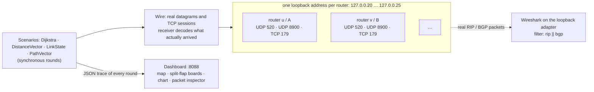
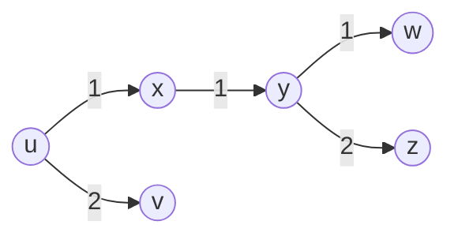
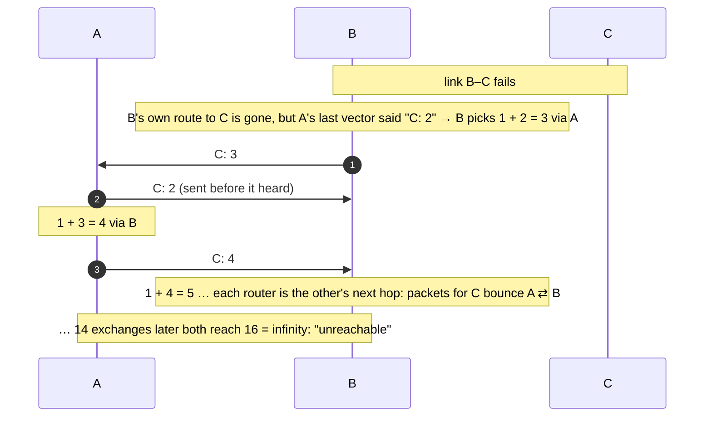

# Routing: Dijkstra, Bellman-Ford, RIP, OSPF and BGP
## Complete Protocol Reference, Architecture & Live Demonstration Guide

---

## Table of Contents
1. [Project Overview & What We Built](#1-project-overview--what-we-built)
2. [The Three Families and Their Packets](#2-the-three-families-and-their-packets)
3. [System Architecture & Lab Networks](#3-system-architecture--lab-networks)
4. [Detailed Workflows, Tables & Sequence Diagrams](#4-detailed-workflows-tables--sequence-diagrams)
   - [4.1 Dijkstra (Link State)](#41-dijkstra-link-state)
   - [4.2 Bellman-Ford (Distance Vector)](#42-bellman-ford-distance-vector)
   - [4.3 Good News Travels Fast, Bad News Travels Slowly](#43-good-news-travels-fast-bad-news-travels-slowly)
   - [4.4 Count to Infinity with Two Routers, and Split Horizon](#44-count-to-infinity-with-two-routers-and-split-horizon)
   - [4.5 Three Routers Beat Split Horizon + Poison Reverse](#45-three-routers-beat-split-horizon--poison-reverse)
   - [4.6 The Same Failure with OSPF](#46-the-same-failure-with-ospf)
   - [4.7 The Same Failure with BGP](#47-the-same-failure-with-bgp)
5. [How to Run & Visualize Everything](#5-how-to-run--visualize-everything)
6. [Step-by-Step Live Demonstration Script (For Presentation / Viva)](#6-step-by-step-live-demonstration-script-for-presentation--viva)
7. [Viva & Technical Examination Questions](#7-viva--technical-examination-questions)

---

## 1. Project Overview & What We Built

A router's job is to fill in its **forwarding table**: for every destination, which neighbour (next hop) to send to. Routing protocols build that table automatically and rebuild it when links fail.

This module puts the three families side by side on small networks, and shows round by round **why distance vector misbehaves and how link state and path vector avoid it**. Everything is pure Java 11 with no libraries:

1. **Dijkstra**, recorded as the textbook table (N', D(v), p(v)) on the Kurose & Ross six-router network. It produces the shortest-path tree and the forwarding table.
2. **Bellman-Ford distance vector** in synchronous rounds. Every router sends its vector to every neighbour as a **real RIPv2 packet over UDP port 520** and recomputes `D_x(y) = min_v { c(x,v) + D_v(y) }`. Options: infinity (16 for RIP), **split horizon**, **poison reverse**.
3. The **instability cases**:
   - good news / bad news (Kurose Fig. 5.7);
   - **2-router count to infinity** (A – B – C);
   - the **3-router loop** that beats split horizon and poison reverse.
4. **OSPF**: Router-LSAs with sequence numbers, flooded as **real OSPFv2 LS Update packets** (both checksums correct), with the two-way check and Dijkstra on the LSDB.
5. **BGP**: real **BGP-4 OPEN / UPDATE / KEEPALIVE over TCP port 179**, AS_PATHs, incremental updates, withdrawals, and **loop rejection when a router sees its own AS in the path**.
6. **Dashboard** (`http://localhost:8088`), designed as a railway signal box:
   - links are tracks, routers are signal lamps;
   - routing tables are **split-flap boards** that flip as costs change;
   - a chart plots each router's cost to the destination round by round;
   - a packet inspector decodes any message field by field.
7. **Verification**: 30 automated checks, and 15 interop checks from an independent Python decoder. **Wireshark decodes our packets as RIP and BGP**: a sample capture is in `docs/rip_bgp_loopback_capture.pcapng`.

---

## 2. The Three Families and Their Packets

| | Link state | Distance vector | Path vector |
|:--|:--|:--|:--|
| Each router knows | the whole map | neighbours' distance to each destination | the AS path each neighbour uses |
| Tells | everyone (flooding), about its own links | its neighbours, about everything | its peers, its chosen path |
| Computes | Dijkstra on the map | Bellman-Ford: min over neighbours | best path, rejecting any containing its own AS |
| Protocol | OSPF (IP proto 89), IS-IS | RIP (UDP 520) | BGP (TCP 179) |
| Metric | link cost (e.g. 10⁸ / bandwidth) | hop count, ∞ = 16 | policy, then shortest AS_PATH |
| Converges | fast; message cost O(N·E) | can count to infinity | no counting; may explore paths briefly |

### 2.1 RIPv2 response (RFC 2453)

```
command(1)=2 · version(1)=2 · zero(2)
per route (20 bytes): AFI(2)=2 · route tag(2) · IP(4) · mask(4) · next hop(4) · metric(4)   ← 1..15, 16 = unreachable
```

### 2.2 OSPFv2 LS Update with a Router-LSA (RFC 2328)

```
OSPF header (24): version 2 · type 4 · length · router ID · area 0.0.0.0 · checksum · AuType · auth(8)
#LSAs (4)
LSA header (20): LS age · options · type 1 · link state ID · advertising router · LS sequence number (0x80000001, +1 per change) · Fletcher checksum · length
Router-LSA body: flags · #links · per link: neighbour's router ID · our interface address · type 1 (point-to-point) · metric
```

### 2.3 BGP-4 UPDATE (RFC 4271)

```
marker 16 × 0xFF · length(2) · type(1)=2
withdrawn routes length(2) · withdrawn prefixes            ← "10.4.0.0/16 is no longer reachable through me"
path attribute length(2) · ORIGIN (IGP) · AS_PATH (AS_SEQUENCE [300 400]) · NEXT_HOP
NLRI: 10.4.0.0/16                                          ← "…is reachable through me, along this path"
```

---

## 3. System Architecture & Lab Networks



| Network | Routers & links | Used for |
|:--|:--|:--|
| Six routers | u–v 2, u–x 1, u–w 5, v–x 2, v–w 3, x–w 3, x–y 1, w–y 1, w–z 5, y–z 2 | Dijkstra, Bellman-Ford |
| Three routers | x–y 4, y–z 1, x–z 50 | good / bad news |
| Line | A–B 1, B–C 1 | 2-router count to infinity |
| Triangle + stub | A–B, A–C, B–C, C–D (all 1); for BGP A = AS 100 … D = AS 400 (owns 10.4.0.0/16) | 3-router loop, OSPF, BGP, scoreboard |

---

## 4. Detailed Workflows, Tables & Sequence Diagrams

### 4.1 Dijkstra (Link State)

From **u**. Each row settles the unsettled router with the smallest D, then relaxes its neighbours (ties broken alphabetically; Kurose's book settles y before v, which is equally valid):

| Step | N' | D(v),p(v) | D(w),p(w) | D(x),p(x) | D(y),p(y) | D(z),p(z) |
|:-:|:--|:-:|:-:|:-:|:-:|:-:|
| 0 | u | 2,u | 5,u | **1,u** | ∞ | ∞ |
| 1 | ux | **2,u** | 4,x | | 2,x | ∞ |
| 2 | uxv | | 4,x | | **2,x** | ∞ |
| 3 | uxvy | | **3,y** | | | 4,y |
| 4 | uxvyw | | | | | **4,y** |
| 5 | uxvywz | | | | | |

The forwarding table of u: v → v; w, x, y, z → **x**. The shortest path to z is u → x → y → z (cost 4).



### 4.2 Bellman-Ford (Distance Vector)

```mermaid
sequenceDiagram
    autonumber
    participant u
    participant x
    participant y
    Note over u,y: time 0: each router knows only its own links (D_u: v 2, w 5, x 1, others ∞)
    u->>x: RIPv2 response: u:0 v:2 w:5 x:1 y:∞ z:∞
    x->>u: x:0 u:1 v:2 w:3 y:1 z:∞
    y->>x: y:0 w:1 x:1 z:2 …
    Note over u: recompute: D_u(w) = min(5, 1 + D_x(w)=3) = 4 via x;  D_u(y) = 1 + 1 = 2 via x
    Note over u,y: exchange 2: u learns w = 3 (via x → y → w), z = 4 · exchange 3: nothing changes → converged
```

Cold start on the six routers converges in **3 exchanges** (60 RIP packets), and every final distance equals Dijkstra's.

### 4.3 Good News Travels Fast, Bad News Travels Slowly

Routers x, y, z; the link x–y changes cost. Shown below: y's and z's cost to x, and their next hop.

| Round | Good news 4 → 1 | Bad news 4 → 60 | Bad news + poison reverse |
|:-:|:--|:--|:--|
| before | y 4/x · z 5/y | y 4/x · z 5/y | y 4/x · z 5/y |
| change | y **1**/x · z 5/y | y **6/z** · z 5/y ← **loop y ⇄ z** | y **60/x** · z 5/y |
| 1 | y 1/x · z **2**/y ✔ | y 6/z · z 7/y | y 60/x · z **50/x** |
| 2 | (no change) | y 8/z · z 7/y | y **51/z** · z 50/x ✔ |
| 3 … | | +1 every round… | |
| 45 | | z gives up the loop: z **50/x** | |
| 46 | | y **51/z** ✔ after **47 rounds** | |

Why the loop forms: y's direct link now costs 60, but z had told y "I reach x for 5". y can't know that z's 5 goes **through y**. **Poison reverse** fixes it: z tells y "x: ∞", because z's route goes through y, so y doesn't trust it.

### 4.4 Count to Infinity with Two Routers, and Split Horizon

A – B – C, every cost 1, RIP (∞ = 16). Link B–C fails.

| | before | change | 1 | 2 | 3 | 4 | … | 12 | 13 | 14 |
|:--|:-:|:-:|:-:|:-:|:-:|:-:|:-:|:-:|:-:|:-:|
| A → C | 2 via B | 2 via B | 4 via B | 4 | 6 | 6 | … | 14 | **16** | 16 |
| B → C | 1 direct | **3 via A** | 3 via A | 5 | 5 | 7 | … | 13 | 15 | **16** |



**Split horizon:** "never advertise a route back to the neighbour you learned it from." A learned C from B, so A never tells B about C. When B–C fails, B has no alternative, sets C = 16 and tells A. Fixed in **1 exchange**. Poison reverse is the stronger form: instead of staying silent, A tells B "C: 16".

### 4.5 Three Routers Beat Split Horizon + Poison Reverse

A, B, C form a triangle; D hangs off C. C–D fails. **Split horizon and poison reverse are both on.**

| Round | A → D | B → D | C → D |
|:-:|:--|:--|:--|
| before | 2 via C | 2 via C | 1 direct |
| change | 2 via C | 2 via C | **∞** (A and B had poisoned it back to C) |
| 1 | **3 via B** | **3 via A** | ∞ ← A ⇄ B loop |
| 2 | ∞ | ∞ | **4 via A** |
| 3 | ∞ | **5 via C** | ∞ |
| 4 | **6 via B** | ∞ | ∞ |
| 5 | ∞ | ∞ | **7 via A** |
| … | the stale route keeps circling A → B → C, +1 per hop | | |
| 14 | ∞ | ∞ | ∞ ✔ only when it reaches 16 |

Why the rules don't help: A learned D from **B**, so poison reverse stops A telling B, but not C. C then tells B, and B tells A. The loop has **three** members, and split horizon only looks at **one** neighbour at a time. Real RIP adds **triggered updates** and **hold-down timers** to reduce the damage, but cannot eliminate it.

### 4.6 The Same Failure with OSPF

```mermaid
sequenceDiagram
    autonumber
    participant A
    participant B
    participant C
    participant D
    Note over C,D: link C–D fails
    Note over C: new Router-LSA, seq 0x80000002: links A, B only
    Note over D: new Router-LSA, seq 0x80000002: no links
    C->>A: LS Update (C's LSA, seq …2)
    C->>B: LS Update (C's LSA, seq …2)
    Note over A,B: newer than stored → install, flood on (except back to C)
    A->>B: LS Update (C's LSA, seq …2)
    B->>A: LS Update (C's LSA, seq …2)
    Note over A,B: same sequence number → already have it: not forwarded
    Note over A,C: every LSDB is identical; C no longer lists D → the C–D link fails the two-way check
    Note over A,C: each router runs Dijkstra: D unreachable. 2 rounds, 4 packets, no loop
```

The difference from RIP: OSPF floods a **fact** ("my link to D is down"), not an **opinion** ("my distance to D is 3"). Nobody can be misled by someone else's stale distance.

### 4.7 The Same Failure with BGP

```mermaid
sequenceDiagram
    autonumber
    participant A as A (AS 100)
    participant B as B (AS 200)
    participant C as C (AS 300)
    participant D as D (AS 400)
    Note over A,D: TCP 179 sessions: OPEN + KEEPALIVE → Established
    D->>C: UPDATE 10.4.0.0/16 AS_PATH [400]
    C->>A: UPDATE [300 400]
    C->>B: UPDATE [300 400]
    A->>C: UPDATE [100 300 400] → C sees AS 300 in it: REJECT (loop)
    Note over A,B: A best [300 400]; A also stores B's [200 300 400] as a backup
    Note over C,D: link C–D fails: session down
    C->>A: WITHDRAW 10.4.0.0/16
    C->>B: WITHDRAW 10.4.0.0/16
    Note over A,B: path exploration: A falls back to [200 300 400] via B, B to [100 300 400] via A (a 1-round loop)
    A->>B: UPDATE [100 200 300 400] → B sees AS 200: REJECT
    B->>A: UPDATE [200 100 300 400] → A sees AS 100: REJECT
    A->>B: WITHDRAW
    B->>A: WITHDRAW
    Note over A,C: converged 3 rounds after the failure: no route anywhere, no counting
```

**Why path vector solves the problem:** a distance is just a number, so a router can't tell whether a neighbour's route goes back through itself. An AS_PATH lists **every AS on the route**, so a router sees its own AS number and rejects the path at once. BGP may still try a stale alternative for a round (path exploration), but it can never count upward forever.

### Scoreboard (triangle, C–D fails)

| Protocol | Rounds until correct | Routing messages |
|:--|:-:|:-:|
| RIP | 15 | 90 |
| RIP + split horizon + poison reverse | 15 | 90 |
| OSPF | 2 | 4 |
| BGP | 3 | 10 |

---

## 5. How to Run & Visualize Everything

```powershell
cd Routing
.\run.bat                 # dashboard http://localhost:8088
.\run.bat --verify        # 30 automated checks
python interop_test.py    # independent Python decoder for our RIP / OSPF / BGP bytes (15 checks)
```

**Wireshark:** capture on *Adapter for loopback traffic capture*, display filter `rip || bgp`, then run any experiment. With `tshark`:

```powershell
& "C:\Program Files\Wireshark\tshark.exe" -i \Device\NPF_Loopback -f "udp port 520 or tcp port 179" -a duration:15 -w rt.pcapng
& "C:\Program Files\Wireshark\tshark.exe" -r rt.pcapng -Y bgp.update.path_attribute.as_path_segment -T fields -e ip.src -e ip.dst -e bgp.update.path_attribute.as_path_segment.as2
```

| Lever | What it shows |
|:--|:--|
| 1 Three ways | comparison table |
| 2 Dijkstra | map (settled routers turn green, tree in amber) + the textbook table, one row per Forward; final forwarding table |
| 3 Bellman-Ford | packets fly each exchange; every router's DV table (own row + neighbours' rows, changed cells lit); click a packet → RIP bytes |
| 4 Good / bad news | 4 → 1 vs 4 → 60, poison reverse toggle; split-flap boards; chart of the 47-round climb |
| 5 2-node loop | split horizon toggle; A ⇄ B loop in red; chart to 16 |
| 6 3-node loop | split horizon + poison reverse on, still counting; the ghost route circling |
| 7 OSPF fix | flooding animation, LSDB sequence numbers, A's Dijkstra result |
| 8 BGP fix | AS_PATH plates, RIB-In boards with "rejected: loop", WITHDRAWs |
| 9 Scoreboard | rounds and messages for all four |

The player bar has **Forward ▶** (→ / space), Auto-play, speed, **Skip to end**, and Restart. Clicking any message opens the **packet inspector**.

---

## 6. Step-by-Step Live Demonstration Script (For Presentation / Viva)

1. **Start**: run `run.bat` and open `http://localhost:8088`. Optionally start a Wireshark capture on the loopback adapter with the filter `rip || bgp`.
2. **Dijkstra (lever 2)**: source **u**, then Load, then Forward 6 times. Read the table aloud: "x is nearest at 1; via x, w drops from 5 to 4 and y becomes 2…". End on u's forwarding table.
3. **Bellman-Ford (lever 3)**: press Forward. Packets fly between all neighbours. Point at u's box: after exchange 1, `w` is 4 via x, and after exchange 2 it is 3. Click a packet to show the RIPv2 bytes.
4. **Bad news (lever 4)**: choose 4 → 60, then Forward 3 times: y and z point at each other (red). Press **Skip to end**: the chart shows the 47-round staircase. Turn on poison reverse and run it again: 3 rounds.
5. **2-node loop (lever 5)**: the counting to 16. Switch on split horizon: fixed in 1 exchange.
6. **3-node loop (lever 6)**: split horizon and poison reverse are both on, and it still counts to 16. Explain the ghost route circling A → B → C.
7. **OSPF (lever 7)**: two flooding rounds. The LSDB shows sequence …2 everywhere, and Dijkstra marks D unreachable. No loop.
8. **BGP (lever 8)**: sessions, then [400], then [300 400]. Fail C–D, then show the **"rejected: loop (AS 200 already in [100 200 300 400])"** row in red. Converged.
9. **Scoreboard (lever 9)**: 15 vs 15 vs 2 vs 3 rounds.
10. **Wireshark**: show the RIP Response packets with metric 16, and the BGP UPDATE AS_PATH field.

---

## 7. Viva & Technical Examination Questions

**Q1: Link state vs distance vector, in one sentence each?**
*Answer:*
- **Link state:** every router learns the **whole map** by flooding and runs **Dijkstra** itself (OSPF).
- **Distance vector:** every router tells its **neighbours** its **distance** to every destination and uses **Bellman-Ford** (`D_x(y) = min_v c(x,v) + D_v(y)`) (RIP).

**Q2: Walk through Dijkstra on the six-router network from u.**
*Answer:*
1. N' = {u}; D(v)=2, D(w)=5, D(x)=1.
2. Settle x (1): w drops to 4 via x, y becomes 2.
3. Settle v (2): no improvement.
4. Settle y (2): w drops to 3 via y, z becomes 4.
5. Settle w (3), then z (4).

Every route from u starts via x, except the one to v.

**Q3: What is Dijkstra's complexity?**
*Answer:*
- O(N²) with a simple array: N iterations, each scanning N nodes.
- O(E log N) with a priority queue.

The message cost of link state is O(N·E), because every LSA is flooded over every link.

**Q4: What is the count-to-infinity problem?**
*Answer:* After a link fails, distance-vector routers keep using each other's **stale** distances: B believes A's "2", A then believes B's "3", and so on. The cost rises by one per exchange while the routers point at each other (a routing loop), until it reaches "infinity". RIP sets infinity to **16** so that the counting ends; that limit is also why RIP allows at most 15 hops.

**Q5: Why does good news travel fast and bad news slowly?**
*Answer:* A cheaper path is adopted at once and spreads one hop per exchange. A worse path is not believed, because a neighbour still advertises the old, cheaper value, which secretly goes through the router itself. So the routers creep upward together. In our lab, 4 → 1 settles in 2 rounds and 4 → 60 takes 47.

**Q6: What are split horizon and poison reverse? Which cases do they fix?**
*Answer:*
- **Split horizon:** don't advertise a route to the neighbour you learned it from.
- **Poison reverse:** do advertise it, but with metric ∞ (16).

Both fix every **two-router** loop: our A–B–C case and Kurose's bad news. They fail when the loop has **three or more** routers (our triangle), because the bad route returns to a router through a **different** neighbour.

**Q7: What else does RIP use against instability?**
*Answer:*
- **Triggered updates:** send at once on a change instead of waiting for the 30 s periodic update.
- **Hold-down timers:** after a route goes unreachable, ignore worse news about it for a while.
- **Route timeout:** 180 s without updates → unreachable.
- **Garbage collection:** 120 s more before deletion.

These shorten the counting, but distance vector still cannot remove it entirely.

**Q8: Why doesn't OSPF count to infinity?**
*Answer:* OSPF floods **facts about links**, not distances. Each router owns its own LSA, and sequence numbers make newer information win. Every router computes from the same map, and a link is used only if **both ends** report it (the two-way check). No router ever relies on another router's computed distance.

**Q9: What do OSPF sequence numbers and LS age do?**
*Answer:*
- The **sequence number** (starting at 0x80000001) increases with each new version of an LSA. A router installs and forwards only a **newer** LSA; an equal one is a duplicate and is just acknowledged.
- **LS age** ages the LSA out after 3600 s (MaxAge). Routers refresh their own LSAs every 30 minutes.

**Q10: OSPF areas, briefly?**
*Answer:* A large network is split into **areas** around a backbone (area 0). LSAs (type 1/2) stay inside their area, and area border routers summarise between areas. This keeps the LSDBs and the Dijkstra runs small.

**Q11: Why is BGP a path-vector protocol, and how does it avoid loops?**
*Answer:* Each announcement carries the full **AS_PATH**, the list of ASes the route passes through. A router that finds **its own AS number** in a received path rejects it. A loop is therefore detected the moment it would form, without any counting. In our lab, B rejects `[100 200 300 400]` because it contains AS 200.

**Q12: If BGP detects loops, why did A and B point at each other for one round?**
*Answer:* **Path exploration.** When C withdrew, A still had B's older path `[200 300 400]` stored and tried it, and B did the same with A's path. Their next UPDATEs (`[100 200 300 400]`, `[200 100 300 400]`) contained the receiver's own AS, so both rejected them and withdrew. The loop lasted one round, not 15. Real BGP also rate-limits updates with the MRAI timer (30 s by default).

**Q13: Why not use OSPF between ASes, or BGP inside one?**
*Answer:*
- **Between ASes**, the issue is **policy and privacy**. An AS won't reveal its internal map, and chooses routes by business relationships (customer, peer, provider), not shortest cost. BGP lets each AS apply its own policy and reveals only paths.
- **Inside an AS**, all routers trust each other and want the fastest convergence on the best metric, so OSPF or IS-IS (or RIP when the network is small) fits better.

**Q14: Why does BGP run over TCP when RIP uses UDP?**
*Answer:*
- BGP sends **incremental** updates (only changes), so every message must arrive exactly once and in order. TCP provides that reliability, and BGP uses KEEPALIVEs to detect a dead peer.
- RIP resends its **whole table every 30 s**, so a lost UDP packet is simply repaired by the next one.
- OSPF runs directly on IP (protocol 89) with its own acknowledgements.

**Q15: Static vs dynamic routing, and how does this relate to Assignment 6?**
*Answer:* In A6 Q5 we typed `ip route …` by hand: simple and predictable, but it never adapts. Our X3 experiment showed how removing one static route broke the return path silently. Dynamic protocols (RIP / OSPF / BGP) discover routes and **reconverge after failures** automatically. This module shows how quickly, and with what failure modes.
