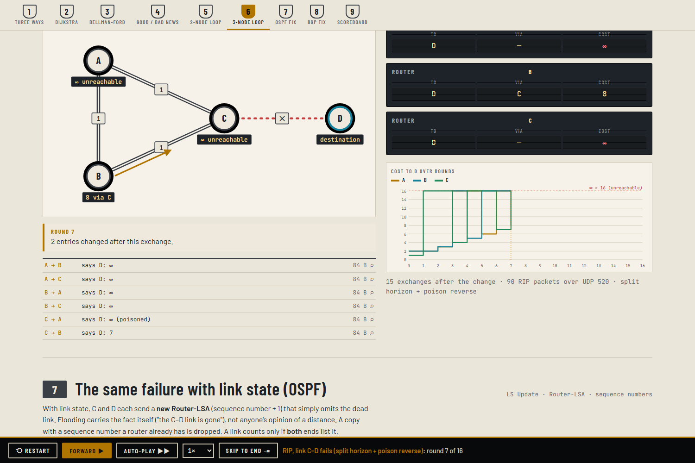
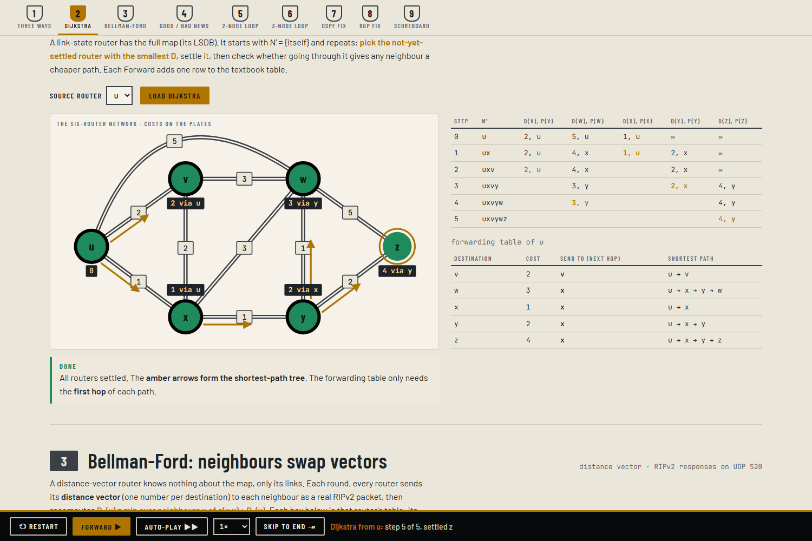
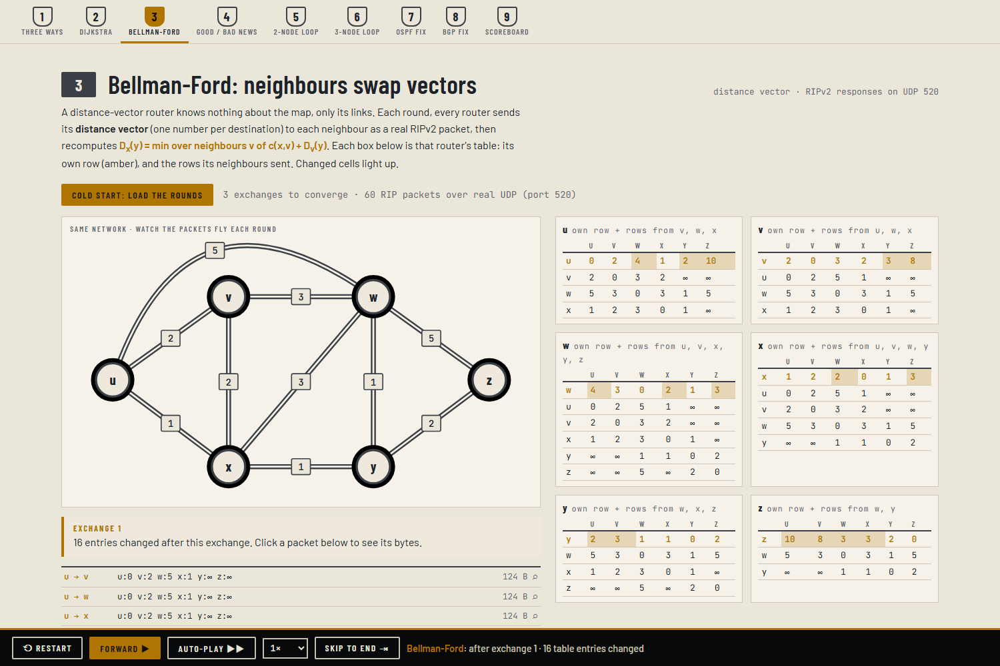
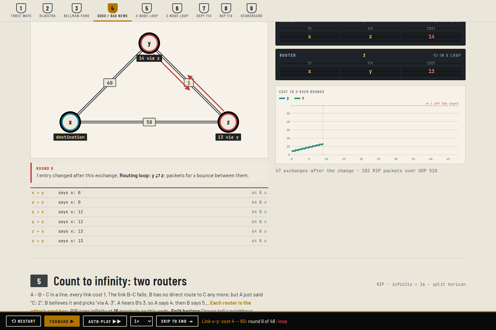
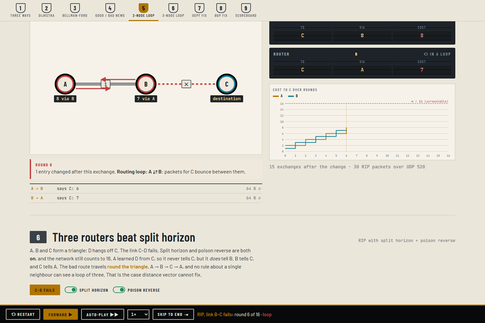
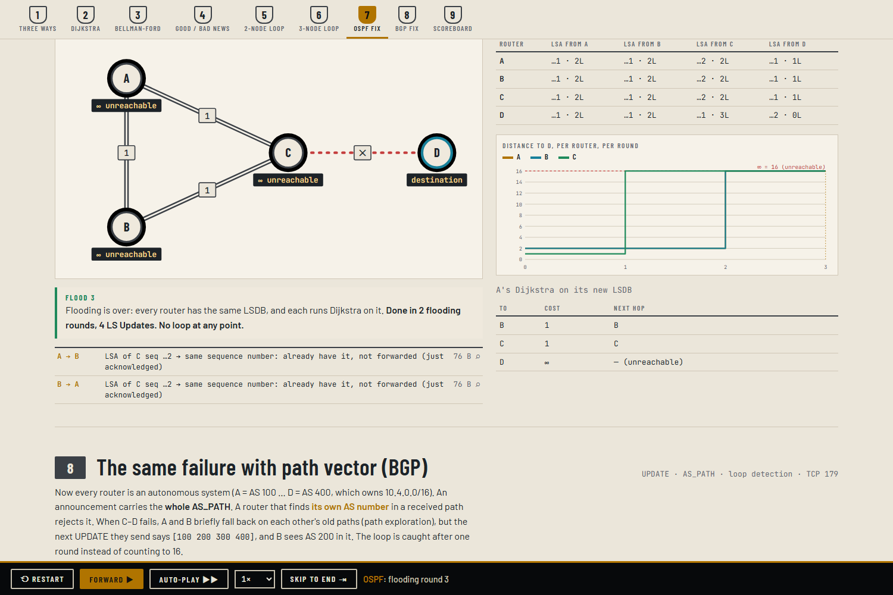
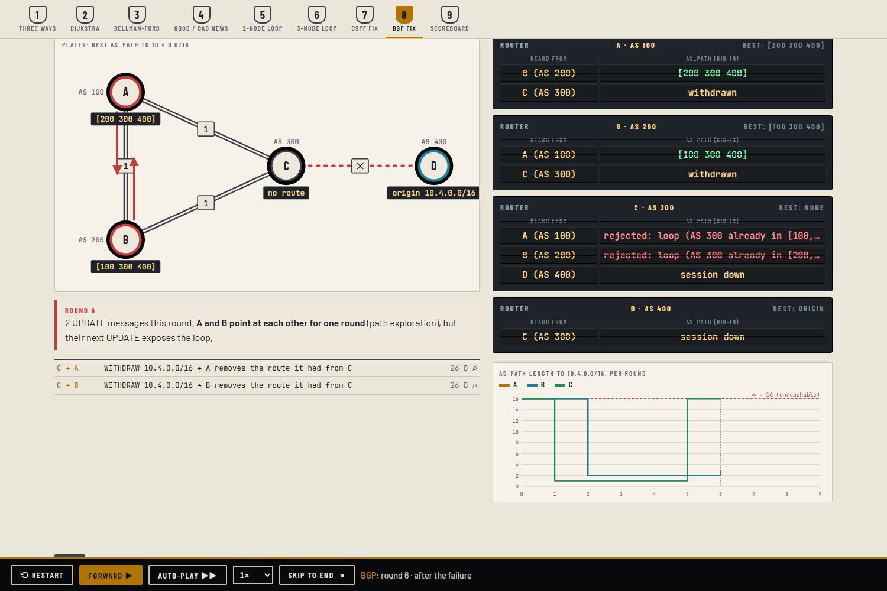
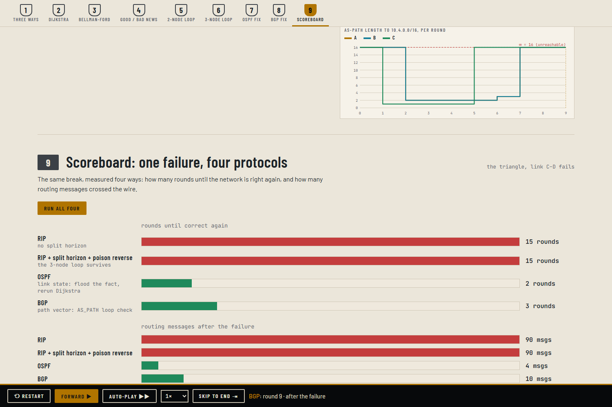
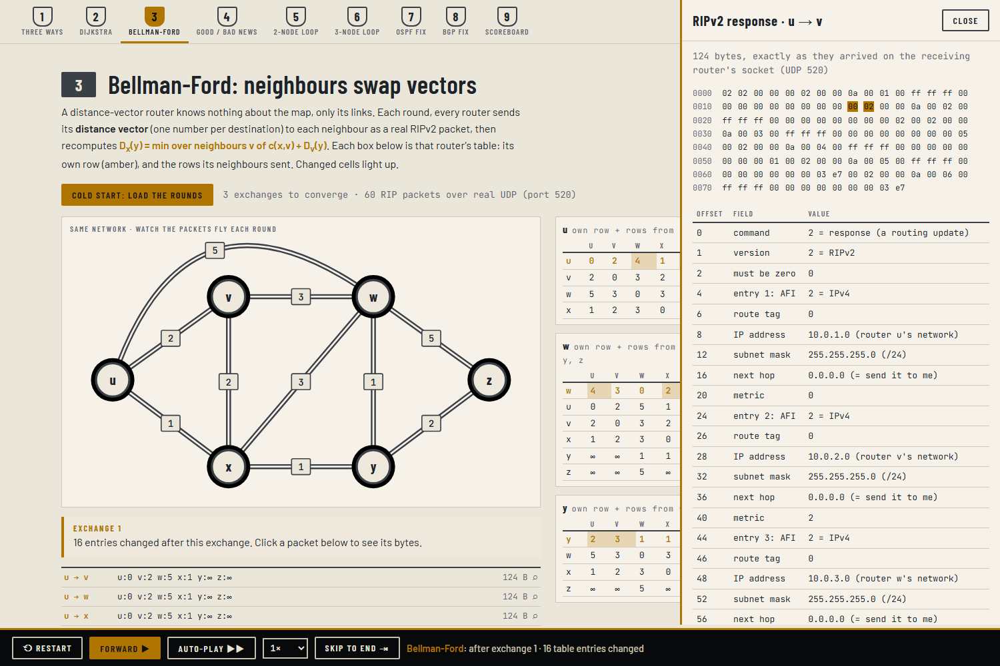

# JU Routing Lab: Dijkstra, Bellman-Ford, RIP, OSPF and BGP

Every router fills in one table: *for each destination, which neighbour do I send to?* There are three ways to build it:

| | Link state | Distance vector | Path vector |
|---|---|---|---|
| Knows | the whole map | neighbours' distances | the whole AS path |
| Algorithm | **Dijkstra** | **Bellman-Ford** | Bellman-Ford over paths + loop check |
| Protocol | OSPF | RIP | BGP |
| When a link breaks | flood the fact, recompute: fast | good news fast, **bad news counts to infinity** | the loop is visible in the path: no counting |

This module runs all three on small networks, round by round. The **2-router** and **3-router** count-to-infinity problems are shown, then OSPF and BGP recover from the same failure without counting. Everything is pure Java 11 with no libraries.



## Run

```
cd Routing
run.bat                 :: compiles, starts the dashboard at http://localhost:8088
run.bat --verify        :: 30 automated checks
python interop_test.py  :: with the lab running: an independent Python decoder checks our RIP, OSPF and BGP bytes (15 checks)
```

## Real packets on real sockets

Each router has its own loopback address, `127.0.0.20` to `127.0.0.25`:

| Protocol | Transport | Port |
|---|---|---|
| RIPv2 responses | UDP | **520**, the real RIP port |
| BGP-4 OPEN / UPDATE / KEEPALIVE | TCP sessions | **179**, the real BGP port |
| OSPFv2 LS Updates with Router-LSAs | UDP | 8900 |

Real OSPF runs on IP protocol 89, which Java cannot send without raw sockets, so the lab carries OSPF inside UDP. The packets carry the correct OSPF checksum and Fletcher LSA checksums.

Each simulated round sends the bytes for real, and the receiver decodes what actually arrived. Capture the loopback adapter in Wireshark with the display filter `rip || bgp`:
- Wireshark decodes our RIP responses and BGP UPDATEs, including the AS_PATHs and the withdrawn prefixes.
- A sample capture is in `docs/rip_bgp_loopback_capture.pcapng`.

## The experiments

| # | Experiment | Network | Result |
|---|---|---|---|
| 2 | **Dijkstra**, step by step | six routers u…z (Kurose & Ross Fig. 5.3) | the textbook table (N', D(v), p(v)), the shortest-path tree, u's forwarding table |
| 3 | **Bellman-Ford** cold start | same | each router's DV table (own row + neighbours' rows) per exchange; converges in 3 exchanges, same answers as Dijkstra |
| 4 | Good news / bad news | x, y, z (Fig. 5.7) | cost 4 → 1 settles in 2 rounds; 4 → 60 makes **y ⇄ z loop for 47 rounds**; poison reverse fixes it in 3 |
| 5 | Count to infinity, **2 routers** | A – B – C, B–C fails | A and B count 3, 4, 5 … 16 (RIP's infinity); **split horizon** fixes it at once |
| 6 | Count to infinity, **3 routers** | triangle A, B, C + D; C–D fails | with split horizon **and** poison reverse it still counts to 16: the loop goes round A → B → C |
| 7 | Same failure, **OSPF** | triangle | new Router-LSAs (sequence + 1) flood in 2 rounds; duplicates aren't forwarded; everyone reruns Dijkstra; no loop |
| 8 | Same failure, **BGP** | triangle, AS 100…400 | AS_PATHs `[400]`, `[300 400]` …; after the failure, a path containing the receiver's own AS is rejected; converged in 3 rounds |
| 9 | Scoreboard | triangle | RIP 15 rounds / 90 msgs · RIP + SH + PR 15 / 90 · OSPF 2 / 4 · BGP 3 / 10 |

Each round is one press of **Forward ▶**. **Skip to end** and Auto-play are there for the 47-round case. Click any message to open the **packet inspector**: a hex dump with every field decoded, and hovering a field highlights its bytes.

## How it works

- `src/route/sim/Dijkstra.java`: records each step of the textbook table. Ties are broken alphabetically.
- `src/route/sim/DistanceVector.java`: synchronous Bellman-Ford.
  - Options: infinity, split horizon, poison reverse.
  - Every router sends its vector to every neighbour each round as a real RIPv2 packet, then all routers recompute.
  - Routing loops are detected in the next-hop graph.
- `src/route/sim/LinkState.java`: OSPF flooding.
  - A higher sequence number means install the LSA and forward it to everyone except the sender.
  - SPF uses only links that **both** ends report (the two-way check).
- `src/route/sim/PathVector.java`: BGP.
  - Updates are incremental.
  - A path containing the receiver's own AS is rejected.
  - The best path is the shortest AS_PATH.
- `src/route/wire/`: the byte formats.
  - **Rip:** RFC 2453 §4.
  - **Ospf:** RFC 2328 A.3.1 / A.3.5 / A.4.1 / A.4.2, with the Fletcher checksum.
  - **Bgp:** RFC 4271 §4.
- `src/route/net/Wire.java`: the sockets, with one loopback address per router.

| | |
|---|---|
|  |  |
|  |  |
|  |  |
|  |  |
