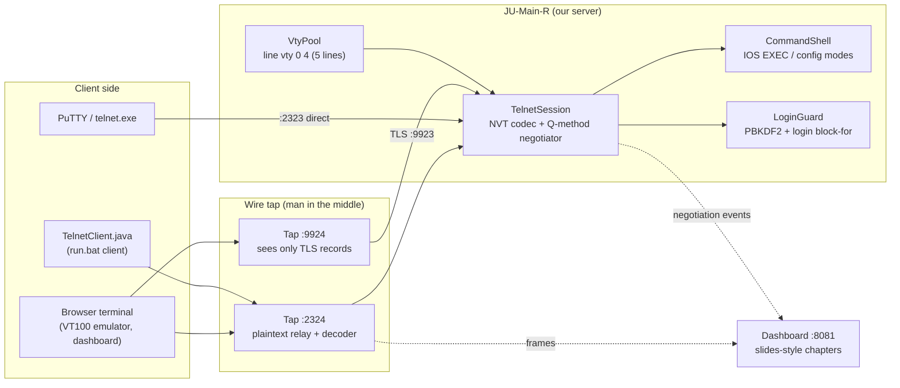
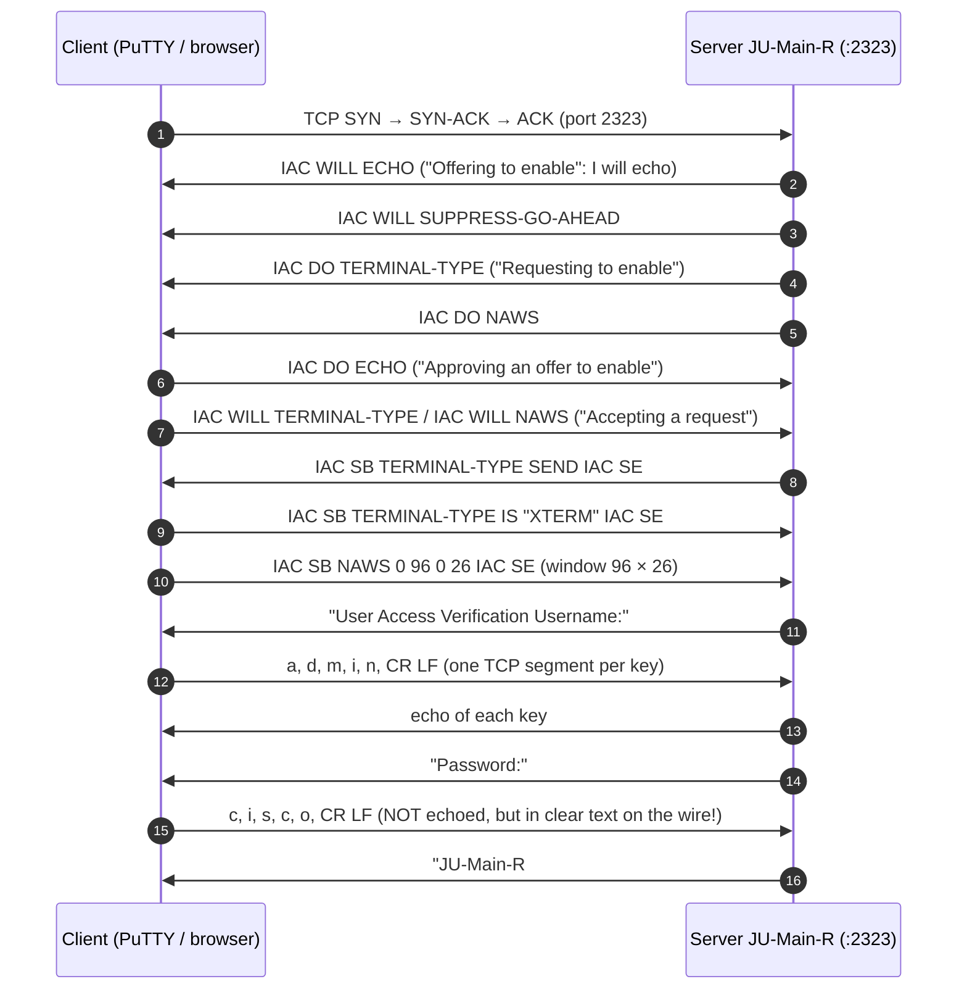
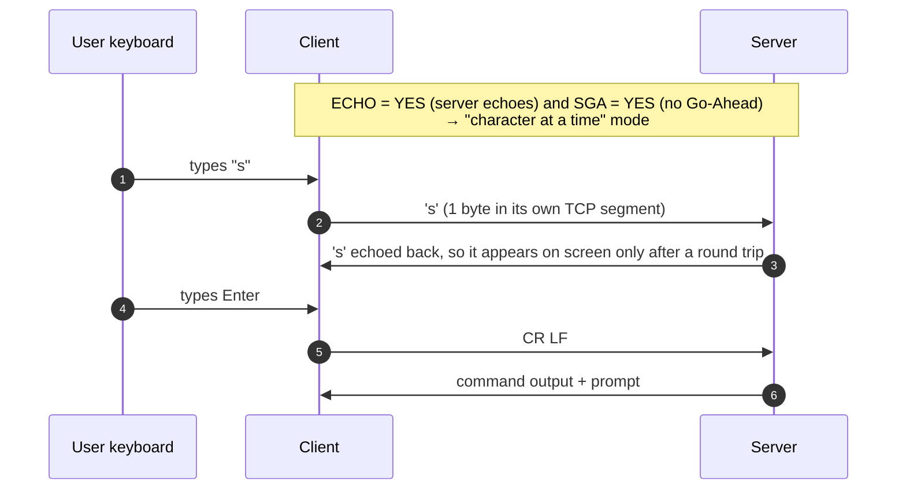
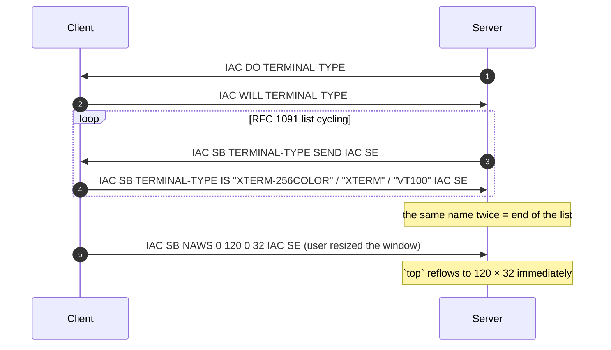
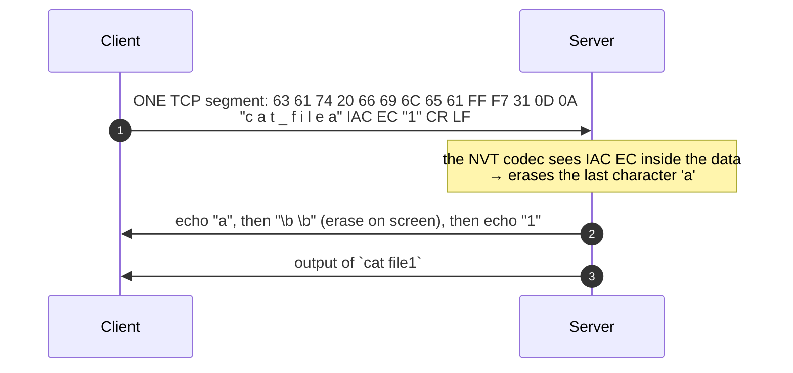
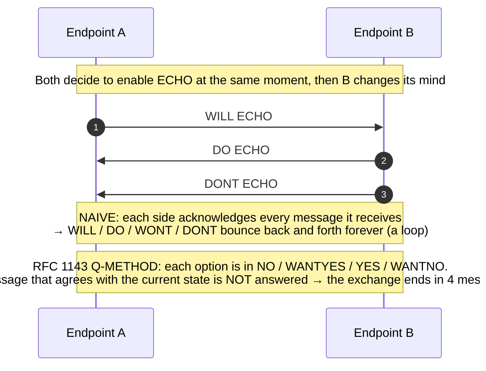
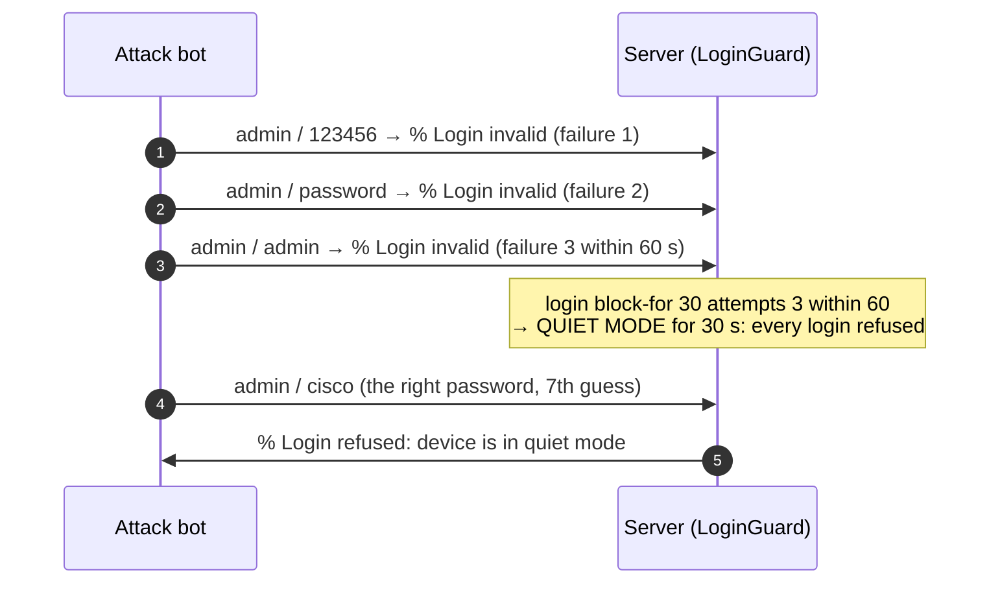

# RFC 854 Telnet Remote-Management Lab
## Complete Protocol Reference, Architecture & Live Demonstration Guide

---

## Table of Contents
1. [Project Overview & What We Built](#1-project-overview--what-we-built)
2. [Protocol Formats & Byte Encodings](#2-protocol-formats--byte-encodings)
3. [System Architecture & Topology](#3-system-architecture--topology)
4. [Detailed Protocol Workflows & Sequence Diagrams](#4-detailed-protocol-workflows--sequence-diagrams)
   - [4.1 Connection, Option Negotiation & Login](#41-connection-option-negotiation--login)
   - [4.2 Character-at-a-Time Echo (ECHO + SUPPRESS-GO-AHEAD)](#42-character-at-a-time-echo-echo--suppress-go-ahead)
   - [4.3 Suboption Negotiation: TERMINAL-TYPE and NAWS](#43-suboption-negotiation-terminal-type-and-naws)
   - [4.4 Embedding a Control Character: IAC EC](#44-embedding-a-control-character-iac-ec)
   - [4.5 RFC 1143 Q-Method vs the Naive Negotiation Loop](#45-rfc-1143-q-method-vs-the-naive-negotiation-loop)
   - [4.6 Password Sniffing vs Telnet over TLS](#46-password-sniffing-vs-telnet-over-tls)
   - [4.7 Dictionary Attack vs `login block-for`](#47-dictionary-attack-vs-login-block-for)
5. [How to Run & Visualize Everything](#5-how-to-run--visualize-everything)
6. [Step-by-Step Live Demonstration Script (For Presentation / Viva)](#6-step-by-step-live-demonstration-script-for-presentation--viva)
7. [Viva & Technical Examination Questions](#7-viva--technical-examination-questions)

---

## 1. Project Overview & What We Built

**Telnet** (RFC 854, 1983) lets a user log in to a remote machine as if their terminal were plugged directly into it. It runs over a single **TCP connection (port 23)**. Its two ideas are the **Network Virtual Terminal (NVT)**, a common character set both ends translate to, and **option negotiation** with `WILL / WONT / DO / DONT`.

Telnet sends everything, **including the password, in plaintext**, which is why SSH replaced it. This project shows that in action, as well as the protocol itself.

This module is a **pure Java (JDK 11+, zero dependencies)** implementation of Telnet built from the RFCs. The server plays the VTY lines (`line vty 0 4`) of router **JU-Main-R** from Assignment 6:

1. **RFC 854 NVT codec**:
   - a byte-level state machine, so commands split across TCP segments still decode;
   - `IAC` doubling, and `CR NUL` / `CR LF` line endings.
2. **RFC 1143 Q-method option negotiation**:
   - states NO / WANTYES / YES / WANTNO, plus a queue bit;
   - every message is labelled with its textbook meaning.
3. **Options:**
   - ECHO (857), SUPPRESS-GO-AHEAD (858), STATUS (859), TIMING-MARK (860), TERMINAL-TYPE (1091), NAWS (1073), TERMINAL-SPEED (1079);
   - BINARY, LINEMODE and the rest are refused properly.
4. **A Cisco IOS-style CLI on 5 VTY lines** (a 6th connection is refused):
   - `enable`, `configure terminal`, `show running-config`;
   - abbreviations, `?` help and Tab completion;
   - `send *`, `monitor line`, `clear line`, `debug telnet`;
   - `tmping` (RTT measured with TIMING-MARK) and a full-screen `top` that reflows with NAWS.
5. **A wire tap** (a man-in-the-middle relay) that shows what a sniffer sees: the password in clear text on plain Telnet, and only TLS records on **Telnet over TLS**.
6. **Login protection**:
   - PBKDF2-SHA256 password hashes (Cisco type 8);
   - `login block-for` quiet mode, demonstrated against a live dictionary-attack bot.
7. **Session recording and replay**, plus a **live dashboard** (`http://localhost:8081`) that follows the lecture slides chapter by chapter.
8. **Automated verification**: 35 checks (`run.bat --verify`).

| Port | Purpose |
|:--|:--|
| TCP **2323** | Telnet server (the real port is 23) |
| TCP **2324** | Wire tap → 2323 (what a sniffer sees) |
| TCP **9923** | Telnet over TLS (the real port is 992), self-signed certificate made with `keytool` |
| TCP **9924** | Wire tap → 9923 (shows that TLS hides everything) |
| HTTP **8081** | Dashboard |

Logins:
- `admin / cisco` (privilege 15);
- `student / ju2026` (privilege 1);
- enable secret `class`.

---

## 2. Protocol Formats & Byte Encodings

### 2.1 Data vs Control Bytes in the NVT

```
 bit:  7   6   5   4   3   2   1   0
      +---+---+---+---+---+---+---+---+
      | 0 |     7-bit ASCII data      |   data character   (0x00 - 0x7F)
      +---+---+---+---+---+---+---+---+
      | 1 |      command code         |   control character (0xF0 - 0xFF), only after IAC
      +---+---+---+---+---+---+---+---+
```

### 2.2 Command Sequences

```
 3-byte option negotiation:   +-----+--------+--------+
                              | IAC | verb   | option |      e.g.  FF FB 01  = IAC WILL ECHO
                              | 255 |251-254 |  code  |
                              +-----+--------+--------+

 2-byte command:              +-----+--------+
                              | IAC | cmd    |               e.g.  FF F7     = IAC EC (erase char)
                              +-----+--------+

 Suboption:      +-----+----+--------+---------------------+-----+----+
                 | IAC | SB | option |  parameters ...     | IAC | SE |
                 | 255 |250 |        |                     | 255 |240 |
                 +-----+----+--------+---------------------+-----+----+
   e.g. FF FA 18 00 58 54 45 52 4D FF F0  = IAC SB TERMINAL-TYPE IS "XTERM" IAC SE
        FF FA 1F 00 60 00 1A FF F0        = IAC SB NAWS 96 x 26 IAC SE
```

| Code | Name | Meaning | Code | Name | Meaning |
|:---:|:---|:---|:---:|:---|:---|
| 255 | IAC | Interpret As Command | 246 | AYT | Are You There? |
| 254 | DONT | refuse / ask to disable | 247 | EC | Erase Character |
| 253 | DO | request / approve enable | 248 | EL | Erase Line |
| 252 | WONT | refuse / offer to disable | 244 | IP | Interrupt Process |
| 251 | WILL | offer / accept enable | 241 | NOP | No Operation |
| 250 | SB | Subnegotiation Begin | 240 | SE | Subnegotiation End |

**Line endings:** `CR LF` = newline, `CR NUL` = carriage return only. A data byte 255 is sent twice (`FF FF`), so it is not taken for IAC.

---

## 3. System Architecture & Topology



---

## 4. Detailed Protocol Workflows & Sequence Diagrams

### 4.1 Connection, Option Negotiation & Login



### 4.2 Character-at-a-Time Echo (ECHO + SUPPRESS-GO-AHEAD)



### 4.3 Suboption Negotiation: TERMINAL-TYPE and NAWS



### 4.4 Embedding a Control Character: IAC EC



### 4.5 RFC 1143 Q-Method vs the Naive Negotiation Loop



### 4.6 Password Sniffing vs Telnet over TLS

```mermaid
sequenceDiagram
    autonumber
    participant C as Client
    participant T as Wire tap
    participant S as Server
    C->>T: 'c' 'i' 's' 'c' 'o' (password, plaintext)
    Note over T: Tap reconstructs what was typed at "Password:"<br/>→ ALERT: password "cisco" sniffed
    T->>S: forwarded unchanged
    Note over C,S: --- Telnet over TLS (:9924 → :9923) ---
    C->>T: TLS records (content type 0x17 application data)
    Note over T: Only TLS record headers are readable; the password is not
    T->>S: forwarded unchanged
```

### 4.7 Dictionary Attack vs `login block-for`



---

## 5. How to Run & Visualize Everything

```powershell
cd Telnet
.\run.bat              # compile + start everything, then open http://localhost:8081
.\run.bat --verify     # 35 automated checks
.\run.bat client       # console Telnet client through the wire tap
```

Any Telnet client also works: `telnet localhost 2323` (enable "Telnet Client" in Windows Features), or PuTTY → Telnet → port 2323.

**What each dashboard chapter shows (it follows the lecture slides):**

| Chapter | Slide | What is live |
|:--|:--|:--|
| 01 Remote log-in | *Local and remote log-in* | the slide's diagram; every key you type travels it, and every echo comes back |
| 02 NVT | *Concept of NVT* | the last bytes on the wire as punched paper tape: MSB 0 = data, MSB 1 = control |
| 03 Control characters | *NVT control characters*, *An example of embedding* | the full table, with rows that light up and count; the `cat filea IAC EC 1` segment |
| 04 Options | *Options* | the live RFC 1143 state for each option on both sides; the `IAC SB STATUS SEND` button |
| 05 Negotiation | *Echo option*, *Suboption negotiation* | every WILL / WONT / DO / DONT labelled with its meaning, in the slides' byte-block style; the naive-vs-Q-method loop experiment |
| 06 Security | (why SSH replaced Telnet) | the sniffer with the password highlighted; plaintext vs TLS; the dictionary-attack bot vs quiet mode |
| 07 Lab | | VTY lines, RTT by TIMING-MARK, session recording and replay, server log |

---

## 6. Step-by-Step Live Demonstration Script (For Presentation / Viva)

1. **Launch**: run `run.bat`, open `http://localhost:8081`, click **Connect via wire tap**.
2. **Negotiation**: chapter 05 fills with the opening exchange. Point at `IAC WILL ECHO`, labelled *"Offering to enable"*, and the client's `IAC DO ECHO`, labelled *"Approving an offer"*.
3. **Login**: log in as `admin` / `cisco`. Chapter 06 shows **the password sniffed off the wire**, one keystroke per TCP segment.
4. **Options**: run `show telnet` (the option table) and `tmping` (RTT measured with TIMING-MARK).
5. **Embedding**: in chapter 03 click **Send this exact segment**. `cat filea` + `IAC EC` + `1` runs `cat file1`.
6. **STATUS**: in chapter 04 click **IAC SB STATUS SEND**. The server lists the options it believes are on.
7. **NAWS**: run `top`, then change the window size. `top` reflows, because NAWS reported the new size. Press `q` to quit.
8. **TLS**: disconnect, choose **Connect over TLS**, and log in again. The sniffer now sees only TLS records.
9. **Brute force**: in chapter 06 click **Dictionary attack**. It is blocked after 3 failures, and a 30 s quiet-mode countdown starts.
10. **RFC 1143**: in chapter 05 click **Run the experiment**. The naive endpoints loop forever; the Q-method finishes in 4 messages.

---

## 7. Viva & Technical Examination Questions

**Q1: Why does Telnet need a Network Virtual Terminal?**
*Answer:* Different machines used different character sets and line-ending conventions (CR, LF, CR LF). Instead of every client knowing every server's format, both translate to one common format on the wire: the NVT. It uses 7-bit ASCII for data, `CR LF` for a newline, and bytes with the MSB set as control characters.

**Q2: How does the receiver tell data from commands in the same byte stream?**
*Answer:* Every command starts with `IAC` (255). A byte after `IAC` is a command, not data. A real data byte 255 is sent twice (`IAC IAC`). This is **in-band signalling**, unlike FTP, which uses a separate control connection (out-of-band).

**Q3: Why can the same byte `WILL` mean two different things?**
*Answer:* It depends on the state of the option. If we sent nothing first, `WILL ECHO` is an **offer** ("I want to enable echo"). If we had just sent `DO ECHO`, then `WILL ECHO` is an **acceptance** of our request. That is why our dashboard labels each message *"Offering to enable"* or *"Accepting a request to enable"*.

**Q4: What problem does RFC 1143 (the Q-method) solve?**
*Answer:* Option negotiation loops. If both sides answer every message, two messages that cross on the wire can bounce back and forth forever. RFC 1143 keeps a state per option (NO / WANTYES / YES / WANTNO plus a queue bit) and never answers a message that only confirms the current state. Our loop experiment shows naive endpoints looping and the Q-method finishing in 4 messages.

**Q5: Why does "character-at-a-time" mode need both ECHO and SUPPRESS-GO-AHEAD?**
*Answer:* With ECHO, the server echoes each key, so it decides what appears on screen; this lets it hide the password. With SUPPRESS-GO-AHEAD, the half-duplex Go-Ahead signal is turned off, so both sides can send at any time. Together they give the remote-shell feel: every key goes to the server immediately.

**Q6: Why is the password not shown on screen, yet still visible to a sniffer?**
*Answer:* The server simply does not echo the password characters. Each keystroke still crosses the network as a plain byte, usually one byte per TCP segment. Our wire tap reconstructs them, and Wireshark's *Follow TCP Stream* shows the same.

**Q7: What is NAWS and what uses it?**
*Answer:* Negotiate About Window Size (RFC 1073). The client reports its width and height with `IAC SB NAWS w1 w0 h1 h0 IAC SE`, sending it again whenever the window is resized. Full-screen programs need it; our `top` reflows when you resize.

**Q8: What is TIMING-MARK, and how did you measure RTT with it?**
*Answer:* RFC 860. Sending `IAC DO TIMING-MARK` asks the other side to reply `WILL TIMING-MARK` (or `WONT`) once everything sent before it has been processed. The time between the request and the reply is the RTT. Our `tmping` command and the dashboard sparkline use it.

**Q9: What is `IAC EC` and why is the "embedding" example important?**
*Answer:* Erase Character. The client sends the edit as a command inside the data stream (`cat filea IAC EC 1`, all in one TCP segment). The server applies the erase before running the line, so it executes `cat file1`. This shows that control can be **embedded** in data.

**Q10: Telnet vs SSH vs rlogin?**
*Answer:*
- **Telnet**: plaintext, option negotiation, port 23.
- **rlogin**: BSD-only and also plaintext; it trusts `.rhosts`.
- **SSH**: encrypts everything, authenticates the server with a host key, and supports public-key login, port forwarding and file transfer (port 22).

Telnet survives for testing ports (`telnet host 25`) and on old network equipment.

**Q11: Why did you use TLS ("telnets", port 992) instead of SSH for the secure demo?**
*Answer:* To keep the Telnet protocol itself unchanged and only wrap the TCP connection, the same way HTTPS wraps HTTP. The tap then shows the exact contrast: the same session is readable on plain TCP and unreadable inside TLS.

**Q12: What does `login block-for 30 attempts 3 within 60` do?**
*Answer:* After 3 failed logins within 60 seconds, the router enters **quiet mode** for 30 seconds and refuses every login, even a correct one. It slows down online guessing. Our attack bot's 7th guess is the right password, but it is never accepted.
