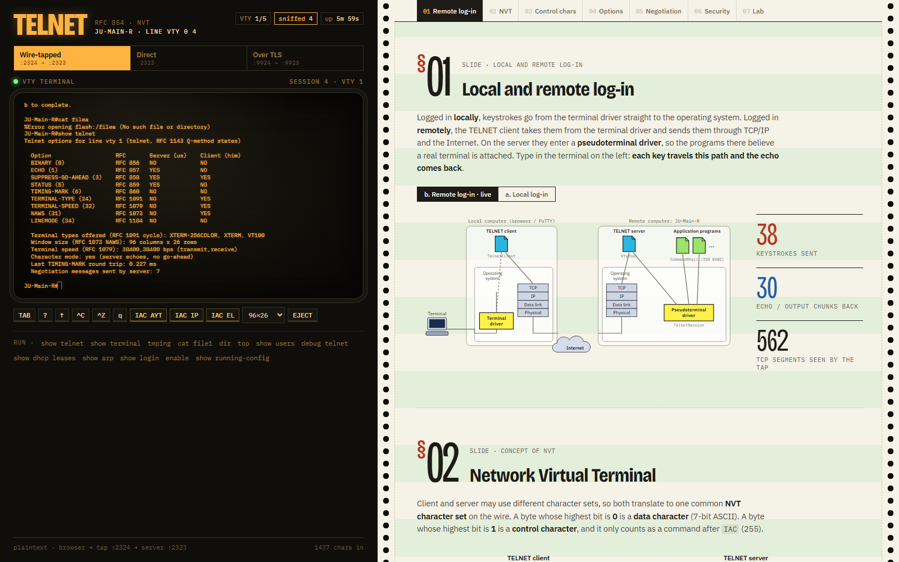
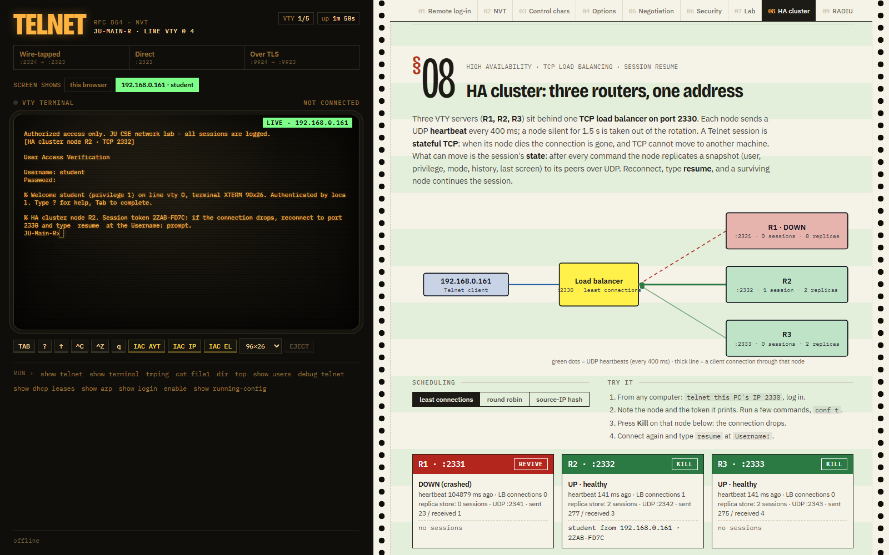
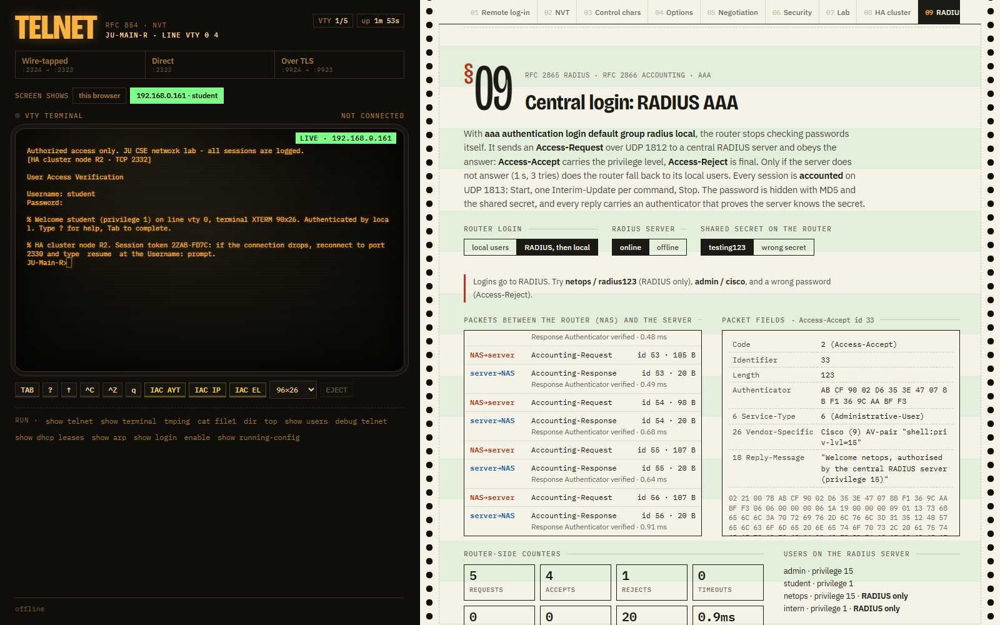
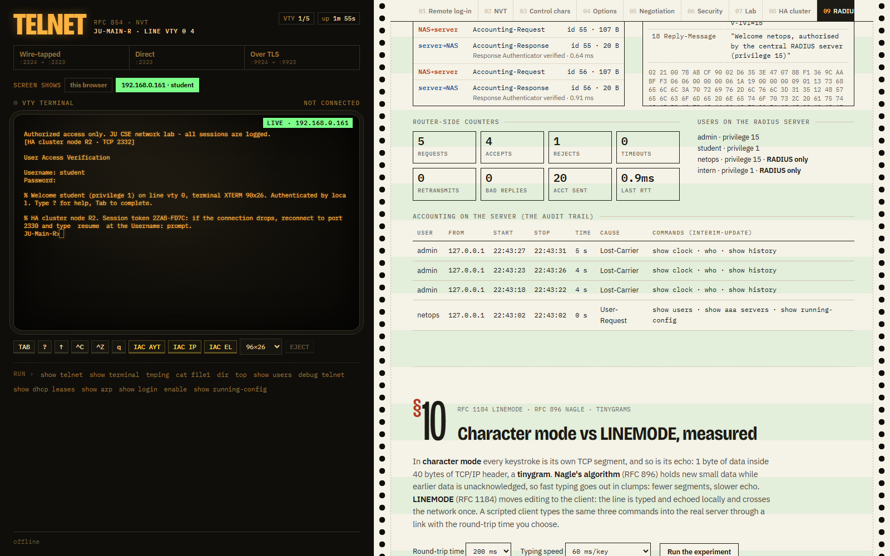
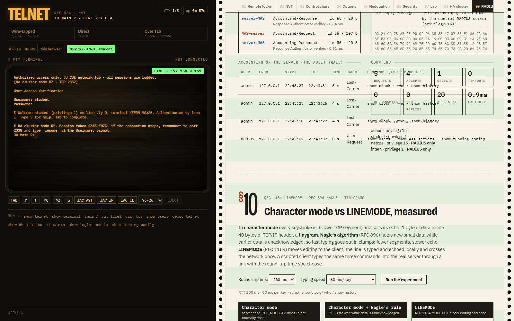

# Telnet Remote-Management Lab (Java, zero dependencies)

A Telnet **server, client, sniffer and live dashboard** written from the RFCs. The server plays the
VTY lines (`line vty 0 4`) of router **JU-Main-R** from Assignment 6, so you log in, run IOS-style
commands, and watch every byte of the protocol: option negotiation, control characters, the NVT
bit layout, and the password crossing the wire in clear text (and not crossing it over TLS).



## Run

```
run.bat              REM compile + start everything, then open http://localhost:8081
run.bat --verify     REM automated test suite (59 checks)
run.bat client       REM console Telnet client through the wire tap
```

| Port | What |
|:--|:--|
| TCP **2323** | Telnet server (real port 23 needs admin rights) |
| TCP **2324** | Wire tap → 2323: a man-in-the-middle relay that shows what a sniffer sees |
| TCP **9923** | Telnet over TLS ("telnets", real port 992), self-signed certificate made with `keytool` |
| TCP **9924** | Wire tap → 9923: shows that TLS hides everything |
| HTTP **8081** | Dashboard (the DHCP module uses 8080, so both run side by side) |
| TCP **2330** | HA cluster: TCP load balancer in front of routers R1, R2, R3 |
| TCP **2331–2333** | The three cluster nodes (VTY servers) |
| UDP **2340** | Heartbeats from the nodes to the load balancer (every 400 ms) |
| UDP **2341–2343** | Session-state replication between the nodes |
| UDP **1812 / 1813** | RADIUS server: authentication / accounting (shared secret `testing123`) |

Logins: `admin / cisco` (privilege 15), `student / ju2026` (privilege 1), enable secret `class`.
On the RADIUS server only: `netops / radius123` (privilege 15), `intern / intern2026` (privilege 1).
Any Telnet client works too: `telnet localhost 2323` (Windows: enable "Telnet Client" in
*Turn Windows features on or off*) or PuTTY → Telnet → port 2323.

## The dashboard follows the lecture slides

| Chapter | Slide | What is live |
|:--|:--|:--|
| 01 Remote log-in | *Local and remote log-in* | the slide's diagram (terminal driver → TELNET client → TCP/IP → Internet → TELNET server → pseudoterminal driver → applications); every key you type travels it, every echo comes back |
| 02 NVT | *Concept of NVT* | local / NVT / remote character sets; the last 60 bytes on the wire drawn as 8 bits, MSB 0 = data character, MSB 1 = control character |
| 03 Control characters | *NVT control characters*, *An example of embedding* | the full table EOF…IAC with decimal and binary; rows light up and count as the bytes cross the wire; **send** buttons; the textbook `c a t _ f i l e a IAC EC 1` sent as one TCP segment, and the server really runs `cat file1` |
| 04 Options | *Options* | Binary, Echo, Suppress-GA, Status, Timing mark, Terminal type, NAWS, Terminal speed, Line mode, with the live RFC 1143 state on both sides; `IAC SB STATUS SEND` button |
| 05 Negotiation | *Character set for option negotiation*, *Echo option*, *Suboption negotiation* | every WILL/WONT/DO/DONT labelled with its textbook meaning (e.g. "Offering to enable" vs "Accepting a request to enable") and counted; the session drawn in the slides' byte-block style (`[IAC][DO][ECHO]`, `[IAC][SB][Terminal type][IS]['X']…[IAC][SE]`); the naive-vs-RFC 1143 loop experiment |
| 06 Security | (why SSH replaced Telnet) | Wireshark-style sniffer with the password highlighted; plaintext vs TLS side by side; dictionary-attack bot vs `login block-for` quiet mode |
| 07 Lab | | VTY lines, RTT measured with TIMING-MARK, session recording and replay, server log |
| 08 HA cluster | (high availability) | three routers behind one load balancer: heartbeats, Kill / Revive, least-connections / round-robin / source-IP-hash scheduling, the replicated session table, and `resume` after a failover |
| 09 RADIUS | (AAA) | switch the router to `aaa authentication login default group radius local`; every Access-Request / Accept / Reject / Accounting packet decoded field by field; take the server offline (fallback to local) or give the router the wrong secret (authenticator check fails); the accounting audit trail |
| 10 Linemode | (RFC 1184, RFC 896) | the same commands typed in character mode, with Nagle's rule, and in LINEMODE through a link with a chosen RTT: segments, wire bytes, header overhead, echo delay, and a timeline of every segment |

## What is implemented

**Protocol (package `telnet.protocol`)**
- RFC 854 NVT codec as a state machine (commands split across TCP segments still decode; fuzz-tested over 2000 random segmentations), IAC doubling, CR NUL / CR LF.
- RFC 1143 Q-method option negotiation (NO / WANTYES / YES / WANTNO + queue bit), with each message labelled by its textbook meaning.
- Options: ECHO (857), SUPPRESS-GO-AHEAD (858), STATUS (859), TIMING-MARK (860), TERMINAL-TYPE with list cycling (1091), NAWS (1073), TERMINAL-SPEED (1079); BINARY, LINEMODE and the rest are refused properly.
- Commands: EOF, EOR, SE, NOP, DM, BRK, IP, AO, AYT, EC, EL, GA, SB, WILL, WONT, DO, DONT, IAC.

**Server (`telnet.server`)**: 5 VTY lines (6th refused), character mode with server-side echo
(the password is simply not echoed), line editor (backspace, Ctrl-U, Ctrl-C, history ↑↓), IOS CLI:
abbreviations (`sh ip int br`), `?` help, Tab completion, `% Invalid input` with a `^` marker,
user/privileged/config modes, `enable`, `configure terminal`, `hostname`, `banner motd`, `username …
secret`, `login block-for`, `exec-timeout`, `write memory`, `show users/telnet/terminal/version/
login/running-config/ip interface brief`, `show dhcp leases` (reads the DHCP module's replicated
lease files), `show arp` (host's real ARP cache), `send *` broadcast, `monitor line` (shadow another
user), `clear line`, `debug telnet`, `tmping` (RTT via TIMING-MARK), `top` (full-screen, ANSI +
NAWS: it reflows when you resize), `cat file1`, `dir`.
Passwords are PBKDF2-SHA256 hashes (Cisco type 8), compared in constant time.

**Tap (`telnet.tap`)**: relays bytes unchanged, decodes them for the dashboard, reconstructs what
is typed at `Username:` / `Password:`, and for TLS shows only record headers.

## The three advanced features

**HA cluster with session resume** (`src/telnet/cluster`). Routers R1–R3 run the same VTY server behind a TCP load balancer on port 2330 (least connections, round robin or source-IP rendezvous hashing). Each node sends a UDP heartbeat every 400 ms; a node silent for 1.5 s leaves the rotation. A Telnet session is stateful TCP and cannot move, but its *state* can: after login and after every command, the node replicates a snapshot (user, privilege, mode, command history, last screen) to its peers over UDP. If a node dies, the client reconnects to port 2330, lands on a healthy node and types `resume` (or `resume TOKEN`) at `Username:`: the session continues in the same mode with the same history. A restarted node pulls the cluster's state from a peer (`SYNC?`). `show session` prints the node and the token.

**RADIUS AAA** (`src/telnet/aaa`, RFC 2865 / 2866). A RADIUS server on UDP 1812/1813 and the router's RADIUS client. With `aaa authentication login default group radius local` the router sends an Access-Request (password hidden with MD5 and the shared secret), verifies the Response Authenticator, and takes the privilege level from the Cisco AV-pair `shell:priv-lvl`. A Reject is final; only if the server stays silent (1 s × 3 tries) does it fall back to local users. Accounting sends Start, an Interim-Update per command, and Stop with session time, octets and terminate cause. `show aaa servers` shows the counters.

**LINEMODE vs character mode vs Nagle** (`src/telnet/lab/ModeLab.java`). The server now accepts RFC 1184 LINEMODE (MODE EDIT): the client edits and echoes locally and sends whole lines. A scripted client types the same commands three times through a link that delays each chunk by RTT/2, and the link counts every segment. Example at 200 ms RTT and 60 ms per key: character mode 29 client segments and 3074 wire bytes; Nagle's rule 12 segments but 310 ms echo instead of 218 ms; LINEMODE 4 segments and 923 bytes.

| | |
|---|---|
|  |  |
|  |  |

## Demo script (5 minutes)

1. `run.bat`, open http://localhost:8081, click **Connect via wire tap**. Chapter 05 fills with the opening negotiation: point at `IAC WILL ECHO`, "Offering to enable".
2. Log in as `admin` / `cisco`. Chapter 06 shows **the password sniffed off the wire**.
3. `show telnet`: the option table. `tmping`: RTT with TIMING-MARK.
4. Chapter 03 → **Send this exact segment**: `cat filea` + `IAC EC` + `1` executes `cat file1`.
5. Chapter 04 → **IAC SB STATUS SEND**: the server lists what it believes is on.
6. `top`, then change the window size: NAWS makes it reflow. `q` to quit.
7. Disconnect, **Connect over TLS**, log in again: the sniffer sees only ciphertext.
8. Chapter 06 → **Dictionary attack**: blocked after 3 guesses (quiet mode, 30 s countdown).
9. Chapter 05 → **Run the experiment**: the naive endpoints loop forever, the Q-method takes 4 messages.

## Links to the other modules and the lab assignments
- **DHCP**: `show dhcp leases` reads `../DHCP/data/leases_node*.db` and merges the replicas.
- **ARP**: `show arp` prints the host's ARP cache: before the first SYN reached the server, ARP resolved the next hop.
- **Wireshark (A5)**: capture on the *Npcap Loopback Adapter*, filter `tcp.port == 2324`, right-click → *Decode As* → TELNET, then *Follow TCP Stream*: the same password the dashboard shows.
- **Packet Tracer (A6)**: on JU-Main-R `line vty 0 4` → `password cisco` → `login` → `transport input telnet`; from M1 `telnet 192.168.148.1`; in Simulation mode filter TELNET and open a PDU: the password is in clear text there too.

## Files

```
src/telnet/protocol   Telnet.java (constants), TelnetCodec.java (RFC 854), OptionNegotiator.java (RFC 1143), LoopExperiment.java
src/telnet/server     VtyPool, TelnetSession (one VTY line), CommandShell (IOS CLI), DeviceConfig, LoginGuard
src/telnet/tap        WireTap.java (sniffer relay)
src/telnet/client     TelnetClient.java
src/telnet/dashboard  DashboardServer.java (HTTP API + browser-terminal bridge + attack bot)
src/telnet/cluster    Cluster, Balancer (TCP LB + heartbeats), Node (VTY server + UDP replication), Snapshot
src/telnet/aaa        Radius (RFC 2865/2866 packets), RadiusServer, RadiusClient (router side + accounting)
src/telnet/lab        ModeLab (character mode / Nagle / LINEMODE experiment)
src/telnet            Main.java, Verify.java
web/dashboard.html    the dashboard (VT100 emulator, diagrams, sniffer, all in one file)
docs/screenshots      screenshots of every chapter
```
